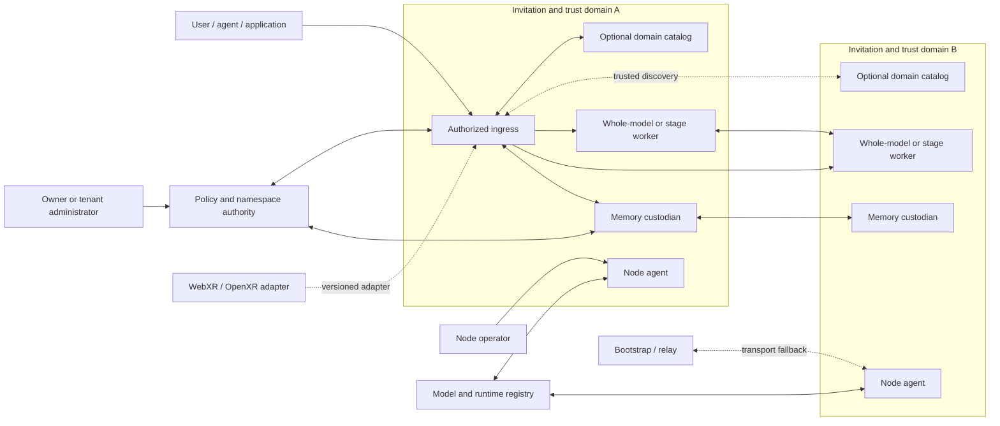
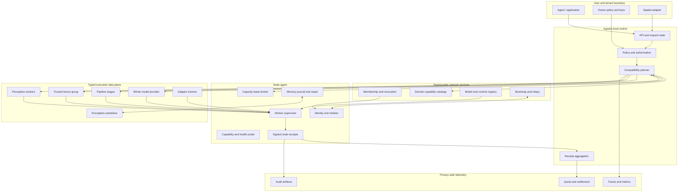
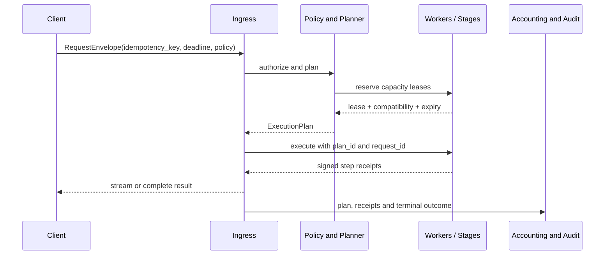
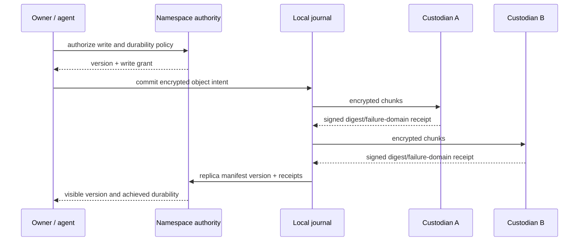
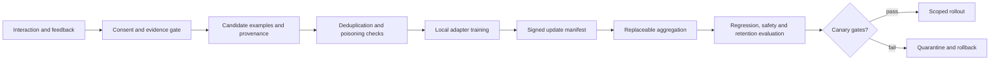

# NeuronMesh System Architecture

[English](ARCHITECTURE.md) | [简体中文](ARCHITECTURE.zh-CN.md)

**Status:** Architecture baseline `v0.1`, target design with partial reference implementation  
**Date:** 2026-10-30  
**Scope:** Cross-node architecture for membership, discovery, inference, durable memory, virtual roles, continual learning and spatial adapters

> This document is normative for the target architecture. It does not claim that every component is implemented. The current Python service is a protocol and failure-semantics reference slice; [implementation status](#18-current-implementation-vs-target) lists the gap.

## 中文摘要

NeuronMesh 不是一个所有设备共享一个全局调度器的平坦 P2P 群，而是由邀请域、节点代理和多类数据面组成的联邦式异构计算网络。

- 身份、准入和策略先于连接；能力记录只是可验证声明，真正分配必须取得短期容量租约。
- 控制面负责发现、规划、授权和审计，数据面负责模型执行、激活流、记忆复制与训练更新，二者故障域分开。
- 强/弱/组/域神经元不是永久设备标签，而是“模型 + 任务 + SLA + 当前状态”的派生视图。
- 模型推理优先选择本地小模型或远端完整模型；只有容量收益足够时才进入跨节点阶段管线。
- “永久记忆”定义为有密钥恢复、跨故障域副本、删除语义和实测 RPO/RTO 的耐久契约，不是物理上永不损坏。
- 持续学习与参数记忆分开：交互先形成可审计证据，再经过筛选、Adapter 训练、回归评测、金丝雀发布和回滚。
- 任何已输出 token 的请求、角色迁移、记忆删除或训练发布都不能用“自动重试”掩盖一致性问题。

## 1. Goals and non-goals

### 1.1 Goals

NeuronMesh targets a research network that can:

1. admit heterogeneous invited hosts without requiring identical operating systems or accelerators;
2. route requests through any authorized ingress while preserving explicit user, data and model policies;
3. use ephemeral, revocable capacity instead of trusting a node's self-reported peak hardware;
4. execute local models, remote whole-model providers and compatible multi-stage pipelines under one request contract;
5. keep encrypted memory and portable virtual roles independent of a single physical host;
6. support human-governed continual learning without broadcasting raw user data or silently mutating global weights;
7. degrade into a local autonomous mode with a visible capability boundary;
8. provide reproducible failure semantics, receipts and benchmarks for every strong claim.

### 1.2 Non-goals for the first production-shaped network

- anonymous public participation;
- one global scheduler that owns all requests;
- internet-scale synchronous tensor parallelism or all-reduce;
- automatic training from every conversation;
- a promise that no host ever fails or that memory is physically permanent;
- a blockchain or token economy before identity, abuse control and accounting are independently testable;
- transparent retry after a streaming response has emitted user-visible tokens;
- treating a devices model name, core count or advertised bandwidth as proof of service capacity.

## 2. Design principles

1. **Identity before connectivity.** Every node, user, role and model artifact has a verifiable identity.
2. **Claims are not capacity.** Static capabilities are signed claims; execution requires a current lease and policy decision.
3. **One state owner per fact.** Every mutable fact has an authoritative owner and explicit merge semantics.
4. **Control and data planes fail independently.** Discovery loss must not corrupt memory, and inference failure must not erase membership state.
5. **Fast demotion, slow promotion.** Unsafe or unverified capacity is removed immediately; stronger roles require repeated benchmarks.
6. **Hierarchical discovery.** Domain catalogs and local groups reduce dependency on full-network enumeration.
7. **No hidden quality downgrade.** Offline fallback, smaller models and reduced context are explicit response decisions.
8. **Durable does not mean permanent.** Durability is a measured copy/key/recovery contract with a stated failure boundary.
9. **Memory is not training.** Retrieval, consolidation and parameter updates are separate governed workflows.
10. **Receipts before settlement.** Resource use, transfer, training and deletion produce signed, auditable evidence.
11. **Fail closed on identity, policy, model compatibility and key ownership.**
12. **Streaming is irreversible after first output.** Recovery semantics change at the first emitted token.
13. **Every distributed feature has a single-node baseline and a partition test.**
14. **Model and data governance ship with the mechanism, not after it.**

### 2.1 How this architecture was derived

The architecture was not created by assigning one service to each feature. The derivation sequence was:

1. define system goals, explicit non-goals and user-visible promises;
2. list mutable facts, secrets and irreversible side effects;
3. assign one authoritative owner and one lifecycle to every fact;
4. split components where their failure, trust or scaling boundaries differ;
5. specify request, lease, memory, role and training transitions before implementation;
6. define compatibility and failure behavior for every cross-boundary call;
7. derive observable quality scenarios and release gates;
8. defer mechanisms that cannot yet be measured against a single-node or simpler baseline.

| Requirement | Architectural decision | Reason |
| --- | --- | --- |
| Heterogeneous hosts may participate | Typed capability profiles plus short leases | Device class is not proof of current service capacity |
| Any authorized node may be an ingress | Request-local planner with no global scheduler | Removes a global availability and trust bottleneck |
| The network should scale beyond a small lab | Hierarchical domain catalogs plus DHT/lease discovery | Full peer-list refresh is O(N) and stale |
| Different models and runtimes must interoperate | Content-addressed model/stage/runtime manifests | Layer numbers alone do not prove compatibility |
| Memory survives host replacement | Namespace authority, encrypted immutable versions and fault-domain replicas | The physical host cannot be the unit of memory identity |
| Users may disconnect and continue locally | Explicit `networked` and `local-autonomous` contracts | Prevents false remote-capability claims |
| Virtual roles move between hosts | Role controller plus fenced primary epochs | Export/import alone permits split-brain |
| The system should learn continuously | Evidence-gated local adapters plus evaluation and rollback | Conversation data must not directly mutate global weights |
| A future metaverse must integrate | Optional versioned spatial adapter | Prevents world engines from owning the durable core |
| Claims should be externally reviewable | Receipts, quality scenarios and architecture gates | A demo alone does not establish reliability |

This process explains why the current code is intentionally smaller than the target design: the repository implements enough mechanisms to test the contracts, but not all production-shape services.

## 3. System context



The diagram deliberately has no mandatory global controller. Domain catalogs, bootstrap nodes and relays are replaceable infrastructure, not owners of request or memory state.

## 4. Architectural planes

| Plane | Owns | May be eventual? | Primary failure behavior |
| --- | --- | --- | --- |
| Membership and trust | Invitations, node certificates, revocations, role policies | No for admission; revocation propagation may be eventual | Reject new work; preserve existing durable state |
| Discovery and planning | Capability indexes, path candidates, capacity leases | Yes, with bounded TTL | Demand a fresh probe or use a declared fallback |
| Execution data plane | Request streams, stage activations, model calls, checkpoints | No for an admitted request | Reselect only before irreversible output; otherwise return recoverable error |
| Durable state | Namespace metadata, memory journal, role manifests, tombstones, key references | Metadata may be eventually replicated; committed versions are immutable | Explicit D1/D2/D3 degradation; never invent durability |
| Learning | Evidence sets, adapter rounds, evaluations, rollout state | Per-experiment eventual coordination | Quarantine update; never auto-promote an unevaluated model |
| Observability and audit | Traces, receipts, resource accounting, deletion and rollout evidence | Aggregates may be delayed | Local signed receipt remains authoritative evidence |
| Spatial adaptation | Ephemeral sessions, event translation, avatar intent requests | Session ordering bounded by declared frames/deadlines | Close or degrade to non-spatial API |

## 5. Logical components



Arrows describe allowed interactions, not a requirement that every service is deployed independently. A single research node may co-locate several logical components while preserving their authorization and state boundaries.

### 5.1 Node agent

Every participating host runs a node agent with these subcomponents:

- **identity agent**: Ed25519 key, certificate chain, rotation and revocation checks;
- **capability prober**: hardware, runtime, model artifact, network and sustained benchmark evidence;
- **runtime supervisor**: starts, isolates, throttles and stops allowed workers;
- **capacity broker**: grants short-lived slots and queue budgets;
- **transport agent**: authenticated streams, relay fallback and connection health;
- **health agent**: thermal, power, disk, memory, battery and shutdown state;
- **receipt signer**: signs completed execution, backup, training and drain evidence.

The node agent does not become a global scheduler.

### 5.2 Ingress and planner

An authorized ingress owns request admission and the request lifecycle. Its planner:

1. evaluates user, tenant, privacy, geography and model-license policy;
2. checks local execution and remote whole-model candidates;
3. constructs pipeline candidates only when a single node cannot satisfy the request;
4. reserves compatible capacity leases before execution;
5. emits an `ExecutionPlan` bound to a deadline, budget and idempotency key;
6. records where retry is safe;
7. releases unused reservations and commits signed receipts.

Planning is request-local. Other ingresses may produce different plans without violating global consistency.

### 5.3 Worker runtime

Workers are typed and least-privileged:

- `whole-model`: OpenAI-compatible or native backend serving a complete model;
- `pipeline-stage`: loads immutable contiguous layers and transfers boundary activations;
- `tensor-group-member`: operates only inside a trusted high-bandwidth group;
- `perception`: OCR, ASR, VAD, encoding and redaction;
- `trainer`: runs approved adapter jobs in an experiment sandbox;
- `storage-custodian`: stores encrypted objects and manifests;
- `relay`: forwards authenticated streams under quota.

Worker admission depends on artifact digest, runtime image digest, model/tokenizer/template compatibility and current lease state.

### 5.4 Durable state services

There is no single global database. The logical services are:

- **membership log**: admissions, certificates, revocations and policy epochs;
- **model registry**: immutable model, tokenizer, template, license and runtime manifests;
- **namespace authority**: owner and delegated grants for a namespace;
- **memory journal**: append-only object versions, replica acknowledgements and tombstones;
- **role controller**: role primary epoch, migration fence and recovery epoch;
- **experiment ledger**: training data manifests, aggregation rounds, evaluation and rollout evidence.

These can initially be co-located in a node or small domain service. The state ownership rules remain unchanged if they later become separate services.

### 5.5 Optional domain catalog

A domain catalog publishes a bounded view of nodes, groups, models, trust scope and reachability for one invitation domain.

- It is a cache and discovery accelerator, not an execution authority.
- It cannot authorize access to a namespace.
- It must publish signed snapshots with epoch and TTL.
- Ingresses must support bypass and at least two catalog replicas.
- A catalog failure can increase discovery time but must not invalidate admitted work.

### 5.6 Bootstrap, relay and registry services

Bootstrap and relay services provide reachability, not scheduling. The model registry provides immutable artifacts and trust evidence, not memory or user data. Each has an explicit capacity budget and observable failure state.

## 6. Deployment topology

### 6.1 Single host

Runs `local-autonomous`: node agent, local model, local memory journal, policy engine and API. This is the baseline for every distributed feature.

### 6.2 Trusted group

A small co-located set of hosts with stable LAN/RDMA connectivity. It may run tensor parallelism or prefill/decode separation. The group publishes a signed membership and topology epoch. Any group capability is re-benchmarked after membership or topology changes.

### 6.3 Invitation domain

An organization, lab or research cohort with shared governance but independent nodes. A domain can operate one or more catalog replicas, membership roots and storage policies. Domain membership does not imply data access across every namespace.

### 6.4 Federation

Multiple invitation domains exchange signed discovery summaries through explicit peering agreements. Cross-domain requests require both domains' policies and the owner's namespace grant. Federation never creates an implicit global administrator.

## 7. State ownership and consistency

| Fact | Authoritative owner | Merge/consistency rule |
| --- | --- | --- |
| Node private key | Node only | Never leaves node; rotation creates a signed succession record |
| Invitation and revocation | Membership authority | Monotonic membership epoch; expired/revoked identity rejected |
| Static capability claim | Node | Signed, versioned and TTL-bound; superseded by newer signed claim |
| Current load and slots | Worker capacity broker | Short lease; no long-lived merge |
| Admission policy | Tenant/domain policy authority | Versioned policy; requests pin an epoch |
| Request lifecycle | Ingress for that request | Single plan owner; immutable state transitions |
| Model artifact | Registry | Content-addressed and immutable |
| Memory object version | Namespace authority | Immutable versions; explicit conflict resolution |
| Replica manifest | Namespace authority plus signed custodian acknowledgements | Anti-entropy; missing acknowledgement never counts as durable |
| Tombstone | Namespace authority | Monotonic delete epoch; must outlive the maximum claim window |
| Virtual role primary | Role controller | Fenced epoch; at most one active primary |
| Training experiment | Experiment coordinator | Versioned round and evaluation records; no silent overwrite |
| Quota and settlement usage | Signed receipts plus accounting authority | Idempotent receipt IDs; disputes use artifacts, not mutable counters |

Detailed state transitions and failure behavior are defined in [STATE_AND_FAILURE.md](docs/architecture/STATE_AND_FAILURE.md).

## 8. Trust boundaries and authorization

### 8.1 Identity hierarchy

```text
network policy root
  -> domain invitation authority
    -> node certificate
      -> worker/runtime attestation

tenant/namespace owner
  -> user or agent grant
  -> role grant
  -> memory key grant
```

Node authentication and user authorization are separate. A node being invited does not grant it access to every namespace.

### 8.2 Required production-shaped controls

- node mTLS or authenticated QUIC identity bound to certificate/public key;
- short-lived tenant/client tokens;
- namespace-scoped policy decisions rather than one invitation-wide bearer token;
- per-node, per-tenant and per-model quotas;
- signed model/runtime manifests and worker sandboxing;
- replay protection through nonce, request ID, expiry and idempotency key;
- bounded peer URLs and outbound destinations to prevent SSRF/relay abuse;
- encrypted metadata where leakage matters, with known leakage documented;
- operator-visible revocation and key-rotation procedures.

The current development bearer token does not satisfy this boundary.

## 9. Inference architecture

### 9.1 Execution modes

| Mode | Data crossing network | Use when |
| --- | --- | --- |
| `local-small` | None | Local model meets privacy, quality and deadline |
| `remote-whole-model` | Prompt/features and result cross once | A remote node can hold the entire model |
| `trusted-group` | High-rate in-group activation/collective traffic | LAN/RDMA tensor group meets the target |
| `pipeline` | Boundary activations across 2-3 compatible stages | No single node can hold or serve the model |
| `async-batch` | Prompt/features and durable job record | Deadline permits minutes or hours |

Remote whole-model execution is the default before internet-scale pipeline execution. A pipeline is justified only by measured capacity or quality benefit.

### 9.2 Request protocol



The request state machine changes at first emitted token. Before that boundary, a failed pipeline may be replanned; after it, transparent retry would duplicate user-visible output.

### 9.3 Compatibility barrier

A stage is compatible only if all of the following match or are explicitly convertible:

- model ID and immutable revision;
- tokenizer and chat-template hashes;
- architecture and RoPE/attention configuration;
- precision and activation serialization;
- layer boundaries without gaps or overlap;
- runtime image and operator implementation;
- model license and allowed execution domain;
- context length and KV/activation memory requirements.

Any unknown field or mismatch fails closed.

## 10. Capacity and scheduling

### 10.1 Capability layers

1. **Device profile**: architecture, OS, power source and mobility.
2. **Artifact profile**: model/runtime/format compatibility.
3. **Measured profile**: sustained throughput, cold/warm start, memory headroom and thermal behavior.
4. **Network profile**: directness, RTT, jitter, throughput, metering and relay need.
5. **Trust profile**: invitation, policy, artifact attestation and historical evidence.
6. **Runtime lease**: current slots, queue, expiry, thermal/power state and revocation conditions.

### 10.2 Placement

The planner solves a constrained multi-objective path problem:

```text
minimize predicted
    TTFT + queue + transfer + failure penalty + energy/cost penalty

subject to
    policy and privacy grants
    model/stage compatibility
    memory and context headroom
    capacity lease still valid at estimated start
    completion probability meets deadline
    failure-domain and license restrictions
    tenant/node quota
```

Hard constraints are never relaxed by a weighted score.

### 10.3 Leases and fencing

A lease contains:

- lease ID and plan ID;
- node, group and worker ID;
- model/stage compatibility digest;
- slot count and maximum accepted work;
- start-by and expiry deadlines;
- revocation conditions;
- fencing token;
- provider signature.

Expired leases cannot be renewed implicitly. A result produced by a fenced or expired worker is rejected unless a new plan explicitly adopts it.

### 10.4 Strong, weak, group and domain neurons

These are views, not mutually exclusive device types:

- `capacity_tier`: `strong` or `weak` for a specific model, task profile and target;
- `unit_scope`: `single`, `group` or `domain`;
- `service_roles`: concrete current responsibilities.

Promotion is slow and evidence-based; demotion is immediate when a hard condition fails.

## 11. Durable memory and portable roles

### 11.1 Memory model

```text
Namespace
  -> MemoryObject (stable logical identity)
    -> immutable Version
      -> encrypted chunks
      -> blind index entries
      -> ReplicaManifest
      -> Tombstone or retention policy
```

The authoritative memory metadata is separated from the physical ciphertext blobs. A custodian acknowledgement identifies the stored version and digest; it does not imply access to plaintext.

### 11.2 Key model

Target model:

- per-namespace data encryption key (DEK);
- owner-controlled key-encryption key (KEK);
- versioned wrapped DEKs for authorized devices or threshold recovery;
- short-lived capability grants for roles and agents;
- rotation independent from content replication;
- crypto-shredding for a version or namespace when required.

The current single local memory master key is a reference implementation, not a production recovery architecture.

### 11.3 Durability levels

| Level | Meaning | Explicit limitation |
| --- | --- | --- |
| `D0` | Volatile or uncommitted | Lost on process/host failure |
| `D1` | Local durable commit | Lost if local storage and all local backups fail |
| `D2` | Local plus at least one acknowledged remote failure domain | Still depends on key availability and anti-entropy |
| `D3` | At least two acknowledged remote failure domains | Not a guarantee against coordinated failure or deletion bugs |

No level is labeled “permanent.” Recovery targets become SLOs only after repeated fault-injection results.

### 11.4 Replica anti-entropy

Replication requires:

- monotonic object and replica-manifest versions;
- periodic digest comparison and scrub;
- tombstone propagation longer than the maximum stale-replica window;
- repair before evicting the last known good copy;
- signed replica receipts;
- storage quotas that can trigger repair elsewhere without deleting committed data;
- an operator-visible degraded state when the requested level cannot be maintained.



If the required acknowledgement set is incomplete, the object remains local/visible under the declared degraded policy and enters repair. The system must not acknowledge the requested durability level merely because a remote request returned success without digest verification.

### 11.5 Virtual roles

A role manifest owns identity, namespace scopes, model/adapter references, allowed tools/actions and memory grants. The physical host is a replaceable execution binding.

Migration uses a fenced epoch:

1. create target candidate;
2. copy encrypted state and verify digests;
3. prepare target role without accepting user actions;
4. increment primary epoch on the role controller;
5. activate only the matching epoch;
6. stop and drain the old primary;
7. preserve a rollback manifest until the target proves healthy.

The current manual export/import path does not yet implement automatic fencing and rollback.

## 12. Continual learning architecture

### 12.1 Separation of memory and parameters

- **Episodic memory** stores events and observations.
- **Semantic memory** stores consolidated, attributable facts and preferences.
- **Procedural memory** points to tools, adapters or verified procedures.
- **Model parameters** change only through a separately authorized training workflow.

### 12.2 Learning pipeline



Training does not stream raw conversations into a global model. Participants control local data and produce bounded updates against an immutable base-model manifest.

### 12.3 Learning contracts

Each round records:

- hypothesis and target behavior;
- participant eligibility and consent;
- base model, tokenizer and runtime digests;
- update format, rank, precision and optimizer state policy;
- aggregation algorithm and adversarial assumptions;
- evaluation set version without leaking private examples;
- compatibility, regression and unlearning checks;
- canary percentage, monitoring window and rollback artifact.

No update is promoted solely because it lowers training loss.

## 13. Multi-modal and spatial boundary

Spatial clients use a versioned adapter that maps events into untrusted semantic input and avatar intents into permission-checked actions.

- session state is ephemeral by default;
- raw coordinates, camera frames and microphone audio do not enter durable memory without an explicit grant;
- event order is bounded by session, frame and deadline;
- high-impact avatar actions require a short-lived action grant;
- model output is untrusted input to the world;
- WebXR/OpenXR/engine dependencies remain outside the durable core.

## 14. Observability and privacy

Every request emits:

- request and plan IDs;
- policy and capability epochs;
- stage/worker/model artifact digests;
- queue, TTFT, inter-token latency, transfer, retry and terminal state;
- capacity lease and receipt IDs;
- failure class and whether output became irreversible;
- resource and data-transfer quantities without plaintext.

Metrics aggregation must use bounded-cardinality fields. Prompt text, memory plaintext, raw media, private namespace identifiers and stable user identifiers must not enter general telemetry.

## 15. Scalability model

| Scale | Discovery approach | Required control |
| --- | --- | --- |
| 2-20 nodes | Direct signed announcements | Full-network tests acceptable |
| 20-200 nodes | Domain catalogs plus bounded peer cache | TTL, backpressure and catalog replicas |
| 200-5,000 nodes | Hierarchical domain summaries and DHT | Bounded query, lease rate limits |
| 5,000+ nodes | Multi-level domains, regional discovery and reputation shards | Capacity-focused research; no claim yet |

The architecture forbids “send every live load update to every node.” Load is a short lease; static capability records are cached separately.

## 16. Failure and consistency contract

Detailed matrices are in [STATE_AND_FAILURE.md](docs/architecture/STATE_AND_FAILURE.md). Required high-level behavior:

- no unresolved write is acknowledged as durable;
- no revoked or fenced worker commits a new result;
- no streaming response is transparently replayed after first output;
- no role has two active primaries in the same epoch;
- no training update enters rollout without an evaluation and rollback artifact;
- no replica repair deletes the last good copy;
- no partition recovery applies stale tombstones or object versions without monotonic checks;
- every degraded state is externally visible.

## 17. Versioning and contracts

Core contracts are versioned independently:

- `neuron.node/*`
- `neuron.capability/*`
- `neuron.lease/*`
- `neuron.model/*`
- `neuron.request/*`
- `neuron.memory/*`
- `neuron.role/*`
- `neuron.train/*`
- `neuron.spatial/*`

Compatibility rules:

- unknown critical field or version -> reject;
- additive optional fields may be ignored only when declared non-critical;
- storage and execution plans pin exact artifact and schema versions;
- migrations are explicit and recorded;
- old readers must not reinterpret a field with changed semantics.

The interface inventory is in [INTERFACE_CONTRACTS.md](docs/architecture/INTERFACE_CONTRACTS.md).

## 18. Current implementation vs target

| Capability area | Current reference slice | Target gap |
| --- | --- | --- |
| Identity | Ed25519 node key and signed capabilities | Membership certificates, rotation, revocation and worker attestation |
| Admission | Shared bearer token | Domain invitations, tenant users, namespace policy and short-lived grants |
| Discovery | Periodic full HTTP peer-list exchange | Hierarchical catalogs, libp2p/DHT, bounded TTL and partition tests |
| Scheduling | Persisted coordination tasks, capability-aware host selection, 1–20 asynchronous slots and independent service deadlines | Signed leases, fencing, compatibility graph, multi-objective placement and admission control |
| Inference | Echo/local OpenAI-compatible whole model | Real worker adapters, native streaming semantics and whole-model conformance |
| Pipeline | Not implemented | Stage manifests, activation protocol, deadlines and failure recovery |
| Memory | Local AES-GCM, lexical blind index, remote ciphertext copies | Key hierarchy/recovery, immutable versions, anti-entropy, scrub and namespace auth |
| Roles | Manual encrypted export/import | Fenced primary epochs, automatic migration, rollback and offline recovery |
| Learning | Design only | Evidence pipeline, local adapter training, aggregation, evaluation and rollout gates |
| Spatial | In-process mock | Versioned adapter, event ordering and real WebXR/OpenXR integration |
| Observability | Health/readiness and basic state | Trace context, signed step receipts, resource accounting and privacy-safe aggregates |

This table is part of the architecture, not a temporary disclaimer. A capability moves to “implemented” only after its contract, conformance test and failure test exist.

## 19. Implementation gates

### Gate A: Architecture and trust baseline

- approve this architecture and state ownership model;
- define JSON Schemas for capability, model/stage, request, lease, receipt, memory and role manifests;
- add schema evolution and critical-field rules;
- replace shared-token authorization for external pilots with node and tenant credentials;
- create deterministic conformance fixtures.

**Exit:** incompatible manifests and unauthorized requests fail before any worker starts.

### Gate B: One trusted cell

- run 3-6 heterogeneous invited nodes on a trusted network;
- support local-small and remote-whole-model execution with leases;
- implement signed step receipts and quotas;
- exercise worker crash, expiry and disconnection.

**Exit:** no duplicate settlement; failure before first token is recoverable; after first token is explicit.

### Gate C: Real execution

- integrate llama.cpp/vLLM worker adapters;
- implement 2-3 stage contiguous pipeline with activation serialization;
- compare against local offload and remote whole-model baselines;
- add a trusted LAN tensor group only after pipeline results justify it.

**Exit:** quality, TTFT, ITL, throughput and resource use are reproducible against fixed baselines.

### Gate D: Durable memory and roles

- implement namespace key hierarchy and recovery grant;
- add immutable versions, replica manifests, anti-entropy, scrub and tombstones;
- implement fenced role migration and offline recovery;
- run planned shutdown, power loss, partition and key-loss exercises.

**Exit:** every stated durability level has measured RPO/RTO and known failure boundary.

### Gate E: Trusted WAN

- add authenticated QUIC, AutoNAT/DCUtR and relay fallback;
- test NAT, CGNAT, packet loss, jitter and domain-catalog failure;
- add revocation propagation and abuse limits.

**Exit:** cross-domain pilot operates without anonymous exposure or a global scheduler.

### Gate F: Continual learning

- implement evidence-gated local data curation;
- add one replaceable federated adapter experiment;
- require compatibility, regression, poisoning and rollback gates;
- publish negative results and threats to validity.

**Exit:** no model update is promoted without traceable data/update lineage and evaluation evidence.

### Gate G: Spatial ecosystem

- freeze a versioned spatial contract;
- add desktop simulator and WebXR conformance fixture;
- verify bystander privacy and high-impact action grants;
- keep engine-specific dependencies in adapters.

## 20. Open architecture decisions

These require evidence and explicit decisions before implementation:

1. What membership authority and recovery model fit an invite-only research federation?
2. Should high-value memory use full replicas first, or introduce erasure coding only for measured cold-storage bottlenecks?
3. How should threshold key recovery share ownership between a person, an organization and a hardware key?
4. Which metadata must be encrypted, and which leakage is acceptable for routing?
5. Which external identity/agent protocols should map to namespace and role grants?
6. Which local adapter algorithm is stable across llama.cpp/vLLM/PyTorch backends?
7. What is the minimum honest quota/settlement model before public funding or compute exchange?
8. How do domain catalogs avoid becoming policy authorities or availability bottlenecks?
9. Which roles can be migrated without pausing active sessions?
10. What evidence is sufficient to call a training update an improvement?

Each decision should become an ADR with alternatives, evidence, owner and reversal cost.

## 21. Architecture change process

An API, storage, trust, scheduling or training change is accepted only with:

1. affected state owner and lifecycle;
2. compatibility and migration plan;
3. failure and partition behavior;
4. security/privacy impact;
5. observability and receipt fields;
6. conformance or benchmark evidence;
7. rollback or downgrade path;
8. explicit unsupported cases.

The project should prefer a smaller verified contract over a larger unverified feature surface.

## 22. Reading order

1. [Architecture baseline](ARCHITECTURE.md)
2. [State and failure model](docs/architecture/STATE_AND_FAILURE.md)
3. [Interface contracts](docs/architecture/INTERFACE_CONTRACTS.md)
4. [Coordination task scheduling](docs/TASK_ORCHESTRATION.md)
5. [Threat model](docs/architecture/THREAT_MODEL.md)
6. [Quality scenarios](docs/architecture/QUALITY_SCENARIOS.md)
7. [Research architecture proposal](神经元式去中心化大模型网络系统-研究型邀请制可执行方案.md)
8. [Persistent memory and continual learning](神经元式去中心化大模型网络系统-持续学习与持久记忆方案.md)
9. [Spatial adapter boundary](神经元式去中心化大模型网络系统-元宇宙接入预留方案.md)

## Appendix A: External technical basis

The architecture uses the following external specifications and projects as constraints or implementation options. They do not by themselves validate NeuronMesh's design.

- [RFC 9000: QUIC transport](https://www.rfc-editor.org/rfc/rfc9000.html)
- [RFC 9001: TLS for QUIC](https://www.rfc-editor.org/rfc/rfc9001.html)
- [libp2p QUIC](https://docs.libp2p.io/concepts/transports/quic/)
- [libp2p DCUtR](https://docs.libp2p.io/concepts/nat/dcutr/)
- [libp2p Circuit Relay v2](https://docs.libp2p.io/concepts/nat/circuit-relay/)
- [libp2p Kademlia DHT](https://docs.libp2p.io/concepts/discovery-routing/kad-dht/)
- [vLLM parallelism and scaling](https://docs.vllm.ai/en/latest/serving/parallelism_scaling.html)
- [llama.cpp RPC status](https://github.com/ggml-org/llama.cpp/blob/master/tools/rpc/README.md)
- [Petals distributed inference and fine-tuning paper](https://arxiv.org/abs/2312.08361)
- [WebXR Device API](https://www.w3.org/TR/webxr/)
- [WebTransport](https://www.w3.org/TR/webtransport/)
- [OpenXR specification](https://registry.khronos.org/OpenXR/)

External capabilities and maturity can change. Implementation decisions must be re-benchmarked against pinned versions and recorded in the decision log.
