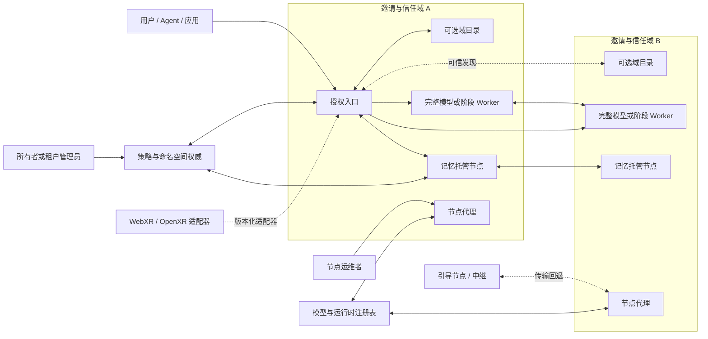
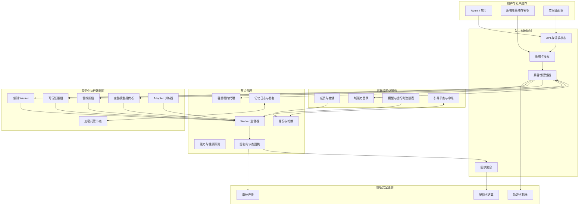
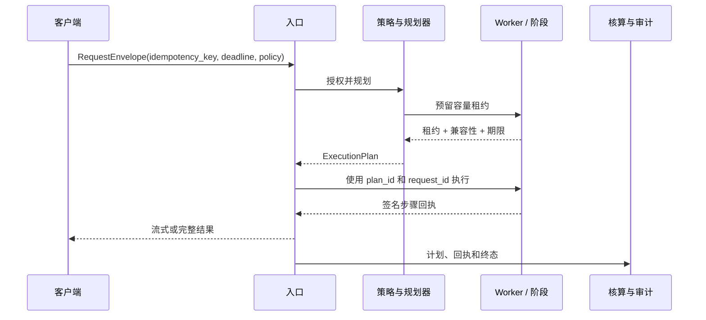
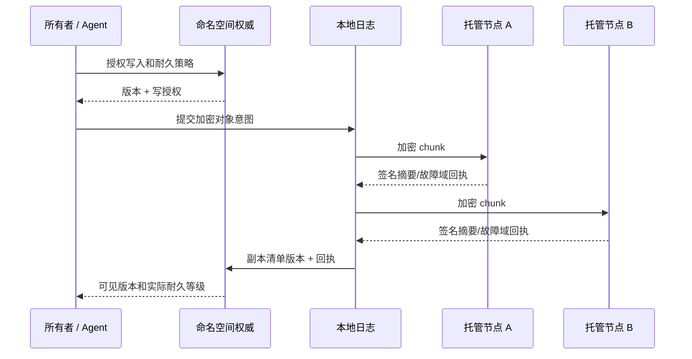
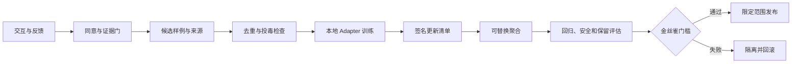

# NeuronMesh 系统架构

[English](ARCHITECTURE.md) | [简体中文](ARCHITECTURE.zh-CN.md)

**状态：** 架构基线 `v0.1`，目标设计，仅部分参考实现  
**日期：** 2026-10-30  
**范围：** 成员、发现、推理、持久记忆、虚拟角色、持续学习和空间适配器的跨节点架构

> 本文规定目标架构，但不声称所有组件已经实现。当前 Python 服务是协议和故障语义的参考切片；[实现状态](#18-当前实现与目标差距)列出了真实差距。

## 1. 目标与非目标

### 1.1 目标

NeuronMesh 研究网络应能：

1. 接纳操作系统和加速器不同的受邀异构主机；
2. 允许任意授权入口参与路由，同时保持明确的用户、数据和模型策略；
3. 使用短期、可撤销的容量，而不是信任节点自报的峰值硬件；
4. 在同一请求契约下执行本地小模型、远端完整模型和兼容的多阶段管线；
5. 让加密记忆和可迁移虚拟角色独立于单台物理主机；
6. 支持人工治理的持续学习，不广播原始用户数据，也不静默修改全局权重；
7. 断网时切换到本地自治模式，并明确显示能力边界；
8. 为每个强主张提供可复现的故障语义、回执和基准。

### 1.2 首个生产形态网络的非目标

- 匿名公共参与；
- 拥有所有请求的单一全局调度器；
- 互联网规模同步张量并行或 all-reduce；
- 从每段对话自动训练；
- 承诺主机永不故障或记忆在物理上永久存在；
- 在身份、滥用控制和核算尚未独立验证前引入区块链或代币经济；
- 首个 token 已经输出后透明重试流式响应；
- 把设备型号、核心数或广告带宽当作服务能力证明。

## 2. 设计原则

1. **身份先于连接。** 每个节点、用户、角色和模型产物都有可验证身份。
2. **声明不是容量。** 静态能力是签名声明；执行需要当前租约和策略决定。
3. **每项事实只有一个状态所有者。** 每类可变事实都有权威所有者和明确合并语义。
4. **控制面与数据面独立失效。** 发现故障不能破坏记忆，推理故障不能清除成员状态。
5. **快速降级，缓慢升级。** 不安全或未验证容量立即撤销；更强角色需要重复基准。
6. **分层发现。** 域目录与局部组降低对全网枚举的依赖。
7. **不隐藏质量降级。** 离线回退、较小模型和缩减上下文都是显式响应决定。
8. **耐久不等于永久。** 耐久性是有明确失败边界、副本和密钥恢复协议的实测契约。
9. **记忆不是训练。** 检索、巩固和参数更新是分离的治理流程。
10. **先有回执，后结算。** 资源使用、传输、训练和删除都必须产生可审计证据。
11. **身份、策略、模型兼容和密钥所有权失败时关闭。**
12. **首次输出后流式请求不可逆。** 此时恢复语义发生变化。
13. **每个分布式特性都有单机基线和分区测试。**
14. **模型和数据治理与机制同时交付，而不是事后补充。**

### 2.1 本架构的推导方法

架构不是按“一项功能对应一个服务”拼接出来的。推导顺序是：

1. 定义目标、明确非目标和用户可见承诺；
2. 列出可变事实、密钥和不可逆副作用；
3. 为每项事实分配唯一权威所有者和生命周期；
4. 根据故障、信任和扩展边界拆分组件；
5. 在实现前规定请求、租约、记忆、角色和训练状态转换；
6. 为每个跨边界调用定义兼容和失败行为；
7. 从架构派生可观测质量场景和发布门槛；
8. 尚不能与单机或更简单基线比较的机制，暂缓进入实现。

| 需求 | 架构决定 | 原因 |
| --- | --- | --- |
| 异构主机都能参与 | 类型化能力画像 + 短期租约 | 设备类别不能证明当前服务能力 |
| 任意授权节点可作为入口 | 请求级规划器，无全局调度器 | 消除全局可用性和信任瓶颈 |
| 网络需超越小型实验 | 分层域目录 + DHT/租约发现 | 全量节点列表刷新是 O(N) 且会陈旧 |
| 模型和运行时需互操作 | 内容寻址的模型/阶段/运行时清单 | 层号本身不能证明兼容 |
| 主机更换后记忆仍存在 | 命名空间权威 + 加密不可变版本 + 故障域副本 | 物理主机不能是记忆身份单位 |
| 断网后仍可继续 | 明确的 `networked` 和 `local-autonomous` 契约 | 防止虚假远端能力声明 |
| 虚拟角色可在主机间迁移 | 角色控制器 + fenced primary epoch | 仅导出/导入可能产生脑裂 |
| 系统应持续学习 | 证据门控的本地 Adapter + 评估与回滚 | 对话不能直接修改全局权重 |
| 未来元宇宙需接入 | 可选版本化空间适配器 | 世界引擎不能拥有持久核心 |
| 主张需外部审查 | 回执、质量场景和架构门槛 | 仅靠演示不能证明可靠性 |

## 3. 系统上下文



图中没有强制的全局控制器。域目录、引导节点和中继都是可替换基础设施，不拥有请求或记忆状态。

## 4. 架构平面

| 平面 | 负责内容 | 可最终一致？ | 主要故障行为 |
| --- | --- | --- | --- |
| 成员与信任 | 邀请、节点证书、撤销、角色策略 | 准入不可最终一致；撤销传播可以 | 拒绝新工作，保留已有持久状态 |
| 发现与规划 | 能力索引、路径候选、容量租约 | 可以，但受 TTL 约束 | 请求新鲜探测或使用声明回退 |
| 执行数据面 | 请求流、阶段激活、模型调用、checkpoint | 已准入请求不可最终一致 | 仅在不可逆输出前重选；否则返回可恢复错误 |
| 持久状态 | 命名空间元数据、记忆日志、角色清单、墓碑、密钥引用 | 元数据可最终复制；已提交版本不可变 | 明确 D1/D2/D3 降级，不虚构耐久性 |
| 学习 | 证据集、Adapter 轮次、评估、发布状态 | 每个实验可最终协调 | 隔离更新，绝不自动发布未评估模型 |
| 观测与审计 | 轨迹、回执、资源核算、删除与发布证据 | 聚合可延迟 | 本地签名回执是权威证据 |
| 空间适配 | 临时会话、事件翻译、Avatar 意图请求 | 会话顺序受 frame/deadline 约束 | 关闭或降级为非空间 API |

## 5. 逻辑组件



箭头表示允许交互，而不是要求每项服务独立部署。研究节点可以合并多个逻辑组件，但仍必须保持授权和状态边界。

### 5.1 节点代理

每台参与主机运行节点代理：

- **身份代理：** Ed25519 密钥、证书链、轮换和撤销检查；
- **能力探针：** 硬件、运行时、模型产物、网络和持续基准证据；
- **运行时监督器：** 启动、隔离、限流和停止允许的 Worker；
- **容量代理：** 发放短期 slot 和队列预算；
- **传输代理：** 认证流、中继回退和连接健康；
- **健康代理：** 温度、电源、磁盘、内存、电池和关机状态；
- **回执签名器：** 签署执行、备份、训练和排空证据。

节点代理不会变成全局调度器。

### 5.2 入口与规划器

授权入口拥有请求准入和生命周期。规划器负责：

1. 评估用户、租户、隐私、地域和模型许可证策略；
2. 检查本地执行和远端完整模型候选；
3. 只有单节点无法满足时才构造管线；
4. 执行前预留兼容容量租约；
5. 生成绑定截止时间、预算和幂等键的 `ExecutionPlan`；
6. 记录哪些位置可安全重试；
7. 释放未使用预留并提交签名回执。

规划是请求本地的。不同入口可以为同一请求生成不同计划，而不会破坏全局一致性。

### 5.3 Worker 运行时

Worker 按类型运行并遵循最小权限：

- `whole-model`：服务完整 OpenAI 兼容或原生模型；
- `pipeline-stage`：加载不可变连续层并传输边界激活；
- `tensor-group-member`：只在可信高带宽组中运行；
- `perception`：OCR、ASR、VAD、编码和脱敏；
- `trainer`：在实验沙箱中运行批准的 Adapter 任务；
- `storage-custodian`：保存加密对象和清单；
- `relay`：在配额下转发认证流。

Worker 准入依赖产物摘要、运行时镜像摘要、模型/Tokenizer/模板兼容和当前租约。

### 5.4 持久状态服务

系统没有单一全局数据库。逻辑服务包括：

- **成员日志：** 准入、证书、撤销和策略 epoch；
- **模型注册表：** 不可变模型、Tokenizer、模板、许可证和运行时清单；
- **命名空间权威：** 所有者及其授权；
- **记忆日志：** 追加式对象版本、副本确认和墓碑；
- **角色控制器：** 角色主节点 epoch、迁移 fence 和恢复 epoch；
- **实验账本：** 训练数据清单、聚合轮次、评估和发布证据。

早期可以合并到单节点或小域服务；后拆分为独立服务时，状态所有权规则不变。

### 5.5 可选域目录

域目录发布一个邀请域内有界的节点、组、模型、信任范围和可达性视图。

- 它是缓存和发现加速器，不是执行权威；
- 它不能授权命名空间访问；
- 它必须发布带 epoch 和 TTL 的签名快照；
- 入口必须支持绕过和至少两个目录副本；
- 目录故障可以增加发现时间，但不能使已准入工作失效。

### 5.6 引导、中继与注册表

引导和中继提供可达性，不负责调度。模型注册表提供不可变产物和信任证据，不保存记忆或用户数据。每项服务都有明确容量预算和可观测故障状态。

## 6. 部署拓扑

### 6.1 单机

运行 `local-autonomous`：节点代理、本地模型、本地记忆日志、策略引擎和 API。每个分布式特性都以它为基线。

### 6.2 可信组

一组具有稳定局域网/RDMA 连接的共址主机，可运行张量并行或 prefill/decode 分离。组发布签名成员和拓扑 epoch；成员或拓扑变化后必须重新基准。

### 6.3 邀请域

具有共同治理但节点独立的研究组、实验室或组织。域可以运行目录副本、成员根和存储策略。域成员身份不意味着拥有所有命名空间的数据访问权。

### 6.4 联邦

多个邀请域通过明确对等协议交换签名发现摘要。跨域请求必须同时满足两个域策略和所有者授权。联邦不会创建隐式全局管理员。

## 7. 状态所有权与一致性

| 事实 | 权威所有者 | 合并/一致性规则 |
| --- | --- | --- |
| 节点私钥 | 仅节点 | 永不离开节点；轮换生成签名继承记录 |
| 邀请与撤销 | 成员权威 | 单调成员 epoch；过期/撤销身份被拒绝 |
| 静态能力声明 | 节点 | 签名、版本化和 TTL；新声明覆盖旧声明 |
| 当前负载和 slot | Worker 容量代理 | 短期租约，不长期合并 |
| 准入策略 | 租户/域策略权威 | 版本化策略；请求固定 epoch |
| 请求生命周期 | 该请求入口 | 单一计划所有者；状态转换不可变 |
| 模型产物 | 注册表 | 内容寻址且不可变 |
| 记忆对象版本 | 命名空间权威 | 不可变版本；显式冲突解决 |
| 副本清单 | 命名空间权威 + 托管节点签名确认 | 反熵；缺少确认不计入耐久性 |
| 墓碑 | 命名空间权威 | 单调删除 epoch；存活时间长于最大声明窗口 |
| 虚拟角色主节点 | 角色控制器 | fenced epoch；同一 epoch 最多一个主节点 |
| 训练实验 | 实验协调者 | 版本化轮次与评估记录，不静默覆盖 |
| 配额和结算 | 签名回执 + 核算权威 | 幂等回执 ID；争议基于产物 |

详细状态见[状态与故障模型](docs/architecture/STATE_AND_FAILURE.zh-CN.md)。

## 8. 信任边界与授权

### 8.1 身份层级

```text
网络策略根
  -> 域邀请权威
    -> 节点证书
      -> Worker/运行时证明

租户/命名空间所有者
  -> 用户或 Agent 授权
  -> 角色授权
  -> 记忆密钥授权
```

节点认证和用户授权相互分离。节点受邀并不赋予其访问所有命名空间的权限。

### 8.2 生产形态所需控制

- 节点 mTLS，或将认证 QUIC 身份绑定到证书/公钥；
- 短期租户/客户端 token；
- 命名空间级策略，而不是全邀请网共享 Bearer Token；
- 按节点、租户和模型设置配额；
- 签名模型/运行时清单和 Worker 沙箱；
- 通过 nonce、请求 ID、期限和幂等键防重放；
- 限制节点 URL 和出站目标，防止 SSRF/中继滥用；
- 对敏感元数据加密，并记录已知泄漏；
- 运维可见的撤销和密钥轮换流程。

当前开发 Bearer Token 不满足该边界。

## 9. 推理架构

### 9.1 执行模式

| 模式 | 跨网络数据 | 使用条件 |
| --- | --- | --- |
| `local-small` | 无 | 本地模型满足隐私、质量和截止时间 |
| `remote-whole-model` | Prompt/特征和结果各跨一次 | 远端节点可以装入完整模型 |
| `trusted-group` | 组内高频率激活/集合通信 | 局域网/RDMA 张量组满足目标 |
| `pipeline` | 2–3 个兼容阶段间传边界激活 | 单节点无法装入或服务模型 |
| `async-batch` | Prompt/特征和持久作业记录 | 截止时间允许分钟或小时级等待 |

跨公网管线前优先使用远端完整模型。只有实测容量或质量收益足够才证明管线合理。

### 9.2 请求协议



首次输出会改变请求状态。此前失败可以重新规划；此后透明重试会重复用户可见输出。

### 9.3 兼容屏障

阶段只有满足以下条件才兼容：

- 模型 ID 和不可变 revision；
- Tokenizer 和聊天模板摘要；
- 架构与 RoPE/attention 配置；
- 精度与激活序列化；
- 阶段边界连续且不重叠；
- 运行时镜像和算子实现；
- 模型许可证与允许执行域；
- 上下文长度和 KV/激活内存。

未知字段或不匹配必须关闭失败。

## 10. 容量与调度

### 10.1 能力层次

1. **设备画像：** 架构、操作系统、电源和移动性；
2. **产物画像：** 模型/运行时/格式兼容；
3. **实测画像：** 持续吞吐、冷暖启动、内存余量和热行为；
4. **网络画像：** 直连、RTT、抖动、吞吐、计费和所需中继；
5. **信任画像：** 邀请、策略、产物证明和历史证据；
6. **运行租约：** 当前 slot、队列、期限、热/电源状态和撤销条件。

### 10.2 放置算法

规划器求解受约束的多目标路径：

```text
最小化预测
    TTFT + 排队 + 传输 + 失败惩罚 + 能耗/成本惩罚

满足
    策略和隐私授权
    模型/阶段兼容
    内存和上下文余量
    容量租约在预计开始时间仍有效
    完成概率满足截止时间
    故障域和许可证限制
    租户/节点配额
```

硬约束绝不能通过加权分数放宽。

### 10.3 租约与 fencing

租约包括：

- 租约 ID、计划 ID；
- 节点、组和 Worker ID；
- 模型/阶段兼容摘要；
- slot 数和最大接受工作量；
- `start_by` 与过期时间；
- 撤销条件；
- fencing token；
- 提供者签名。

过期租约不能隐式续期。fenced 或过期 Worker 的结果必须拒绝，除非新计划显式接收。

### 10.4 强、弱、组、域神经元

这些是视图，而不是互斥设备类型：

- `capacity_tier`：对具体模型、任务画像和目标而言的 `strong`/`weak`；
- `unit_scope`：`single`、`group` 或 `domain`；
- `service_roles`：当前具体职责。

升级缓慢且基于证据；硬条件失败时立即降级。

## 11. 持久记忆与可迁移角色

### 11.1 记忆模型

```text
命名空间
  -> MemoryObject（稳定逻辑身份）
    -> 不可变 Version
      -> 加密 chunk
      -> 盲索引项
      -> ReplicaManifest
      -> 墓碑或保留策略
```

权威元数据与物理密文块分离。托管节点确认具体版本和摘要，不代表拥有明文访问权。

### 11.2 密钥模型

目标模型：

- 每个命名空间的数据加密密钥（DEK）；
- 所有者控制的密钥加密密钥（KEK）；
- 为授权设备或阈值恢复保存版本化 wrapped DEK；
- 给角色和 Agent 的短期能力授权；
- 密钥轮换独立于内容复制；
- 必要时对版本或命名空间执行 crypto-shredding。

当前单一本地记忆主密钥是参考实现，不是生产恢复架构。

### 11.3 耐久等级

| 等级 | 含义 | 明确限制 |
| --- | --- | --- |
| `D0` | 易失或未提交 | 进程/主机故障即丢失 |
| `D1` | 本地持久提交 | 本地盘和所有本地备份均损坏时丢失 |
| `D2` | 本地 + 一个确认的远端故障域 | 仍依赖密钥可用性和反熵 |
| `D3` | 至少两个确认的远端故障域 | 不保证协调故障或删除 Bug |

任何等级都不能称为“永久”。只有反复故障注入后，恢复目标才能成为 SLO。

### 11.4 副本反熵

- 单调对象版本和副本清单；
- 周期性摘要比较与清洗；
- 墓碑传播时间长于最大陈旧副本窗口；
- 删除最后已知良好副本前先修复；
- 签名副本回执；
- 配额压力触发迁移，而不是删除已提交数据；
- 无法维持目标时显示 degraded。



确认集合不完整时，对象按声明降级保留并进入修复，不能仅因远端返回成功而无摘要验证地宣称耐久性。

### 11.5 虚拟角色

角色清单拥有身份、命名空间范围、模型/Adapter 引用、允许工具/动作和记忆授权。物理主机只是可替换执行绑定。

迁移使用 fenced epoch：

1. 创建目标候选；
2. 复制加密状态并验证摘要；
3. 准备目标角色，但不接收用户动作；
4. 在角色控制器递增主节点 epoch；
5. 只激活匹配 epoch；
6. 停止并排空旧主节点；
7. 保留回滚清单直至目标健康。

当前手动导出/导入尚未实现自动 fencing 和回滚。

## 12. 持续学习架构

### 12.1 记忆与参数分离

- **情景记忆：** 事件和观察；
- **语义记忆：** 巩固后可追溯的事实与偏好；
- **程序记忆：** 指向工具、Adapter 或验证流程；
- **模型参数：** 只通过单独授权的训练流程改变。

### 12.2 学习管线



训练不会把原始对话流入全局模型。参与者控制本地数据，并针对不可变基础模型生成有界更新。

### 12.3 学习契约

每轮记录：

- 假设和目标行为；
- 参与者资格与同意；
- 基础模型、Tokenizer 和运行时摘要；
- 更新格式、rank、精度和优化器状态策略；
- 聚合算法与对抗假设；
- 不泄漏私有样例的评估集版本；
- 兼容、回归和遗忘检查；
- 金丝雀比例、监控窗口和回滚产物。

仅因训练损失下降不能发布更新。

## 13. 多模态与空间边界

空间客户端使用版本化适配器，将事件映射为不可信语义输入，将 Avatar 意图映射为经权限检查的动作。

- 会话状态默认临时；
- 原始坐标、相机帧和麦克风音频未经显式授权不得进入持久记忆；
- 事件顺序受 session、frame 和 deadline 约束；
- 高影响 Avatar 动作需要短期动作授权；
- 模型输出对世界而言是不可信输入；
- WebXR/OpenXR/引擎依赖留在持久核心之外。

## 14. 可观测性与隐私

每个请求产生：

- 请求和计划 ID；
- 策略和能力 epoch；
- 阶段/Worker/模型产物摘要；
- 排队、TTFT、ITL、传输、重试和终态；
- 容量租约和回执 ID；
- 失败类别及输出是否已不可逆；
- 非明文资源与传输量。

指标聚合必须控制基数。Prompt、记忆明文、原始媒体、私有命名空间标识和稳定用户标识不得进入通用遥测。

## 15. 扩展模型

| 规模 | 发现方式 | 必需控制 |
| --- | --- | --- |
| 2–20 节点 | 直接签名公告 | 可接受全网测试 |
| 20–200 节点 | 域目录 + 有界 peer cache | TTL、背压、目录副本 |
| 200–5,000 节点 | 分层域摘要 + DHT | 有界查询、租约限速 |
| 5,000+ 节点 | 多级域、区域发现和信誉分片 | 仍需容量研究，不作承诺 |

架构禁止“把每个实时负载更新发给所有节点”。负载是短期租约，静态能力记录单独缓存。

## 16. 故障与一致性契约

详细矩阵见[状态与故障模型](docs/architecture/STATE_AND_FAILURE.zh-CN.md)。高层要求：

- 未解决写入不得确认耐久；
- 被撤销或 fenced 的 Worker 不得提交新结果；
- 首次输出后不得透明重放流式响应；
- 同一 epoch 不得出现两个活跃角色主节点；
- 没有评估和回滚产物的训练更新不得发布；
- 修复不得删除最后良好副本；
- 分区恢复不得无单调检查地应用陈旧墓碑/版本；
- 所有降级状态必须外部可见。

## 17. 版本与契约

核心契约独立版本化：

- `neuron.node/*`
- `neuron.capability/*`
- `neuron.lease/*`
- `neuron.model/*`
- `neuron.request/*`
- `neuron.memory/*`
- `neuron.role/*`
- `neuron.train/*`
- `neuron.spatial/*`

兼容规则：

- 未知关键字段或版本 -> 拒绝；
- 只有在标记为非关键时才可忽略新增可选字段；
- 存储和执行计划固定产物及 Schema 版本；
- 迁移显式记录；
- 旧读取器不能重新解释语义变化的字段。

接口清单见[接口契约](docs/architecture/INTERFACE_CONTRACTS.zh-CN.md)。

## 18. 当前实现与目标差距

| 能力 | 当前参考切片 | 目标差距 |
| --- | --- | --- |
| 身份 | Ed25519 节点密钥与签名能力 | 成员证书、轮换、撤销和 Worker 证明 |
| 准入 | 共享 Bearer Token | 域邀请、租户用户、命名空间策略和短期授权 |
| 发现 | 周期 HTTP peer 列表交换 | 分层目录、libp2p/DHT、有界 TTL 和分区测试 |
| 调度 | 偏好 RTT 的完整模型选择 | 兼容图、多目标计划、租约、fencing 和准入控制 |
| 推理 | Echo/本地 OpenAI 兼容完整模型 | 真实 Worker 适配器、原生流语义和一致性 |
| 管线 | 未实现 | 阶段清单、激活协议、截止时间和恢复 |
| 记忆 | 本地 AES-GCM、词法盲索引、远端密文副本 | 密钥层级/恢复、不可变版本、反熵、清洗和命名空间授权 |
| 角色 | 手动加密导出/导入 | fenced 主节点 epoch、自动迁移、回滚和离线恢复 |
| 学习 | 仅设计 | 证据管线、本地 Adapter、聚合、评估和发布门槛 |
| 空间 | 进程内 mock | 版本化适配器、事件顺序和真实 WebXR/OpenXR |
| 观测 | 健康/就绪和基础状态 | trace context、签名步骤回执、资源核算和隐私安全聚合 |

只有契约、一致性测试和故障测试都存在时，能力才能标为已实现。

## 19. 实施门槛

### Gate A：架构与信任基线

- 批准架构与状态所有权；
- 为 capability、model/stage、request、lease、receipt、memory 和 role 定义 JSON Schema；
- 增加 Schema 演进和关键字段规则；
- 用节点和租户凭证替换共享 token；
- 建立确定性一致性夹具。

**退出：** 不兼容清单和未授权请求在 Worker 启动前失败。

### Gate B：可信单元

- 在可信网络运行 3–6 个异构受邀节点；
- 支持带租约的本地小模型和远端完整模型；
- 实现签名步骤回执和配额；
- 测试 Worker 崩溃、过期和断连。

**退出：** 不重复结算；首 token 前可恢复，首 token 后语义明确。

### Gate C：真实执行

- 集成 llama.cpp/vLLM Worker；
- 实现 2–3 个连续阶段及激活序列化；
- 与本地 offload 和远端完整模型比较；
- 只有在管线证据充分后才增加可信局域网张量组。

**退出：** 质量、TTFT、ITL、吞吐和资源使用可对固定基线复现。

### Gate D：持久记忆与角色

- 实现命名空间密钥层级和恢复授权；
- 增加不可变版本、副本清单、反熵、清洗和墓碑；
- 实现 fenced 角色迁移与离线恢复；
- 进行计划关机、断电、分区和密钥丢失演练。

**退出：** 每个耐久等级都有实测 RPO/RTO 和明确失败边界。

### Gate E：可信广域网

- 增加认证 QUIC、AutoNAT/DCUtR 和中继回退；
- 测试 NAT、CGNAT、丢包、抖动和目录故障；
- 增加撤销传播和滥用限制。

**退出：** 无匿名暴露或无全局调度器地运行跨域试点。

### Gate F：持续学习

- 实现证据门控的本地数据整理；
- 增加一个可替换联邦 Adapter 实验；
- 强制兼容、回归、投毒和回滚门槛；
- 发布负面结果和有效性威胁。

**退出：** 没有可追溯数据/更新来源和评估证据，更新不得发布。

### Gate G：空间生态

- 冻结版本化空间契约；
- 增加桌面模拟器和 WebXR 一致性夹具；
- 验证旁观者隐私和高影响动作授权；
- 引擎依赖只存在于适配器。

## 20. 待决架构问题

1. 哪种成员权威和恢复模型适合邀请制研究联邦？
2. 高价值记忆先使用完整副本，还是只在实测冷存储瓶颈下引入纠删码？
3. 阈值密钥恢复如何在个人、组织和硬件密钥之间分配所有权？
4. 哪些元数据必须加密，哪些泄漏对路由可接受？
5. 哪些外部身份/Agent 协议应映射到命名空间和角色授权？
6. 哪种本地 Adapter 算法能稳定跨 llama.cpp/vLLM/PyTorch？
7. 公开资金或算力交换前，最小诚实的配额/结算模型是什么？
8. 域目录如何避免变成策略权威或可用性瓶颈？
9. 哪些角色无需暂停活跃会话即可迁移？
10. 什么证据足以称训练更新为改进？

每个决策都应成为包含替代方案、证据、所有者和反转成本的 ADR。

## 21. 架构变更流程

API、存储、信任、调度或训练变更必须包含：

1. 受影响状态所有者和生命周期；
2. 兼容与迁移方案；
3. 故障和分区行为；
4. 安全与隐私影响；
5. 可观测性和回执字段；
6. 一致性或基准证据；
7. 回滚或降级路径；
8. 明确不支持场景。

项目应优先选择更小但已验证的契约，而不是更大但未验证的功能面。

## 22. 阅读顺序

1. [架构基线](ARCHITECTURE.zh-CN.md)
2. [状态与故障模型](docs/architecture/STATE_AND_FAILURE.zh-CN.md)
3. [接口契约](docs/architecture/INTERFACE_CONTRACTS.zh-CN.md)
4. [威胁模型](docs/architecture/THREAT_MODEL.zh-CN.md)
5. [质量场景](docs/architecture/QUALITY_SCENARIOS.zh-CN.md)
6. [研究型架构方案](神经元式去中心化大模型网络系统-研究型邀请制可执行方案.md)
7. [持久记忆与持续学习](神经元式去中心化大模型网络系统-持续学习与持久记忆方案.md)
8. [空间适配边界](神经元式去中心化大模型网络系统-元宇宙接入预留方案.md)

## 附录 A：外部技术依据

- [RFC 9000: QUIC](https://www.rfc-editor.org/rfc/rfc9000.html)
- [RFC 9001: QUIC TLS](https://www.rfc-editor.org/rfc/rfc9001.html)
- [libp2p QUIC](https://docs.libp2p.io/concepts/transports/quic/)
- [libp2p DCUtR](https://docs.libp2p.io/concepts/nat/dcutr/)
- [libp2p Circuit Relay v2](https://docs.libp2p.io/concepts/nat/circuit-relay/)
- [libp2p Kademlia DHT](https://docs.libp2p.io/concepts/discovery-routing/kad-dht/)
- [vLLM 并行与扩展](https://docs.vllm.ai/en/latest/serving/parallelism_scaling.html)
- [llama.cpp RPC 状态](https://github.com/ggml-org/llama.cpp/blob/master/tools/rpc/README.md)
- [Petals 论文](https://arxiv.org/abs/2312.08361)
- [WebXR Device API](https://www.w3.org/TR/webxr/)
- [WebTransport](https://www.w3.org/TR/webtransport/)
- [OpenXR](https://registry.khronos.org/OpenXR/)

外部能力会变化。实现决策必须针对固定版本重新验证，并记录到决策日志。
