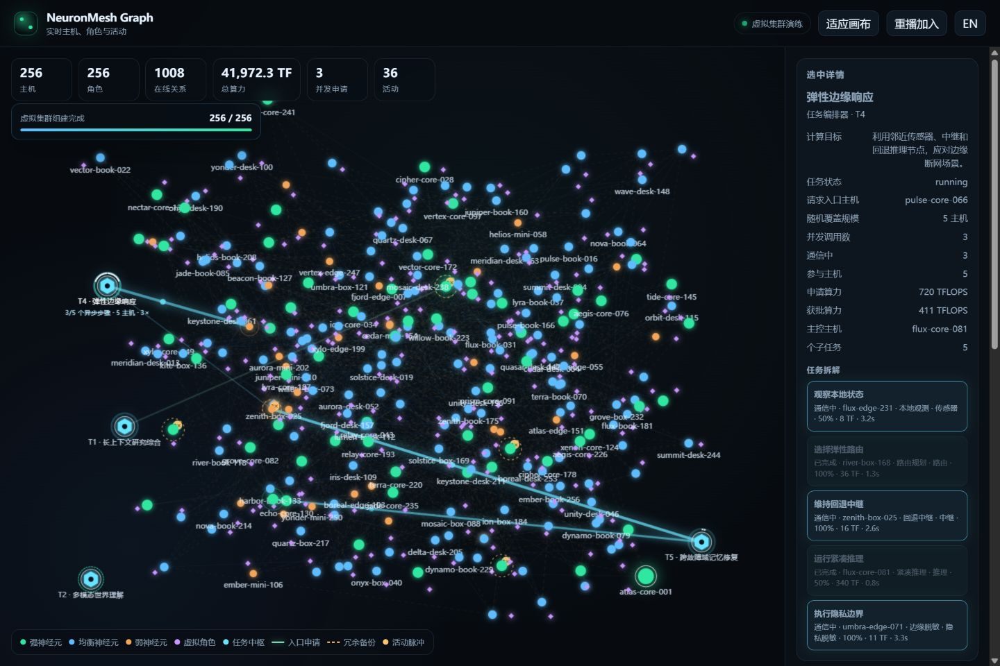
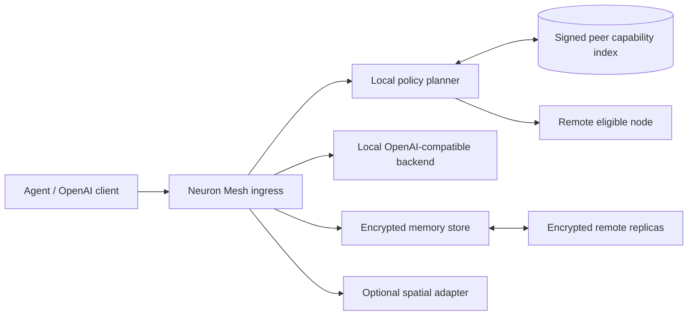

# NeuronMesh

[English](README.md) | [简体中文](README.zh-CN.md)

### Open-Source Decentralized LLM Network for Collaborative Inference, Persistent Memory & Continual Learning

**NeuronMesh** is an open-source research project for connecting computers, servers, phones and edge devices into a capability-aware distributed AI network. Authorized nodes can act as model ingresses, encrypted memory can cross sessions and hosts, and disconnected nodes can fall back to local autonomous operation.

[](https://github.com/yanxee/neuron-mesh/actions/workflows/ci.yml)
[](https://www.python.org/)
[](LICENSE)
[]()

> `v0.2.0` is a runnable research reference slice, not a completed production public network. Implemented behavior, architecture contracts, tests and future gates are kept separate.

**Project website:** <https://yanxee.github.io/neuron-mesh/>

**Chinese website:** <https://yanxee.github.io/neuron-mesh/zh-CN/>

**Architecture:** [ARCHITECTURE.md](ARCHITECTURE.md) | [简体中文](ARCHITECTURE.zh-CN.md)

**Search terms:** decentralized AI · distributed inference · large language models · LLM network · peer-to-peer AI · federated learning · continual learning · persistent memory · long-term memory · heterogeneous computing · edge AI · multi-modal AI · OpenAI-compatible API · 去中心化大模型 · 分布式推理 · 联邦学习 · 长期记忆 · 异构算力



## Help build the measurable network

NeuronMesh is looking for researchers, engineers, node operators, translators and protocol reviewers who want to make decentralized AI measurable rather than aspirational. You do **not** need a GPU or a complete model deployment for a useful first contribution.

| Time | Useful first step | Start |
| --- | --- | --- |
| 10 minutes | Reproduce the deterministic two-node demo and report your environment | [Demo](docs/DEMO.md) |
| 30–90 minutes | Pick a scoped bug, test, translation or documentation task | [Good first issues](https://github.com/yanxee/neuron-mesh/issues?q=is%3Aissue+is%3Aopen+label%3A%22good+first+issue%22) |
| One afternoon | Benchmark routing, memory tiering or heterogeneous hardware | [Research task board](docs/CONTRIBUTOR_TASKS.md#research-contributions) |
| Ongoing | Review a protocol boundary or own a subsystem gate | [Contributor entry guide](https://yanxee.github.io/neuron-mesh/join.html) |

Read [CONTRIBUTING.md](CONTRIBUTING.md) before opening a pull request. Open-ended ideas belong in [GitHub Discussions](https://github.com/yanxee/neuron-mesh/discussions); actionable changes belong in issues.

All public project documentation is available in English and Simplified Chinese. Paired files use `name.md` and `name.zh-CN.md`.

## Why NeuronMesh?

NeuronMesh is not another wrapper around a chat API. It studies four connected infrastructure problems: computation, memory, lifecycle and interoperability.

| Common approach | NeuronMesh research direction |
| --- | --- |
| Fixed cloud ingress and centralized scheduling | Any authorized node can become an ingress; a request-local planner selects resources under policy and latency constraints |
| GPU model and theoretical FLOPS determine placement | Strong/weak capacity is derived from sustained throughput, memory, thermal behavior, network and trust evidence |
| Memory ends with a session | User, organization and role namespaces have hot/warm/cold tiers and encrypted cross-failure-domain replicas |
| A host failure destroys the agent | Virtual roles are separated from physical hosts and support encrypted export, target re-encryption and recovery |
| Offline means unavailable | Online pooled resources fall back to local models and memory caches with an explicit degradation boundary |
| Backups require plaintext custody | Source-side AES-GCM encryption means storage custodians hold ciphertext they cannot decrypt |
| “Never shut down” is treated as uptime | `DRAINING`, replica confirmation, WAL checkpoint, signed receipts and readiness checks define safe lifecycle behavior |
| AI infrastructure is tied to one world engine | A versioned WebXR/OpenXR adapter boundary avoids changing the inference and memory core |

## Architecture status

> `v0.2.0` is a reference slice. The full target architecture, state ownership, failure contracts, interface inventory and implementation gates are in [ARCHITECTURE.md](ARCHITECTURE.md).

NeuronMesh is designed as a federated layered system, not a flat swarm with one global scheduler.

| Plane | Target responsibility | Current reference slice |
| --- | --- | --- |
| Membership and trust | Invitation domains, node certificates, tenant grants, revocation and rotation | Ed25519 node identity and a shared token |
| Discovery and planning | Hierarchical catalogs, compatibility constraints, short leases and ingress-side plans | HTTP peer announcements and simple RTT preference |
| Execution data plane | Local small models, remote whole-model providers, trusted groups and 2–3-stage pipelines | OpenAI-compatible whole-model forwarding only |
| Durable state | User namespaces, immutable memory versions, replica manifests and role epochs | SQLite, encrypted memory and basic remote replicas |
| Learning | Evidence gates, local adapters, aggregation, regression, canary and rollback | Research design only |
| Observability and audit | Request traces, signed step receipts, accounting and deletion evidence | Health checks, drain receipts and basic status |
| Spatial adaptation | WebXR/OpenXR/engine event and action boundary | In-process mock interface only |

The following diagram describes the current reference slice only:



Architecture documents:

- [System architecture baseline](ARCHITECTURE.md)
- [State and failure model](docs/architecture/STATE_AND_FAILURE.md)
- [Interface contracts](docs/architecture/INTERFACE_CONTRACTS.md)
- [Threat model](docs/architecture/THREAT_MODEL.md)
- [Quality scenarios](docs/architecture/QUALITY_SCENARIOS.md)
- [Architecture decision log](docs/architecture/DECISIONS.md)

## Implemented in the reference slice

- OpenAI-compatible `/v1/models` and `/v1/chat/completions` subset;
- local Echo backend or forwarding to an OpenAI-compatible llama.cpp/vLLM service;
- Ed25519 node identity and signed capability records;
- resource pledges, device profiles and strong/weak capacity labels;
- storage admission and remote replica quota rejection;
- invite-only HTTP peer discovery, signed announcements and ingress-side remote selection;
- `networked` and `offline-autonomous` modes;
- SQLite WAL persistence;
- AES-GCM memory and HMAC blind indexing;
- hot/warm/cold tiers, encrypted remote replicas and on-demand recovery;
- virtual roles, action allowlists and spatial-session mocks;
- role export/import with transfer-key re-encryption;
- safe drain, WAL checkpoint and signed shutdown receipts that distinguish local and remote durability;
- `status`/`drain` CLI commands and `/readyz`;
- two-node Docker Compose, tests and GitHub Actions CI.
- Obsidian-style live graph of hosts, virtual roles and node-to-node activity;
- a deterministic 256-host join animation with a chaos-first cloud layout while
  retaining failure-domain metadata for a future grouped view;
- task-driven asynchronous dispatch with random coverage from 1 to 40 hosts and
  visible per-host subtask assignment across failure domains;
- up to three simultaneous ingress-host resource requests with proportional
  compute shares, overlapping leases and automatic rebalancing;
- a SQLite-backed coordination scheduler with `/v1/tasks`, capability-aware
  host selection, 1–20 asynchronous call slots and independent service deadlines;
- animated relation lines for discovery, remote compute and encrypted-storage support.

## Not implemented yet

- public-internet libp2p/QUIC transport and DHT;
- real Transformer stage splitting and cross-node activation transport;
- internet-scale tensor parallelism or all-reduce;
- federated LoRA training, aggregation and unlearning;
- automatic fenced role migration, offline key custody and unattended recovery;
- native WebXR/OpenXR clients;
- production identity, billing, abuse governance and disaster-recovery SLA;
- namespace key hierarchy, anti-entropy, scrub and complete deletion semantics.

The current peer mesh is an invite-only HTTP design for controlled research. Do not expose development tokens or default configuration to the public internet.

## Quick start

Python 3.11 or newer is required.

### Windows PowerShell

```powershell
python -m venv .venv
.\.venv\Scripts\python.exe -m pip install -e ".[dev]"
$env:NEURON_SHARED_TOKEN = "replace-with-a-long-random-token"
.\.venv\Scripts\neuron-mesh.exe serve --host 127.0.0.1 --port 8000
```

### Linux / macOS

```bash
python3 -m venv .venv
. .venv/bin/activate
pip install -e ".[dev]"
export NEURON_SHARED_TOKEN="replace-with-a-long-random-token"
neuron-mesh serve --host 127.0.0.1 --port 8000
```

API documentation: <http://127.0.0.1:8000/docs>

Live relationship graph: <http://127.0.0.1:8000/graph>

The graph asks for the configured bearer token and keeps it in tab memory only. Start
`python scripts/graph_demo.py --open` for a populated two-node demonstration.
Open <http://127.0.0.1:8000/graph?demo=fleet256> for a browser-generated 256-host
fleet rehearsal. This visual simulation does not claim that 256 real nodes exist.
The same browser-only demo is published at
<https://yanxee.github.io/neuron-mesh/graph-demo.html?demo=fleet256>.
Use the cache-safe URL
<https://yanxee.github.io/neuron-mesh/graph-demo-256-chaos.html?demo=fleet256>
after layout updates.
The rehearsal also cycles through five task objectives and randomly covers between
1 and 40 hosts for each decomposed plan. Each asynchronous batch contacts a random
1–20 hosts at once. Every call keeps its own service deadline derived from host
capacity, allocated share and stage work, so slow or lightly funded hosts remain
connected longer while faster hosts release their slots earlier.
Up to three entry hosts can request resources concurrently; shared hosts expose
their per-task compute percentages, and expired requests are replaced and
rebalanced automatically.

Real task coordination is available through `POST /v1/tasks`; task state is
persisted and visible in the authenticated `/graph` view. This reference slice
schedules coordination windows only and does not claim to execute real model
shards yet.

## Operations

```powershell
# Show online peers and the local degradation state.
.\.venv\Scripts\neuron-mesh.exe status --url http://127.0.0.1:8000

# Drain and wait for the signed receipt before stopping the process.
.\.venv\Scripts\neuron-mesh.exe drain --url http://127.0.0.1:8000
```

`/healthz` means only that the HTTP process is alive. `/readyz` also checks the storage pledge, admission state and draining status. Graceful Uvicorn termination attempts drain and WAL checkpoint; force-kill cannot provide the same recovery semantics.

## OpenAI-compatible examples

```bash
curl http://127.0.0.1:8000/v1/models \
  -H "Authorization: Bearer $NEURON_SHARED_TOKEN"
```

```bash
curl http://127.0.0.1:8000/v1/chat/completions \
  -H "Authorization: Bearer $NEURON_SHARED_TOKEN" \
  -H "Content-Type: application/json" \
  -d '{
    "model": "neuron-echo-1",
    "messages": [{"role": "user", "content": "Hello"}]
  }'
```

Explicit remote routing:

```bash
curl http://127.0.0.1:8000/v1/chat/completions \
  -H "Authorization: Bearer $NEURON_SHARED_TOKEN" \
  -H "X-Neuron-Route: network" \
  -H "Content-Type: application/json" \
  -d '{
    "model": "neuron-echo-1",
    "messages": [{"role": "user", "content": "Run remotely"}]
  }'
```

Role migration is explicit. The source node exports an encrypted package and the target imports it with the same one-time transfer secret. The secret is not written to the database.

## Two-node demo

Copy `.env.example` to `.env`, change the invitation token, then run:

```bash
docker compose up --build
```

- `http://127.0.0.1:8001`: `domain-a`
- `http://127.0.0.1:8002`: `domain-b`

Write a memory to node B with immediate replication and inspect the ciphertext at node A's `/v1/internal/backups/{memory_id}`. The remote node cannot decrypt the content because the key remains on the source node.

Linux service deployment can use the [systemd unit](deploy/systemd/neuron-mesh.service). Change the public URL, invitation token and failure domain before deployment.

## Real model backend

Set `NEURON_LOCAL_BACKEND_URL` to an OpenAI `/v1/chat/completions` service such as llama.cpp server or vLLM:

```bash
export NEURON_LOCAL_BACKEND_URL=http://127.0.0.1:8080
export NEURON_MODEL_ID=your-configured-model
neuron-mesh serve --port 8000
```

Before a production-shaped deployment:

- terminate TLS at a reverse proxy or use authenticated QUIC;
- replace the shared token with audited node and tenant credentials;
- isolate the GPU worker;
- sign model hashes, runtime images and license allowlists;
- never expose llama.cpp RPC directly to an untrusted network.

## Configuration

| Variable | Default | Meaning |
| --- | --- | --- |
| `NEURON_NODE_NAME` | Hostname | Display name |
| `NEURON_DATA_DIR` | `./data/<node>` | Database, identity and key directory |
| `NEURON_PUBLIC_URL` | Local URL | URL reachable by peers |
| `NEURON_BOOTSTRAP_PEERS` | Empty | Comma-separated bootstrap node URLs |
| `NEURON_SHARED_TOKEN` | Development value | Invitation-wide bearer token; must be changed |
| `NEURON_MODEL_ID` | `neuron-echo-1` | Public model ID |
| `NEURON_LOCAL_BACKEND_URL` | Empty | OpenAI-compatible backend |
| `NEURON_FAILURE_DOMAIN` | `local` | Replica failure domain |
| `NEURON_OFFLINE` | `false` | Force offline autonomy |
| `NEURON_PREFER_REMOTE` | `false` | Prefer remote capacity in `auto` mode |
| `NEURON_STORAGE_PLEDGE_BYTES` | 5 GiB | Minimum storage pledge |
| `NEURON_STORAGE_MAX_BYTES` | 20 GiB | Maximum storage use |
| `NEURON_CPU_LIMIT_PERCENT` | 25 | Contribution limit |
| `NEURON_BACKUP_INTERVAL_SECONDS` | 60 | Memory replication interval |

See [.env.example](.env.example) for the complete example.

## Verification

```powershell
.\.venv\Scripts\ruff.exe check .
.\.venv\Scripts\python.exe -m pytest
.\.venv\Scripts\python.exe scripts\e2e_check.py
```

`scripts/e2e_check.py` starts two temporary nodes and verifies discovery, remote inference, encrypted replication and cold restore.

## Security boundary

- the default token is for local development only;
- the HTTP mesh does not provide production transport security; use TLS or a trusted private network;
- AES-GCM memory keys remain on the source node in the reference slice;
- one invitation-wide token is not multi-tenant authorization;
- model output and external memory are untrusted data;
- role-migration transfer secrets require a separate secure channel;
- the repository does not contain real model weights.

## Documentation

- [Join NeuronMesh](docs/JOIN.md)
- [Contributor task board](docs/CONTRIBUTOR_TASKS.md)
- [Documentation language policy](docs/I18N.md)
- [Research library](docs/research/README.md)
- [System architecture](ARCHITECTURE.md)
- [Coordination task scheduling principles](docs/TASK_ORCHESTRATION.md)
- [Research plan](docs/research/invite-only-executable-plan.en.md)
- [Persistent memory and continual learning](docs/research/continual-learning-persistent-memory.en.md)
- [Spatial integration](docs/research/metaverse-integration.en.md)
- [Technical disclosure](docs/research/technical-disclosure.en.md)

## Next architecture gate

The next release targets Gate A: versioned schemas, critical-field compatibility, node/tenant identity, outbound peer policy, idempotency keys, signed receipts and state-machine tests. See [ROADMAP.md](ROADMAP.md).

## License

MIT. See [LICENSE](LICENSE) and the [unofficial Chinese reference translation](LICENSE.zh-CN.md).
