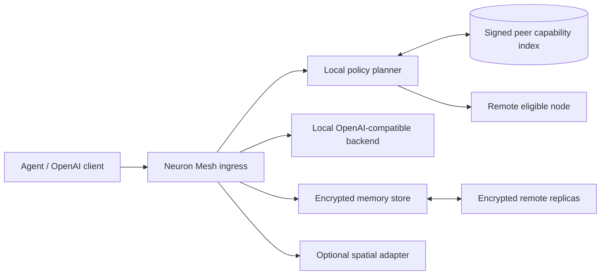

# Neuron Mesh

Neuron Mesh 是一个面向**研究型、邀请制网络**的去中心化大模型协同推理与持久记忆参考实现。

当前版本是 `v0.1.0` 研究型 MVP，目标是提供一套可以实际启动、测试和继续扩展的工程骨架，而不是宣称已经完成公网级大模型训练网络。

## 已实现

- OpenAI 兼容的 `/v1/models` 与 `/v1/chat/completions` 子集；
- 支持本地 Echo 后端，也可转发到 llama.cpp、vLLM 等 OpenAI 兼容后端；
- Ed25519 节点身份和签名能力记录；
- 节点资源承诺、设备画像及强/弱神经元分级；
- 基于共享邀请令牌的 HTTP 节点发现、签名节点公告和入口侧远端选择；
- `networked` 在线模式和 `offline-autonomous` 离线降级模式；
- SQLite WAL 持久化；
- AES-GCM 加密记忆和 HMAC 盲索引；
- 热/温/冷记忆分层、远端密文副本和按需恢复；
- 虚拟角色、动作白名单和空间会话模拟接口；
- 主动排空接口和签名关机回执；
- 双节点 Docker Compose、本地测试和 GitHub Actions CI。

## 尚未实现

这些能力在设计中，但不应被误解为当前代码已经完成：

- libp2p/QUIC 公网 P2P 传输与 DHT；
- 真实的 Transformer 阶段切分与跨节点激活传输；
- 真实 GPU 集群张量并行；
- 联邦 LoRA 训练、模型聚合和遗忘算法；
- 角色主节点自动迁移及跨加密域的密钥托管；
- WebXR/OpenXR 原生客户端；
- 商用身份、计费、滥用治理和容灾 SLA。

当前节点发现使用邀请制 HTTP 网格，适合在受控研究环境中验证签名、路由和备份协议。不要把开发令牌或默认配置暴露到公共互联网。

## 架构



代码模块：

| 模块 | 职责 |
| --- | --- |
| `config.py` | 环境配置、设备类型和资源承诺 |
| `capabilities.py` | 硬件采样、强弱分类、签名能力记录 |
| `peers.py` | 邀请制节点公告、发现、验证和远端选择 |
| `memory.py` | 加密记忆、盲索引、分层和副本元数据 |
| `backup.py` | 跨故障域复制、冷召回和删除传播 |
| `roles.py` | 与物理主机分离的虚拟角色 |
| `spatial.py` | 元宇宙预留接口的模拟会话和权限检查 |
| `api.py` | HTTP API、OpenAI 兼容入口和后台维护任务 |

## 快速开始

需要 Python 3.11 或更高版本。

### Windows PowerShell

```powershell
python -m venv .venv
.\.venv\Scripts\python.exe -m pip install -e ".[dev]"
$env:NEURON_SHARED_TOKEN = "replace-with-a-long-random-token"
.\.venv\Scripts\neuron-mesh.exe serve --host 127.0.0.1 --port 8000
```

### Linux / macOS

```bash
python3 -m venv .venv
. .venv/bin/activate
pip install -e ".[dev]"
export NEURON_SHARED_TOKEN="replace-with-a-long-random-token"
neuron-mesh serve --host 127.0.0.1 --port 8000
```

API 文档：<http://127.0.0.1:8000/docs>

## 调用示例

```bash
curl http://127.0.0.1:8000/v1/models \
  -H "Authorization: Bearer $NEURON_SHARED_TOKEN"
```

```bash
curl http://127.0.0.1:8000/v1/chat/completions \
  -H "Authorization: Bearer $NEURON_SHARED_TOKEN" \
  -H "Content-Type: application/json" \
  -d '{
    "model": "neuron-echo-1",
    "messages": [{"role": "user", "content": "Hello"}]
  }'
```

请求显式使用网络中的其他符合条件节点：

```bash
curl http://127.0.0.1:8000/v1/chat/completions \
  -H "Authorization: Bearer $NEURON_SHARED_TOKEN" \
  -H "X-Neuron-Route: network" \
  -H "Content-Type: application/json" \
  -d '{
    "model": "neuron-echo-1",
    "messages": [{"role": "user", "content": "Run remotely"}]
  }'
```

## 双节点演示

复制 `.env.example` 为 `.env`，修改邀请令牌，然后运行：

```bash
docker compose up --build
```

节点地址：

- `http://127.0.0.1:8001`：`domain-a`
- `http://127.0.0.1:8002`：`domain-b`

两节点会互相公告签名能力记录。向节点 B 写入一条需要立即备份的记忆后，可检查节点 A 的 `/v1/internal/backups/{memory_id}`。远端只能保存密文，密钥仍在来源节点。

## 使用真实推理后端

Neuron Mesh 不强制绑定推理引擎。将 `NEURON_LOCAL_BACKEND_URL` 指向一个提供 OpenAI `/v1/chat/completions` 的本地服务，例如 llama.cpp server 或 vLLM：

```bash
export NEURON_LOCAL_BACKEND_URL=http://127.0.0.1:8080
export NEURON_MODEL_ID=your-configured-model
neuron-mesh serve --port 8000
```

当前实现会把非流式聊天请求转发给该后端。生产部署还应：

- 在反向代理中启用 TLS；
- 将共享令牌替换为经过审计的客户端/节点凭证；
- 使用独立 GPU worker 或沙箱；
- 为模型哈希、许可证和推理镜像建立签名清单；
- 不要直接暴露 llama.cpp RPC 端口。

## 关键环境变量

| 变量 | 默认值 | 说明 |
| --- | --- | --- |
| `NEURON_NODE_NAME` | 主机名 | 节点显示名 |
| `NEURON_DATA_DIR` | `./data/<node>` | 数据库、身份和密钥目录 |
| `NEURON_PUBLIC_URL` | 本地地址 | 其他节点可访问的本节点 URL |
| `NEURON_BOOTSTRAP_PEERS` | 空 | 逗号分隔的引导节点 URL |
| `NEURON_SHARED_TOKEN` | 开发值 | 邀请网共享访问令牌，必须修改 |
| `NEURON_MODEL_ID` | `neuron-echo-1` | 对外模型 ID |
| `NEURON_LOCAL_BACKEND_URL` | 空 | OpenAI 兼容本地后端 |
| `NEURON_FAILURE_DOMAIN` | `local` | 副本故障域 |
| `NEURON_OFFLINE` | `false` | 强制离线自治 |
| `NEURON_PREFER_REMOTE` | `false` | `auto` 路由是否优先远端 |
| `NEURON_STORAGE_PLEDGE_BYTES` | 5 GiB | 最低存储承诺 |
| `NEURON_STORAGE_MAX_BYTES` | 20 GiB | 最大存储使用 |
| `NEURON_CPU_LIMIT_PERCENT` | 25 | 设计用 CPU 上限 |
| `NEURON_BACKUP_INTERVAL_SECONDS` | 60 | 记忆备份周期 |

完整示例见 [.env.example](.env.example)。

## 测试

```bash
.\.venv\Scripts\python.exe -m pytest
.\.venv\Scripts\ruff.exe check .
.\.venv\Scripts\python.exe scripts\e2e_check.py
```

测试覆盖节点签名、能力记录、盲索引、加密记忆、远端节点验证、OpenAI 兼容入口、主动排空和空间动作权限。
`scripts/e2e_check.py` 会启动两个临时节点，验证节点发现、远端推理、密文备份和冷记忆恢复。

## 安全边界

- 默认令牌只用于本地开发；
- HTTP 网格不提供生产级传输加密，部署时必须置于 TLS 反向代理或受信私有网络；
- AES-GCM 密钥保存在来源节点本地目录，远程副本节点无法解密；
- 单个共享令牌不等于多租户授权；
- 模型输出和外部记忆必须视为不可信数据；
- 本仓库不包含真实模型权重。

## 设计与研究文档

- [研究型邀请制可执行方案](神经元式去中心化大模型网络系统-研究型邀请制可执行方案.md)
- [持续学习与持久记忆方案](神经元式去中心化大模型网络系统-持续学习与持久记忆方案.md)
- [元宇宙接入预留方案](神经元式去中心化大模型网络系统-元宇宙接入预留方案.md)
- [原始技术交底书](神经元式去中心化大模型网络系统-技术交底书.md)

## 下一阶段

1. 接入 libp2p QUIC、AutoNAT/DCUtR 和签名能力记录；
2. 实现 PGAS/管线阶段执行器与真实模型后端；
3. 增加 namespace key wrapping、角色迁移和密钥授权；
4. 实现可替换聚合器与联邦 Adapter 实验；
5. 建立两节点以上的网络、功耗、断网和恢复基准。

## License

Apache-2.0，详见 [LICENSE](LICENSE)。

