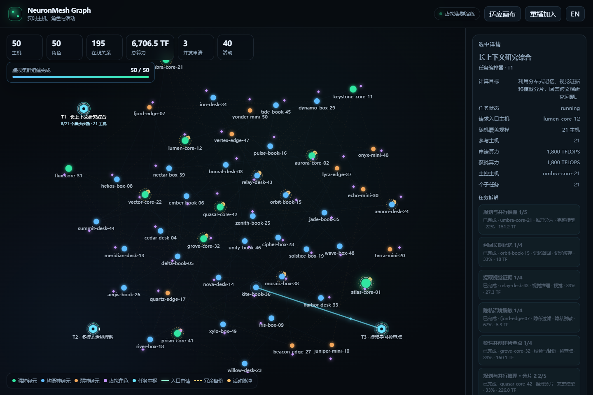
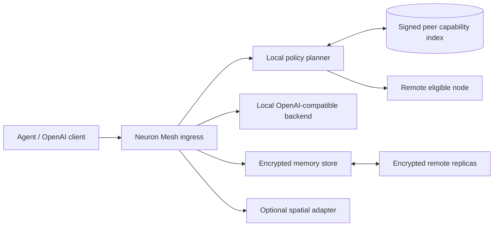

# NeuronMesh

[English](README.md) | [简体中文](README.zh-CN.md)

### Open-Source Decentralized LLM Network for Collaborative Inference, Persistent Memory & Continual Learning

**NeuronMesh（神经元式去中心化大模型网络）** 是一个面向异构主机的开源研究项目：让电脑、服务器、手机和边缘设备按实测能力组成分布式 AI 网络，在任意节点提供模型入口，用加密记忆跨越会话与主机，在断网时自动退回本地自治。

[](https://github.com/yanxee/neuron-mesh/actions/workflows/ci.yml)
[](https://www.python.org/)
[](LICENSE)
[]()

> `v0.2.0` 是可运行的研究型 MVP，不是已经完成的生产级公网训练网络。实际实现边界、测试结果与后续路线均明确列在本文中。

**项目网站：** <https://yanxee.github.io/neuron-mesh/zh-CN/>

**英文网站：** <https://yanxee.github.io/neuron-mesh/>

**Search terms / 搜索关键词：** decentralized AI · distributed inference · large language models · LLM network · peer-to-peer AI · federated learning · continual learning · persistent memory · long-term memory · heterogeneous computing · edge AI · multi-modal AI · OpenAI-compatible API · 去中心化大模型 · 分布式推理 · 联邦学习 · 长期记忆 · 异构算力



## 参与建设可度量的网络

NeuronMesh 正在寻找研究者、工程师、节点运维者、翻译贡献者和协议评审者，共同把去中心化 AI 从愿景变成可度量系统。做出有价值的首次贡献，**不需要 GPU，也不需要完整部署模型**。

| 时间 | 有价值的起点 | 入口 |
| --- | --- | --- |
| 10 分钟 | 复现确定性双节点演示，并报告你的系统和硬件 | [十分钟演示](docs/DEMO.zh-CN.md) |
| 30–90 分钟 | 选择一个有边界的 Bug、测试、翻译或文档任务 | [Good First Issues](https://github.com/yanxee/neuron-mesh/issues?q=is%3Aissue+is%3Aopen+label%3A%22good+first+issue%22) |
| 一个下午 | 基准测试路由、记忆分层或异构硬件 | [研究任务板](docs/CONTRIBUTOR_TASKS.zh-CN.md#研究贡献) |
| 持续合作 | 评审协议边界或负责一个子系统门槛 | [贡献者入口](https://yanxee.github.io/neuron-mesh/join.zh-CN.html) |

提交 Pull Request 前请阅读[贡献指南](CONTRIBUTING.zh-CN.md)。开放问题和早期想法放在 [GitHub Discussions](https://github.com/yanxee/neuron-mesh/discussions)，可执行变更放在 Issue 中。

所有公开项目文档都提供中英文版本，成对文件使用 `name.md` 和 `name.zh-CN.md`。

高价值领域：分布式系统、LLM Serving、记忆巩固、持续/联邦学习、隐私、安全、混沌测试和 WebXR。

## 为什么是 NeuronMesh？

NeuronMesh 关注的不是再包装一个聊天 API，而是探索大模型基础设施中四个相互关联的问题：计算、记忆、生命周期与互操作。

| 常见方案 | NeuronMesh 的研究方向 |
| --- | --- |
| 固定云端入口与集中调度 | 任意授权节点可作为入口，由入口按需规划符合权限和时延约束的资源 |
| GPU 型号和理论 FLOPS 决定调度 | 以持续吞吐、内存、热降频、网络、供能和信任画像动态推导强/弱神经元 |
| 会话结束即遗忘 | 用户/组织/角色拥有独立记忆命名空间，热/温/冷分层并跨故障域复制 |
| 主机故障导致角色消失 | 虚拟角色与物理主机解耦，支持加密导出、目标节点重加密和恢复 |
| 断网即不可用 | 在线访问资源池，离线自动切换本地小模型和本地记忆缓存 |
| 明文备份和全权托管 | 来源节点使用 AES-GCM 加密，承载节点只保存不可解密副本 |
| “永不停机”式运维 | `DRAINING`、副本确认、WAL checkpoint、签名关机回执和 readiness 检查 |
| 模型网络与空间平台强耦合 | 预留版本化 WebXR/OpenXR 空间适配层，不重写推理和记忆核心 |

## 已实现

- OpenAI 兼容的 `/v1/models` 与 `/v1/chat/completions` 子集；
- 支持本地 Echo 后端，也可转发到 llama.cpp、vLLM 等 OpenAI 兼容后端；
- Ed25519 节点身份和签名能力记录；
- 节点资源承诺、设备画像及强/弱神经元分级；
- 存储承诺准入门槛和远端副本容量拒绝；
- 基于共享邀请令牌的 HTTP 节点发现、签名节点公告和入口侧远端选择；
- `networked` 在线模式和 `offline-autonomous` 离线降级模式；
- SQLite WAL 持久化；
- AES-GCM 加密记忆和 HMAC 盲索引；
- 热/温/冷记忆分层、远端密文副本和按需恢复；
- 虚拟角色、动作白名单和空间会话模拟接口；
- 虚拟角色导出、导入和传输密钥保护的跨节点记忆重加密；
- 主动排空、WAL checkpoint 和区分本地/远端持久性的签名关机回执；
- `status`/`drain` 运维命令和 `/readyz` 就绪探测；
- 双节点 Docker Compose、本地测试和 GitHub Actions CI。
- 类似 Obsidian 的主机、虚拟角色与跨节点活动实时关系图；
- 确定性的 50 台虚拟主机加入动画，可查看硬件、算力、能力、Agent 角色和
  跨故障域冗余备份；
- 根据计算目标动态拆解任务，随机覆盖 1 至 40 台异构主机，并逐台异步分配算力；
- 最多 3 个入口主机同时申请资源，显示比例算力份额、共享租约和自动再平衡；
- 节点发现、远端算力和加密存储支持时，关系线会发光闪烁。

## 尚未实现

这些能力在设计中，但不应被误解为当前代码已经完成：

- libp2p/QUIC 公网 P2P 传输与 DHT；
- 真实的 Transformer 阶段切分与跨节点激活传输；
- 真实 GPU 集群张量并行；
- 联邦 LoRA 训练、模型聚合和遗忘算法；
- 角色迁移的自动两阶段切换、离线秘钥托管和无人值守恢复；
- WebXR/OpenXR 原生客户端；
- 商用身份、计费、滥用治理和容灾 SLA。

当前节点发现使用邀请制 HTTP 网格，适合在受控研究环境中验证签名、路由和备份协议。不要把开发令牌或默认配置暴露到公共互联网。

## 当前参考切片与目标架构

> `v0.2.0` 实现的是一个可运行参考切片，不是完整系统。完整的目标架构、状态所有权、故障语义、接口契约与实施门槛见[系统架构](ARCHITECTURE.zh-CN.md)。

目标是形成联邦式分层系统，而不是让所有设备共享一个全局调度器：

| 平面 | 目标职责 | 当前状态 |
| --- | --- | --- |
| 成员与信任 | 邀请域、节点证书、租户授权、撤销与轮换 | 仅有 Ed25519 节点身份和共享令牌 |
| 发现与规划 | 分层目录、兼容性约束、短期容量租约、入口侧执行计划 | 有 HTTP 节点公告与简单的 RTT 偏好选择 |
| 执行数据面 | 本地小模型、远端完整模型、可信组和 2–3 阶段管线 | 仅实现 OpenAI 兼容的完整模型转发 |
| 持久状态 | 用户命名空间、不可变记忆版本、副本清单、角色 epoch | 有 SQLite、加密记忆和基础远端副本 |
| 学习 | 证据门控、本地 Adapter、聚合、回归、金丝雀与回滚 | 仅有研究设计，尚未实现训练 |
| 观测与审计 | 请求轨迹、签名步骤回执、资源核算和删除证据 | 有健康检查、排空回执和基础状态 |
| 空间适配 | WebXR/OpenXR/引擎的事件与动作适配边界 | 仅有进程内模拟接口 |

以下图仅描述当前参考切片：



关键架构文档：

- [系统架构基线](ARCHITECTURE.zh-CN.md)
- [状态与故障模型](docs/architecture/STATE_AND_FAILURE.zh-CN.md)
- [接口契约](docs/architecture/INTERFACE_CONTRACTS.zh-CN.md)
- [威胁模型](docs/architecture/THREAT_MODEL.zh-CN.md)
- [质量场景](docs/architecture/QUALITY_SCENARIOS.zh-CN.md)
- [架构决策日志](docs/architecture/DECISIONS.zh-CN.md)

代码模块：

| 模块 | 职责 |
| --- | --- |
| `config.py` | 环境配置、设备类型和资源承诺 |
| `capabilities.py` | 硬件采样、强弱分类、签名能力记录 |
| `peers.py` | 邀请制节点公告、发现、验证和远端选择 |
| `memory.py` | 加密记忆、盲索引、分层和副本元数据 |
| `backup.py` | 跨故障域复制、冷召回和删除传播 |
| `roles.py` | 与物理主机分离的虚拟角色 |
| `spatial.py` | 元宇宙预留接口的模拟会话和权限检查 |
| `api.py` | HTTP API、OpenAI 兼容入口和后台维护任务 |

## 快速开始

需要 Python 3.11 或更高版本。

### Windows PowerShell

```powershell
python -m venv .venv
.\.venv\Scripts\python.exe -m pip install -e ".[dev]"
$env:NEURON_SHARED_TOKEN = "replace-with-a-long-random-token"
.\.venv\Scripts\neuron-mesh.exe serve --host 127.0.0.1 --port 8000
```

### Linux / macOS

```bash
python3 -m venv .venv
. .venv/bin/activate
pip install -e ".[dev]"
export NEURON_SHARED_TOKEN="replace-with-a-long-random-token"
neuron-mesh serve --host 127.0.0.1 --port 8000
```

API 文档：<http://127.0.0.1:8000/docs>

实时关系图：<http://127.0.0.1:8000/graph>

关系图会要求输入配置的 Bearer Token，并仅在当前标签页内存中保存。可运行
`python scripts/graph_demo.py --open` 启动带主机、角色和活动的双节点演示。
打开 <http://127.0.0.1:8000/graph?demo=fleet50> 可观看由浏览器生成的
50 台虚拟主机加入、算力分配、Agent 角色和跨故障域冗余备份演练。该页面不会
伪造真实在线节点或资源承诺。
演示会在五类计算目标之间轮换，并为每次任务随机覆盖 1 至 40 台主机。任务
每次只与当前阶段的一台主机通信，完成该调用窗口后再异步联系下一台主机。
最多 3 个入口主机会同时发起资源申请；共享主机会显示它在各任务中的算力占比，
过期请求会被替换并重新平衡资源。

## 运行与维护

```powershell
# 查看当前在线节点和本机降级状态
.\.venv\Scripts\neuron-mesh.exe status --url http://127.0.0.1:8000

# 主动排空；拿到签名回执后再停止进程
.\.venv\Scripts\neuron-mesh.exe drain --url http://127.0.0.1:8000
```

`/healthz` 只表示 HTTP 进程存活；`/readyz` 还会检查最低存储承诺、资源准入和是否正在排空。Uvicorn 正常收到终止信号时，会先尝试排空和 WAL checkpoint；强制终止无法保证同样的恢复语义。

## 调用示例

```bash
curl http://127.0.0.1:8000/v1/models \
  -H "Authorization: Bearer $NEURON_SHARED_TOKEN"
```

```bash
curl http://127.0.0.1:8000/v1/chat/completions \
  -H "Authorization: Bearer $NEURON_SHARED_TOKEN" \
  -H "Content-Type: application/json" \
  -d '{
    "model": "neuron-echo-1",
    "messages": [{"role": "user", "content": "Hello"}]
  }'
```

请求显式使用网络中的其他符合条件节点：

```bash
curl http://127.0.0.1:8000/v1/chat/completions \
  -H "Authorization: Bearer $NEURON_SHARED_TOKEN" \
  -H "X-Neuron-Route: network" \
  -H "Content-Type: application/json" \
  -d '{
    "model": "neuron-echo-1",
    "messages": [{"role": "user", "content": "Run remotely"}]
  }'
```

角色迁移是显式操作：源节点导出加密迁移包，目标节点使用同一个一次性传输密钥导入。传输密钥不会写入数据库。完整 OpenAPI 定义见 `/docs`。

## 双节点演示

复制 `.env.example` 为 `.env`，修改邀请令牌，然后运行：

```bash
docker compose up --build
```

节点地址：

- `http://127.0.0.1:8001`：`domain-a`
- `http://127.0.0.1:8002`：`domain-b`

两节点会互相公告签名能力记录。向节点 B 写入一条需要立即备份的记忆后，可检查节点 A 的 `/v1/internal/backups/{memory_id}`。远端只能保存密文，密钥仍在来源节点。

Linux 常驻部署可使用 [systemd 服务样例](deploy/systemd/neuron-mesh.service)，它启用了 `Restart=always`、独立状态目录、受限系统访问和 30 秒正常退出窗口。Docker Compose 使用 `restart: unless-stopped`。

```bash
sudo useradd --system --home /opt/neuron-mesh neuron
sudo install -d -o neuron -g neuron /var/lib/neuron-mesh
sudo install -m 0644 deploy/systemd/neuron-mesh.service /etc/systemd/system/
sudo install -m 0600 deploy/systemd/neuron-mesh.env.example /etc/neuron-mesh.env
sudo systemctl daemon-reload
sudo systemctl enable --now neuron-mesh
```

部署前必须修改环境文件中的公共地址、邀请令牌和故障域。

## 使用真实推理后端

Neuron Mesh 不强制绑定推理引擎。将 `NEURON_LOCAL_BACKEND_URL` 指向一个提供 OpenAI `/v1/chat/completions` 的本地服务，例如 llama.cpp server 或 vLLM：

```bash
export NEURON_LOCAL_BACKEND_URL=http://127.0.0.1:8080
export NEURON_MODEL_ID=your-configured-model
neuron-mesh serve --port 8000
```

当前实现会把非流式聊天请求转发给该后端。生产部署还应：

- 在反向代理中启用 TLS；
- 将共享令牌替换为经过审计的客户端/节点凭证；
- 使用独立 GPU worker 或沙箱；
- 为模型哈希、许可证和推理镜像建立签名清单；
- 不要直接暴露 llama.cpp RPC 端口。

## 关键环境变量

| 变量 | 默认值 | 说明 |
| --- | --- | --- |
| `NEURON_NODE_NAME` | 主机名 | 节点显示名 |
| `NEURON_DATA_DIR` | `./data/<node>` | 数据库、身份和密钥目录 |
| `NEURON_PUBLIC_URL` | 本地地址 | 其他节点可访问的本节点 URL |
| `NEURON_BOOTSTRAP_PEERS` | 空 | 逗号分隔的引导节点 URL |
| `NEURON_SHARED_TOKEN` | 开发值 | 邀请网共享访问令牌，必须修改 |
| `NEURON_MODEL_ID` | `neuron-echo-1` | 对外模型 ID |
| `NEURON_LOCAL_BACKEND_URL` | 空 | OpenAI 兼容本地后端 |
| `NEURON_FAILURE_DOMAIN` | `local` | 副本故障域 |
| `NEURON_OFFLINE` | `false` | 强制离线自治 |
| `NEURON_PREFER_REMOTE` | `false` | `auto` 路由是否优先远端 |
| `NEURON_STORAGE_PLEDGE_BYTES` | 5 GiB | 最低存储承诺 |
| `NEURON_STORAGE_MAX_BYTES` | 20 GiB | 最大存储使用 |
| `NEURON_CPU_LIMIT_PERCENT` | 25 | 设计用 CPU 上限 |
| `NEURON_BACKUP_INTERVAL_SECONDS` | 60 | 记忆备份周期 |

完整示例见 [.env.example](.env.example)。

## 测试

```bash
.\.venv\Scripts\python.exe -m pytest
.\.venv\Scripts\ruff.exe check .
.\.venv\Scripts\python.exe scripts\e2e_check.py
```

测试覆盖节点签名、能力记录、盲索引、加密记忆、远端节点验证、OpenAI 兼容入口、主动排空和空间动作权限。
`scripts/e2e_check.py` 会启动两个临时节点，验证节点发现、远端推理、密文备份和冷记忆恢复。

## 安全边界

- 默认令牌只用于本地开发；
- HTTP 网格不提供生产级传输加密，部署时必须置于 TLS 反向代理或受信私有网络；
- AES-GCM 密钥保存在来源节点本地目录，远程副本节点无法解密；
- 单个共享令牌不等于多租户授权；
- 模型输出和外部记忆必须视为不可信数据；
- 角色迁移的传输密钥必须通过独立安全通道传递，不可与迁移包一起公开传输；
- 本仓库不包含真实模型权重。

## 设计与研究文档

- [参与指南：从 10 分钟验证到研究合作](docs/JOIN.zh-CN.md)
- [贡献流程](CONTRIBUTING.zh-CN.md)
- [文档语言规则](docs/I18N.zh-CN.md)
- [研究资料库](docs/research/README.zh-CN.md)
- [完整系统架构基线](ARCHITECTURE.zh-CN.md)
- [英文研究型邀请制方案](docs/research/invite-only-executable-plan.en.md)
- [英文持续学习与持久记忆方案](docs/research/continual-learning-persistent-memory.en.md)
- [英文元宇宙接入方案](docs/research/metaverse-integration.en.md)
- [英文技术交底书](docs/research/technical-disclosure.en.md)
- [研究型邀请制可执行方案](神经元式去中心化大模型网络系统-研究型邀请制可执行方案.md)
- [持续学习与持久记忆方案](神经元式去中心化大模型网络系统-持续学习与持久记忆方案.md)
- [元宇宙接入预留方案](神经元式去中心化大模型网络系统-元宇宙接入预留方案.md)
- [原始技术交底书](神经元式去中心化大模型网络系统-技术交底书.md)

## 下一架构门槛

下一版本聚焦 Gate A：版本化 Schema、关键字段兼容、节点/租户身份、出站节点策略、幂等键、签名回执和状态机测试。详见[路线图](ROADMAP.zh-CN.md)。

## 许可证

MIT，详见 [LICENSE](LICENSE) 和[中文参考译文](LICENSE.zh-CN.md)。

