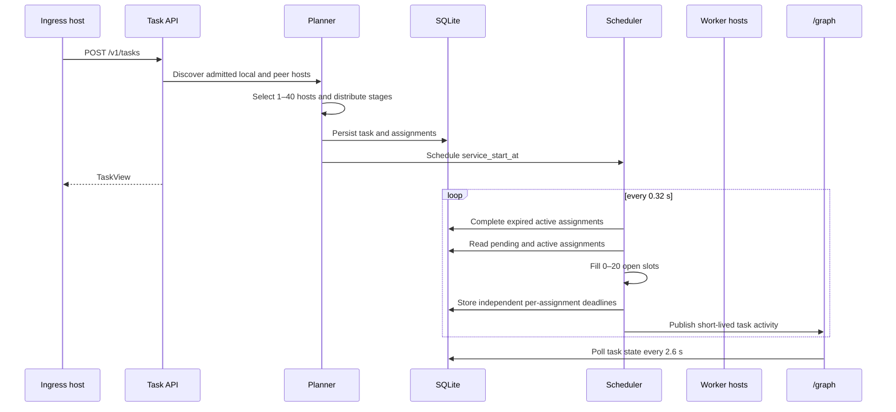
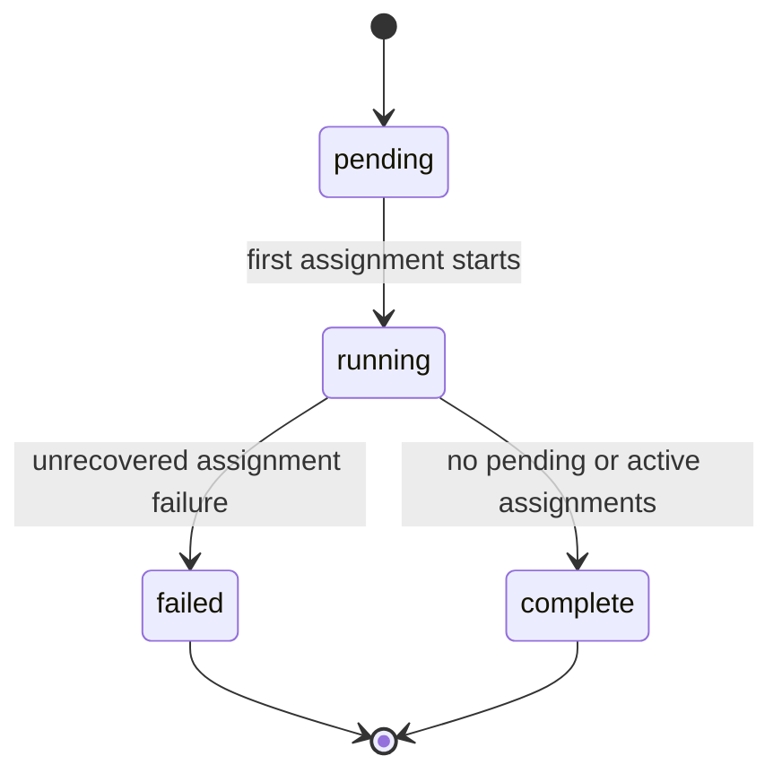
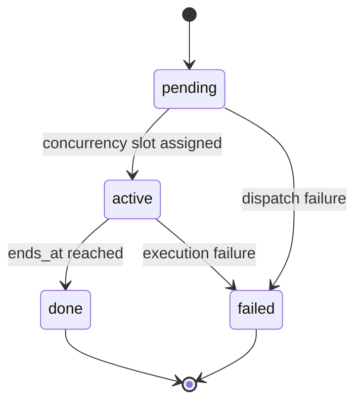

# Coordination Task Scheduling

[English](TASK_ORCHESTRATION.md) | [简体中文](TASK_ORCHESTRATION.zh-CN.md)

**Status:** implemented coordination-only scheduler  
**Implementation:** `neuron_mesh/tasks.py`, `neuron_mesh/activity.py`, `neuron_mesh/api.py`  
**Interactive visualization:** `/graph` and `/graph?demo=fleet256`

## 1. What problem this layer solves

An inference request should not be modeled as one immutable connection between exactly two nodes. A useful task can require several capabilities:

- planning and model reasoning;
- long-term memory retrieval;
- visual or sensor processing;
- privacy redaction;
- inference, verification and durable checkpoints.

The task scheduler therefore treats a request as a **plan made of stages**. A plan may cover 1–40 distinct hosts. At runtime, each task keeps at most 1–20 worker calls active. Those calls need not start or finish together.

This is intentionally different from two extremes:

1. It is not limited to one fixed pair of hosts.
2. It does not connect every planned host simultaneously.

The scheduler opens concurrency slots, contacts a bounded set of workers, closes each slot when that worker's service window ends, and admits another pending worker.

## 2. Two execution surfaces

| Surface | Purpose | Host data | Persistence |
| --- | --- | --- | --- |
| Browser fleet rehearsal, `?demo=fleet256` | Demonstrate 256 hosts, random 1–40 task coverage and 1–20 concurrent calls | Deterministic synthetic data in the browser | Never written to the node database |
| Backend coordination API, `/v1/tasks` | Plan against admitted local and discovered peer nodes | Actual capability records | SQLite `tasks` and `task_assignments` |

The visualization and backend share terminology, but synthetic rehearsal hosts are not claimed to be real machines.

The backend currently runs in `execution_mode: "coordination"`. It schedules and records resource windows. It does not yet execute model stages on GPU workers. Real stage activation transport remains a later architecture gate.

## 3. Concepts and ownership

| Concept | Meaning | Owner |
| --- | --- | --- |
| Requester/ingress | Host or Agent that submits the objective | Requesting node |
| Task | Immutable objective plus scheduling policy | Requesting node |
| Stage | Capability-specific unit such as retrieval, inference or verification | Task planner |
| Assignment | One worker host and one stage occurrence | Task scheduler |
| Service window | Time during which one assignment is actively using a concurrency slot | Task scheduler |
| Participant | Distinct host referenced by at least one assignment | Task planner |
| Concurrency width | Maximum active assignments for one task; 1–20 | Task policy |
| Coverage | Required distinct participating hosts; 1–40 | Task request |
| Share | Fraction of a host's estimated capacity available to one concurrent task | Rebalancer |

The task does not own the worker's private state. It owns a durable coordination record and the expected completion window.

## 4. End-to-end flow



## 5. Planning algorithm

### 5.1 Build the candidate host set

The coordinator collects:

- the local node if capability admission succeeds;
- live peers whose capability records are admitted;
- peers not in `draining` or `hibernated`.

Each candidate is normalized to:

```text
node_id, name, endpoint, capabilities, estimated_tflops,
failure_domain, rtt_ms, is_local
```

The estimate is a scheduling heuristic, not a benchmark score:

```text
cpu_score = cpu_count × cpu_limit_fraction × 1.4
ram_score = available_ram_gib × 0.35
gpu_score = 45 + min(120, gpu_memory_gib × 2.5)
estimated_tflops = clamp(cpu_score + ram_score + gpu_score, 1, 1000)
```

### 5.2 Select participating hosts

The planner sorts hosts by capacity and latency, then prefers hosts from unused failure domains. It selects:

```text
participant_count = min(requested_target_hosts, admitted_host_count)
```

`requested_target_hosts` is constrained to 1–40. The returned `participant_count` is the actual number selected.

### 5.3 Decompose stages into assignments

The request supplies one or more stages:

```json
{
  "name": "Retrieve context",
  "capability": "cache",
  "weight": 1.0
}
```

The assignment count is:

```text
assignment_count = max(participant_count, stage_count)
```

For assignment sequence `i`:

```text
stage = stages[i mod stage_count]
candidates = selected_hosts_supporting(stage.capability)
           or selected_hosts
host = candidates[i mod candidate_count]
```

Consequences:

- If one host covers four stages, all four stages are assigned to that host and run as separate windows.
- If forty hosts cover four stages, the stages are sharded across the selected host pool.
- Capability matching is preferred. If no selected host declares the requested capability, the planner falls back within the selected pool and records the capability requirement rather than inventing a capability.

## 6. Resource-share rebalancing

A host may serve several tasks. For every host and each active or pending task using it:

```text
host_task_count = number of concurrent tasks using the host
base_share = 100 / host_task_count
raw_allocation = estimated_host_tflops × base_share / 100
```

The task's allocations are then capped at its requested budget:

```text
scale = min(1, requested_tflops / sum(raw_allocations))
final_share = base_share × scale
allocated_tflops = estimated_host_tflops × final_share / 100
```

The database updates all affected assignments and recomputes every task's `granted_tflops`.

## 7. Asynchronous service windows

When a task's `service_start_at` is reached, the scheduler:

1. marks calls whose `ends_at <= now` as `done`;
2. counts remaining `active` calls;
3. computes free slots as `max_parallel - active_count`;
4. starts up to that many pending assignments;
5. assigns every started call its own duration and deadline;
6. refills each slot only after its previous call completes.

Service duration is derived from allocated capacity, stage weight and deterministic jitter:

```text
jitter = 0.78 + first_sha256_byte(task_id, sequence, host_id) / 255 × 0.66
raw = (0.65 + 5.4 / sqrt(allocated_tflops + 1)) × stage_weight × jitter
service_seconds = clamp(raw, 0.65, 8.0)
```

Therefore:

- stronger or better-funded hosts finish sooner;
- weak hosts and lightly funded hosts can remain active longer;
- equal-stage calls do not end at one common batch timestamp;
- a completed fast call immediately creates a slot for a pending host.

## 8. State machines

### 8.1 Task state



### 8.2 Assignment state



The current reference scheduler advances successful coordination windows. It does not yet retry a failed model-stage execution because no model-stage executor is connected.

## 9. Persistence model

### `tasks`

Stores objective, requester, requested coverage, concurrency width, requested/granted TFLOPS, lifecycle timestamps and execution mode.

### `task_assignments`

Stores:

```text
assignment_id, task_id, sequence, stage_name, stage_weight, capability,
host_id, host_name, host_endpoint, host_capacity_tflops,
status, share_percent, allocated_tflops,
service_seconds, started_at, ends_at, completed_at
```

Foreign keys cascade task deletion into assignments. Indexes cover task status, assignment order and active deadlines.

## 10. API

Create a task:

```bash
curl http://127.0.0.1:8000/v1/tasks \
  -H "Authorization: Bearer $NEURON_SHARED_TOKEN" \
  -H "Content-Type: application/json" \
  -d '{
    "objective": "Answer a verified research question",
    "target_hosts": 20,
    "max_parallel": 8,
    "requested_tflops": 1200,
    "stages": [
      {"name": "Plan", "capability": "full-model"},
      {"name": "Retrieve", "capability": "cache"},
      {"name": "Infer", "capability": "inference"},
      {"name": "Verify", "capability": "checkpoint"}
    ]
  }'
```

Inspect:

```text
GET /v1/tasks
GET /v1/tasks/{task_id}
```

All endpoints require the configured Bearer token. Task records do not contain memory plaintext or model weights.

## 11. Relationship-graph projection

The authenticated `/v1/observability/graph` endpoint maps backend state to:

- host nodes from local and peer capability records;
- virtual role nodes;
- task nodes from persisted tasks;
- host/role edges;
- no permanent task-to-worker spokes.

Worker communication appears only while a call is active:

- green pulse: ingress request to task hub;
- cyan pulse: task hub to the current worker;
- several cyan pulses may coexist when the task has an open concurrency batch;
- pulse lifetime equals that worker's calculated service window or the request window.

This makes the visual statement precise: a reservation can exist before, during or after communication, but a line does not mean a permanent connection.

## 12. Limits and invariants

### Enforced

- `1 <= target_hosts <= 40`;
- `1 <= max_parallel <= 20`;
- 1–32 capability-tagged stages;
- admitted, non-draining hosts only;
- persisted task and assignment state;
- per-host independent service deadlines;
- task `granted_tflops <= requested_tflops`;
- no fabricated backend tasks.

### Not implemented

- actual Transformer stage execution;
- activation and KV-cache transport;
- worker crash recovery and retry receipts;
- signed capacity leases and fencing;
- per-tenant quotas and billing;
- producer placement based on data locality;
- network reservation or admission under a global scheduler.

## 13. Verification

Current tests verify:

- authenticated task creation and lookup;
- a one-host task with four sequential assignment windows;
- a two-host task selecting both hosts;
- independent service durations across windows;
- graph projection of persisted task nodes;
- existing two-node graph and memory tests.

Run:

```powershell
.\.venv\Scripts\python.exe -m pytest
.\.venv\Scripts\python.exe -m ruff check .
.\.venv\Scripts\python.exe scripts\graph_demo.py
```

## 14. Next execution layer

The scheduler is designed so a real executor can replace the simulated completion transition:

1. acquire a signed worker lease;
2. dispatch the stage request over authenticated transport;
3. stream progress and activation artifacts;
4. replace `ends_at` simulation with a worker receipt;
5. record failure, retry and settlement without duplicating work.

That work belongs to the roadmap's trusted-cell and distributed-inference gates. It should not be inferred from the current coordination demo.
