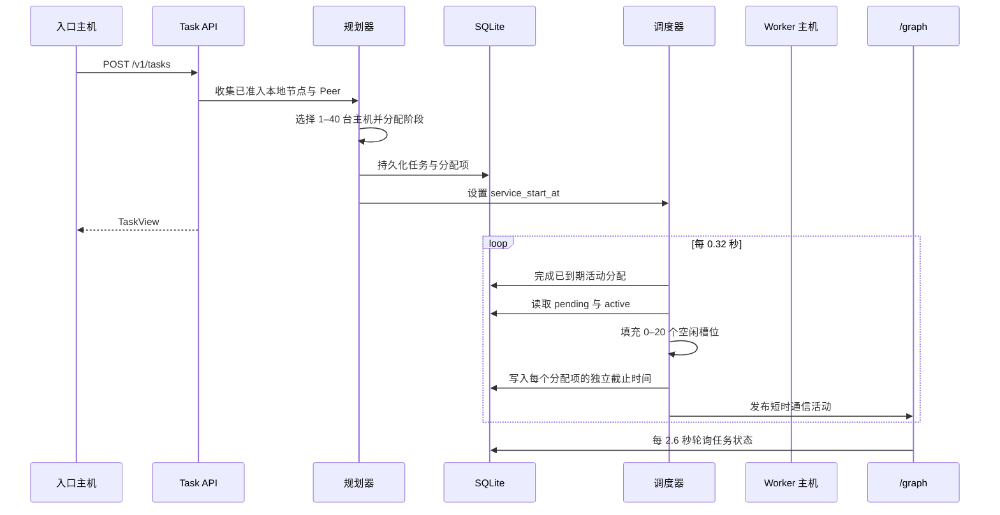
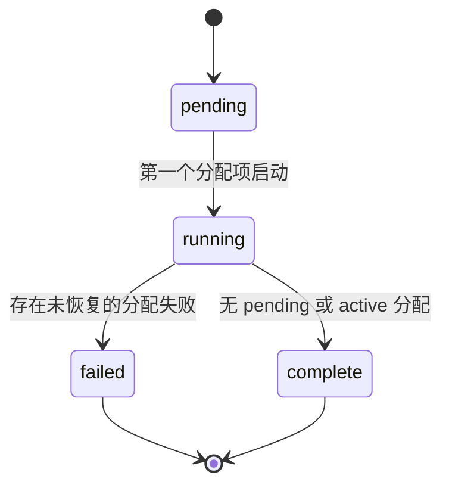
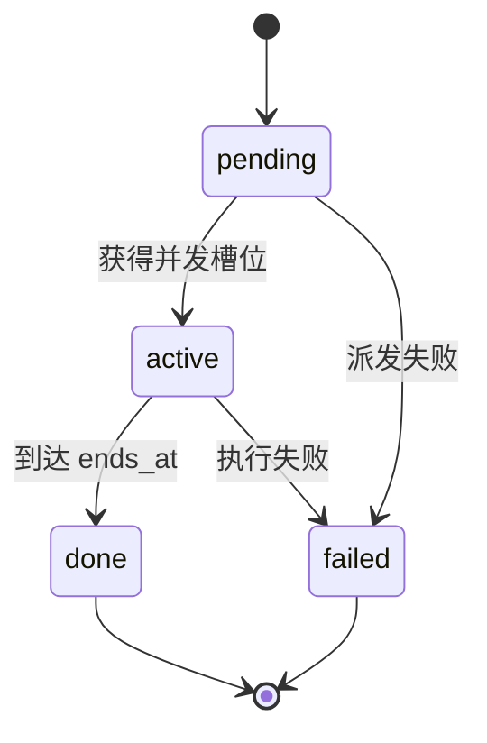

# 任务协调调度实现原理

[English](TASK_ORCHESTRATION.md) | [简体中文](TASK_ORCHESTRATION.zh-CN.md)

**状态：** 已实现协调型调度器  
**实现位置：** `neuron_mesh/tasks.py`、`neuron_mesh/activity.py`、`neuron_mesh/api.py`  
**交互演示：** `/graph` 与 `/graph?demo=fleet256`

## 1. 这一层解决的问题

推理请求不应被固定建模为两个节点之间的一条永久连接。一个实际任务可能需要多种能力：

- 规划和大模型推理；
- 长期记忆召回；
- 视觉或传感器处理；
- 隐私脱敏；
- 推理、校验和持久检查点。

因此调度器把请求表示为一个由多个阶段组成的**任务计划**。计划可覆盖 1–40 台不同主机；运行时每个任务最多保持 1–20 个 Worker 调用处于活动状态。这些调用不要求同时开始或同时结束。

系统明确避免两个极端：

1. 不限制为固定的一对主机；
2. 不会让计划中的全部主机同时连接。

调度器维护并发槽位，只联系当前获得槽位的 Worker；该 Worker 的服务窗口结束后释放槽位，再由下一台待处理主机补位。

## 2. 两套执行界面

| 界面 | 用途 | 主机数据 | 持久化 |
| --- | --- | --- | --- |
| 浏览器集群演练 `?demo=fleet256` | 展示 256 台主机、任务随机覆盖 1–40 台和 1–20 并发调用 | 浏览器内确定性合成数据 | 不写入节点数据库 |
| 后端协调 API `/v1/tasks` | 对已准入本地节点与发现到的 Peer 进行真实规划 | 实际能力记录 | SQLite `tasks` 与 `task_assignments` |

可视化演示与后端共享术语，但合成主机不能被解释为真实机器。

后端当前使用 `execution_mode: "coordination"`。它负责调度和记录资源窗口，尚未在 GPU Worker 上真正执行模型阶段。真实阶段激活传输属于后续架构门槛。

## 3. 概念与所有权

| 概念 | 含义 | 所有者 |
| --- | --- | --- |
| 请求入口 | 提交目标的 Host 或 Agent | 请求节点 |
| 任务 | 不可变目标与调度策略 | 请求节点 |
| 阶段 | 召回、推理、校验等能力单元 | 任务规划器 |
| 分配项 | 某台 Worker 上的一次阶段执行记录 | 任务调度器 |
| 服务窗口 | 某个分配项占用并发槽位的活动时间 | 任务调度器 |
| 参与者 | 至少拥有一个分配项的不同主机 | 任务规划器 |
| 并发宽度 | 单个任务最多活动分配数，1–20 | 任务策略 |
| 覆盖规模 | 任务要求的不同参与主机数，1–40 | 任务请求 |
| 资源份额 | 某主机容量分配给一个并发任务的百分比 | 再平衡器 |

任务不拥有 Worker 的私有状态。它只拥有持久协调记录和预期完成窗口。

## 4. 端到端流程



## 5. 规划算法

### 5.1 建立候选主机集合

协调器收集：

- 能力准入成功的本地节点；
- 能力记录已准入且仍然活跃的 Peer；
- 不处于 `draining` 或 `hibernated` 的 Peer。

候选节点统一表示为：

```text
node_id、name、endpoint、capabilities、estimated_tflops、
failure_domain、rtt_ms、is_local
```

容量估值只是调度启发式，不是正式基准分数：

```text
cpu_score = CPU 核数 × CPU 贡献比例 × 1.4
ram_score = 可用内存 GiB × 0.35
gpu_score = 45 + min(120, GPU 显存 GiB × 2.5)
estimated_tflops = clamp(cpu_score + ram_score + gpu_score, 1, 1000)
```

### 5.2 选择参与主机

规划器首先按容量和延迟排序，再优先选择尚未使用过的故障域。参与数为：

```text
participant_count = min(requested_target_hosts, admitted_host_count)
```

`requested_target_hosts` 范围为 1–40；返回的 `participant_count` 是实际选择数量。

### 5.3 将阶段拆成分配项

请求提供一个或多个阶段：

```json
{
  "name": "召回上下文",
  "capability": "cache",
  "weight": 1.0
}
```

分配项数量为：

```text
assignment_count = max(participant_count, stage_count)
```

对于序号为 `i` 的分配项：

```text
stage = stages[i mod stage_count]
candidates = 支持 stage.capability 的已选主机
          或全部已选主机
host = candidates[i mod candidate_count]
```

由此得到：

- 1 台主机覆盖 4 个阶段时，4 个阶段都会分配给该主机，并作为独立服务窗口依次执行；
- 40 台主机覆盖 4 个阶段时，阶段会分片到整个主机池；
- 优先匹配能力；若没有候选主机声明所需能力，则只在已选池内回退，并保留能力要求，不伪造能力。

## 6. 资源份额再平衡

同一主机可以服务多个任务。对于每台主机和每个使用它的 pending/active 任务：

```text
host_task_count = 使用该主机的并发任务数
base_share = 100 / host_task_count
raw_allocation = estimated_host_tflops × base_share / 100
```

随后按任务申请预算封顶：

```text
scale = min(1, requested_tflops / sum(raw_allocations))
final_share = base_share × scale
allocated_tflops = estimated_host_tflops × final_share / 100
```

数据库会更新所有受影响的分配项，并重新计算任务 `granted_tflops`。

## 7. 异步服务窗口

到达任务 `service_start_at` 后，调度器执行：

1. 将 `ends_at <= now` 的调用标记为 `done`；
2. 统计剩余 `active` 调用；
3. 计算空闲槽位 `max_parallel - active_count`；
4. 启动同样数量的 pending 分配项；
5. 为每个调用独立计算时长和截止时间；
6. 只有某个槽位的前一调用完成后，才允许下一台主机补位。

服务时长由获批容量、阶段权重和确定性抖动共同决定：

```text
jitter = 0.78 + SHA-256(task_id, sequence, host_id) 首字节 / 255 × 0.66
raw = (0.65 + 5.4 / sqrt(allocated_tflops + 1)) × stage_weight × jitter
service_seconds = clamp(raw, 0.65, 8.0)
```

因此：

- 强主机或份额更高的主机完成更快；
- 弱主机和低份额主机保持活动更久；
- 同等阶段不会共享一个统一批次结束时间；
- 快速完成的主机会立即释放槽位给下一台待处理主机。

## 8. 状态机

### 8.1 任务状态



### 8.2 分配项状态



当前参考调度器推进成功的协调窗口，但尚未接入真实模型阶段执行器，因此失败重试还未实现。

## 9. 持久化模型

### `tasks`

保存目标、请求者、覆盖规模、并发宽度、申请/获批 TFLOPS、生命周期时间与执行模式。

### `task_assignments`

保存：

```text
assignment_id、task_id、sequence、stage_name、stage_weight、capability、
host_id、host_name、host_endpoint、host_capacity_tflops、
status、share_percent、allocated_tflops、
service_seconds、started_at、ends_at、completed_at
```

外键在删除任务时级联删除分配项；索引覆盖任务状态、分配顺序和活动截止时间。

## 10. API

创建任务：

```bash
curl http://127.0.0.1:8000/v1/tasks \
  -H "Authorization: Bearer $NEURON_SHARED_TOKEN" \
  -H "Content-Type: application/json" \
  -d '{
    "objective": "回答一个经过校验的研究问题",
    "target_hosts": 20,
    "max_parallel": 8,
    "requested_tflops": 1200,
    "stages": [
      {"name": "规划", "capability": "full-model"},
      {"name": "召回", "capability": "cache"},
      {"name": "推理", "capability": "inference"},
      {"name": "校验", "capability": "checkpoint"}
    ]
  }'
```

查询：

```text
GET /v1/tasks
GET /v1/tasks/{task_id}
```

所有接口都需要配置的 Bearer Token。任务记录不包含记忆明文或模型权重。

## 11. 关系图映射

需要认证的 `/v1/observability/graph` 会把后端状态映射为：

- 根据本地和 Peer 能力记录生成的主机节点；
- 虚拟角色节点；
- 来自持久任务的 Task 节点；
- 主机与角色关系；
- 不生成永久的“任务中枢到所有 Worker”关系线。

只有调用处于活动状态时才显示主机通信：

- 绿色脉冲：入口主机向任务中枢申请资源；
- 青色脉冲：任务中枢联系当前 Worker；
- 同一任务有并发槽位时，可以同时存在多条青色脉冲；
- 脉冲寿命等于该 Worker 的服务窗口或入口请求窗口。

因此关系图表达的是：资源预留可以早于或晚于通信存在，但不代表永久连接。

## 12. 不变量与限制

### 已执行

- `1 <= target_hosts <= 40`；
- `1 <= max_parallel <= 20`；
- 1–32 个带能力标签的阶段；
- 只使用已准入且未排空的主机；
- 任务和分配项持久化；
- 每台主机独立服务截止时间；
- 任务 `granted_tflops <= requested_tflops`；
- 后端不会自动伪造任务。

### 尚未实现

- 真实 Transformer 阶段执行；
- 激活值与 KV Cache 传输；
- Worker 崩溃恢复和重试回执；
- 签名容量租约和 fencing；
- 租户配额与计费；
- 基于数据本地性的生产者放置；
- 全局调度器下的网络预留或准入控制。

## 13. 验证

当前测试验证：

- 认证任务创建与查询；
- 单主机、四阶段顺序窗口；
- 双主机任务确实选择两台主机；
- 不同窗口拥有独立服务时长；
- 持久任务节点进入关系图；
- 现有双节点关系图和记忆测试。

运行：

```powershell
.\.venv\Scripts\python.exe -m pytest
.\.venv\Scripts\python.exe -m ruff check .
.\.venv\Scripts\python.exe scripts\graph_demo.py
```

## 14. 下一层执行器

调度器已经为真实执行器保留替换点：

1. 获取签名 Worker 租约；
2. 通过认证传输派发阶段请求；
3. 流式传输进度与激活产物；
4. 用 Worker 回执替代模拟到期；
5. 在不重复执行的前提下记录失败、重试和结算。

这部分属于路线图中的“可信单元执行”和“真实分布式推理”门槛，不能根据当前协调演示推断为已经完成。
