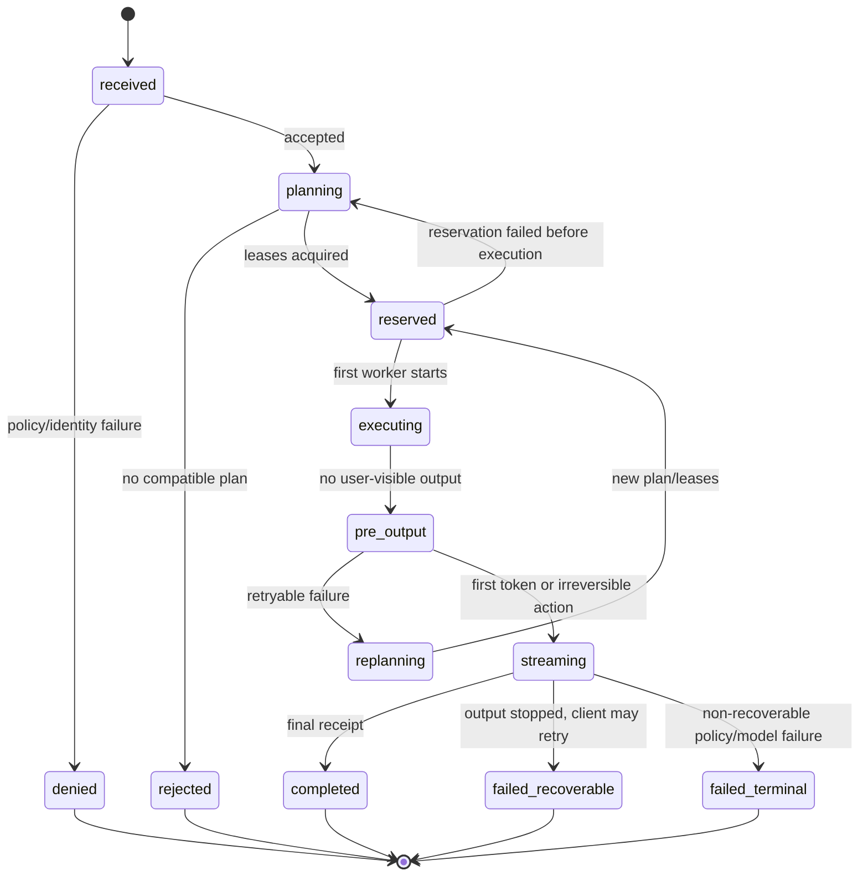
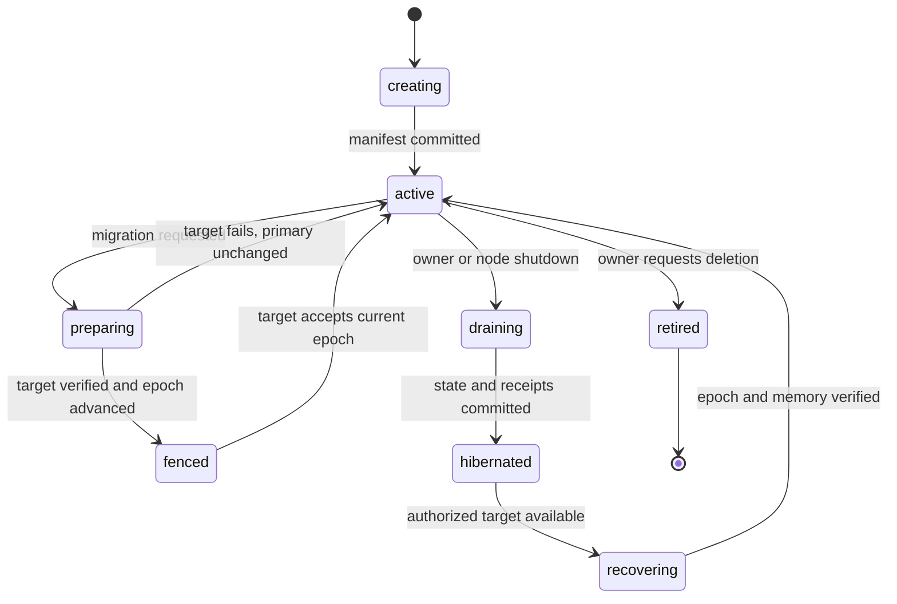

# State, Consistency and Failure Model

**Status:** Architecture contract `v0.1`  
**Applies to:** requests, capacity leases, memory, virtual roles, training rounds and signed receipts

This document turns high-level architecture claims into testable state transitions. A component is not complete until it implements the applicable transitions and passes their failure tests.

## 1. Terms

| Term | Definition |
| --- | --- |
| Authoritative state | The state that decides whether an action is accepted |
| Replica | A copy that can be promoted or read after verification |
| Lease | A time-bounded permission from a provider to use specific capacity |
| Fence | A monotonic token that prevents an old owner from committing after replacement |
| Commit | A durable state transition represented by an immutable record |
| Tombstone | A durable deletion marker that prevents stale copies from reappearing |
| Receipt | A signed statement about completed work or observed state |
| Failure domain | A set of components expected to fail together |
| Irreversible output | A user-visible token, action or side effect that cannot be silently replayed |
| RPO | Maximum acknowledged data loss after a named failure |
| RTO | Maximum time to restore service after a named failure |

## 2. Correctness invariants

These invariants override availability and latency optimizations.

1. **Identity invariant:** a worker cannot execute under a revoked or mismatched node identity.
2. **Lease invariant:** a worker cannot start a plan without a compatible, unexpired lease and fencing token.
3. **Compatibility invariant:** a pipeline cannot cross a stage boundary with an unknown or mismatched model/tokenizer/runtime digest.
4. **Commit invariant:** a result is committed at most once for a given idempotency key unless a new explicit plan is created.
5. **Streaming invariant:** no transparent replay occurs after the first emitted token.
6. **Durability invariant:** no storage acknowledgement promotes a memory to D2/D3 without a verified independent failure domain.
7. **Deletion invariant:** a stale replica cannot become visible after a committed tombstone.
8. **Role invariant:** no role manifest has two active primaries at the same epoch.
9. **Training invariant:** no training update enters rollout without an evaluation artifact, compatibility result and rollback reference.
10. **Receipt invariant:** resource accounting uses idempotent signed receipts, never inferred retry counts.
11. **Policy invariant:** the authorization epoch used by a plan is valid for the plan's entire execution.
12. **Data invariant:** plaintext user memory and raw media are not required by a remote storage custodian.

## 3. State ownership

| State | Authoritative writer | Readers | Durability expectation | Conflict rule |
| --- | --- | --- | --- | --- |
| Node identity | Node | Peers, membership authority | Long-lived local key | Signed rotation chain |
| Membership epoch | Membership authority | All admitted nodes | D2+ target | Monotonic epoch; higher valid epoch wins |
| Capability claim | Node | Discovery layer | TTL cache | Newer signature for same epoch; stale rejected |
| Runtime capacity lease | Provider broker | Planner | Short-lived | Expiry and fencing, no merge |
| Request state | Request ingress | Client, workers, audit | Receipt-backed | Single request owner and idempotency key |
| Execution plan | Request ingress | Leased workers | Durable until terminal | Immutable version |
| Model artifact manifest | Registry | Workers, planners | Content-addressed | Digest conflict is fatal |
| Memory metadata | Namespace authority | Authorized agents | D2/D3 per policy | Version vector plus policy; no blind LWW |
| Memory ciphertext | Custodians | Authorized retrievers | Replica-manifest dependent | Digest-addressed immutable chunks |
| Replica manifest | Namespace authority | Repair and recovery | D2+ target | Monotonic version and signed acks |
| Tombstone | Namespace authority | Custodians, agents | Long enough for stale copies | Monotonic delete epoch |
| Role manifest | Role controller | Ingress and workers | D2+ target | Fenced primary epoch |
| Training round | Experiment coordinator | Participants and evaluators | Durable audit | Immutable round manifest |
| Adapter update | Participant | Aggregator/evaluator | Content-addressed | Signature and provenance required |
| Quota usage | Accounting authority | Tenant and operator | Durable, auditable | Receipt IDs deduplicate retries |

## 4. Request state machine



### 4.1 State definitions

| State | New work allowed? | May retry automatically? | Required evidence |
| --- | --- | --- | --- |
| `received` | No | N/A | Request envelope |
| `planning` | No | Yes | Candidate plan |
| `reserved` | No | Yes before worker start | Lease IDs |
| `executing` | No | Only before user-visible output | Worker start receipt |
| `pre_output` | No | Yes within deadline/budget | Stage receipts |
| `streaming` | No | No transparent retry | First output event |
| `completed` | No | No | Final signed receipt |
| `failed_recoverable` | No | Client-initiated only | Failure class and safe boundary |
| `failed_terminal` | No | No | Terminal reason |

### 4.2 Idempotency

The request idempotency key covers:

- tenant and agent identity;
- operation type and normalized input digest;
- model/policy epoch;
- requested output mode.

Retries with the same key return the existing terminal state or attach to a still-running request. A changed model, policy or prompt requires a new key.

## 5. Capacity lease lifecycle

```text
offered -> reserved -> active -> completed
                   \-> expired
                   \-> revoked
                   \-> failed
```

- Offers are informational and non-exclusive.
- A reservation is exclusive for the stated slots until `start_by`.
- An active lease may be revoked for safety, thermal, power, policy or identity reasons.
- A revoked lease increments its fence.
- Commits with an old fence are rejected.
- Expired leases cannot be silently renewed during a running request.

### 5.1 Lease receipt fields

- `lease_id`, `plan_id`, `request_id`, `idempotency_key`;
- provider node/group/worker identity;
- model, runtime and compatibility digest;
- slot count, queue position and start-by;
- expiry and maximum work;
- policy epoch, privacy scope and model-license scope;
- fencing token;
- revocation conditions and provider signature.

## 6. Memory lifecycle

### 6.1 Object states

```text
candidate -> active -> sealed -> archived
                    \-> deleted(tombstoned)
candidate -> rejected
active -> superseded(version)
```

- **candidate:** extracted but not authorized as durable knowledge.
- **active:** eligible for retrieval within its scope.
- **sealed:** retained but excluded from normal retrieval.
- **archived:** metadata and/or encrypted content moved to a colder tier.
- **superseded:** historical version no longer default.
- **deleted:** tombstoned and eventually removed from all authorized custodians.
- **rejected:** not accepted as durable memory; retention follows audit policy.

### 6.2 Commit protocol

1. Namespace authority validates consent, scope, retention and write grant.
2. Owner/agent encrypts and content-addresses the immutable version.
3. Local journal records intent, version and required durability level.
4. Required custodians store chunks and return signed acknowledgements.
5. Namespace authority advances the replica manifest.
6. The write becomes visible only when the requested durability policy is satisfied.
7. If policy cannot be satisfied, the result is `D1-degraded` or an explicit failure.

### 6.3 Durability claims

| Level | Commit condition | Named failure that may lose data |
| --- | --- | --- |
| `D0` | In memory only | Process crash |
| `D1` | Local durable commit | Host/disk loss, local corruption |
| `D2` | D1 plus one remote fault-domain ack | Coordinated loss of local and that remote domain; lost key |
| `D3` | D1 plus two remote fault-domain acks | Coordinated loss of all three domains; lost key |

The project must publish measured RPO/RTO and key-recovery assumptions for each level before describing it as an SLO.

### 6.4 Replica repair

- Daily or policy-driven Merkle/inventory comparison.
- Repair from a verified copy before deleting a suspicious copy.
- A replica that cannot prove digest/version is quarantined, not counted.
- Quota pressure pauses new writes or triggers migration; it never silently drops the last good copy.
- The manifest remains degraded until acknowledgements match the requested policy.

### 6.5 Deletion

Deletion is a separate, monotonic operation:

1. namespace authority writes a tombstone with a new delete epoch;
2. authorized agents stop retrieving the version;
3. tombstone propagates through anti-entropy to every known replica;
4. custodians delete ciphertext and acknowledgement records according to policy;
5. keys may be crypto-shredded to invalidate unreachable copies;
6. stale replicas cannot be resurrected because tombstones compare newer than their replica version;
7. remaining unreachable replicas stay visible as deletion debt.

“Remote deletion complete” is a measurable state, not a best-effort log line.

## 7. Virtual-role lifecycle



### 7.1 Fencing rules

- The role controller is authoritative for the primary epoch.
- A host may serve a role only when its local manifest epoch equals the authoritative epoch.
- Exporting a migration package does not activate the target.
- Target activation increments the epoch before old-primary shutdown.
- A stale primary may finish already accepted non-mutating requests but cannot accept new work.
- Rollback requires a new epoch, not restoration of an old epoch.

### 7.2 Recovery without a reachable controller

Default behavior is to reject new role writes and allow only declared local read-only behavior. Emergency promotion requires a pre-authorized quorum or offline recovery grant; it must prefer split-brain prevention over convenience.

## 8. Node lifecycle

| State | New leases | New memory writes | Existing work | Drain receipt |
| --- | --- | --- | --- | --- |
| `joining` | No | No | None | N/A |
| `benchmarking` | Limited probe slots | No | None | N/A |
| `resident` | Yes | Yes | Yes | No |
| `degraded` | Policy-dependent | D1 only unless policy permits | Yes | Not terminal |
| `draining` | No | No new external writes | Complete/abort within deadline | Required |
| `hibernated` | No | No | None | Required |
| `revoked` | No | No | Stop safely | Required if reachable |

A graceful shutdown is a protocol, not merely a process signal. It freezes admission, resolves/checkpoints work, replicates high-value state, propagates tombstones, checkpoints local storage and signs a receipt.

## 9. Failure matrix

| Fault | Detection | Safe immediate behavior | Recovery | Forbidden claim |
| --- | --- | --- | --- | --- |
| Ingress crash | Client disconnect, lease expiry | Stop new requests | Client retries with idempotency key | Seamless session continuity without a migration design |
| Worker crash pre-output | Missing heartbeat/receipt | Replan within budget | Use another compatible worker | Duplicate side effects |
| Worker crash post-output | Stream break | Stop stream; mark irreversible | Resume only with a supported checkpoint protocol | Transparent whole-request replay |
| Capacity lease expiry | Broker clock/expiry | Fence worker result | New lease/plan | Count expired work as committed |
| Stage incompatibility | Manifest validator | Fail before dispatch | Deploy compatible artifact | Best-effort tokenizer substitution |
| Network partition | Probe/lease failures | Hide remote capacity | Rejoin and reconcile epochs | Continuing to claim online pool |
| Membership revocation | New epoch/signature | Reject worker and new leases | Rotate or re-admit | Accept old epoch indefinitely |
| Memory custodian loss | Missing ack/scrub | Mark replica degraded | Repair from verified copy | Counting missing node as durable |
| Last good memory copy unavailable | Manifest/scrub | Freeze deletion/eviction | Restore backup or recover key | “Permanent memory” |
| Tombstone propagation partial | Delete debt inventory | Keep deleted object inaccessible | Anti-entropy delete | Resurrecting stale copy |
| Role controller partition | Epoch uncertainty | Read-only/local behavior | Rejoin and reconcile | Two active primaries |
| Catalog outage | Discovery timeout | Try alternate catalog/direct peers | Refresh snapshot | Treating catalog as request authority |
| Training update bad | Evaluation/regression | Quarantine update | Roll back to base/canary artifact | Automatic global promotion |
| Model registry compromise | Digest/signature mismatch | Refuse artifact | Trust-root recovery | Running unknown worker image |

## 10. Retry and duplicate-side-effect rules

Retries are classified by operation:

- **Pure read:** safe within policy and deadline.
- **Idempotent write with request key:** may be retried; the authority deduplicates.
- **Non-idempotent local tool:** cannot be silently retried.
- **Streaming model output:** safe to retry only before first emitted token.
- **Avatar/world action:** requires an action grant and a deduplication key; never retried blindly.
- **Role migration:** epoch-fenced.
- **Training round:** round ID and update digest deduplicate contributions.

## 11. Quotas and accounting

A signed receipt binds:

- tenant, request and plan IDs;
- provider identity and lease;
- model/runtime/stage artifact digest;
- accepted work and consumed resource units;
- transfer bytes and storage duration;
- start/end timestamps;
- retry/duplicate status;
- provider signature.

Accounting stores receipt IDs idempotently. A retry that does not consume provider capacity produces no new billable receipt. A failed partial execution follows a published minimum-work policy.

## 12. Observability requirements

### 12.1 Required request trace fields

- trace ID, request ID, idempotency key hash, plan version;
- authorization and membership epochs;
- chosen execution mode and reason codes;
- capacity lease and fence;
- stage/worker IDs and artifact digests;
- queue, transfer, TTFT, ITL, completion and retry counts;
- terminal state and safe-retry boundary;
- receipt IDs.

### 12.2 Required durable-state metrics

- memories below requested durability;
- replicas failing scrub;
- deletion debt age;
- key-grant age and rotation state;
- role-epoch conflicts;
- anti-entropy lag and repair bytes;
- quota rejection and storage pressure.

### 12.3 Prohibited telemetry

- prompt or memory plaintext;
- raw audio, images or precise location;
- raw user identifiers when a rotating pseudonym is sufficient;
- namespace IDs in public metrics;
- secrets, tokens or private endpoint credentials.

## 13. Failure-injection gates

No durability, routing or migration feature is marked stable until it passes:

1. worker termination before and after first token;
2. process pause long enough to expire a lease;
3. duplicate delivery of every idempotent request;
4. network partition during replica acknowledgement;
5. stale replica after tombstone;
6. local disk full and quota pressure;
7. power loss after local commit but before remote ack;
8. key unavailable while ciphertext exists;
9. role migration at each state boundary;
10. old primary resuming with a stale epoch;
11. malicious peer returning altered capabilities or receipts;
12. bad training update passing performance but failing regression;
13. catalog outage with healthy direct peers;
14. clock skew around lease expiry;
15. revocation during an active request.

## 14. SLO publication template

Every reliability claim must state:

```text
Claim:
Workload and test duration:
Deployment topology and failure domains:
Failure injected:
Committed writes or requests:
Lost or duplicated operations:
Observed RPO / RTO:
P50 / P95 / P99 recovery latency:
Key and backup assumptions:
Known undetected failure modes:
Reproduction command and artifact:
```

The current repository has mechanism-level tests, not production SLO evidence. This distinction must remain visible in README, releases and research reports.
