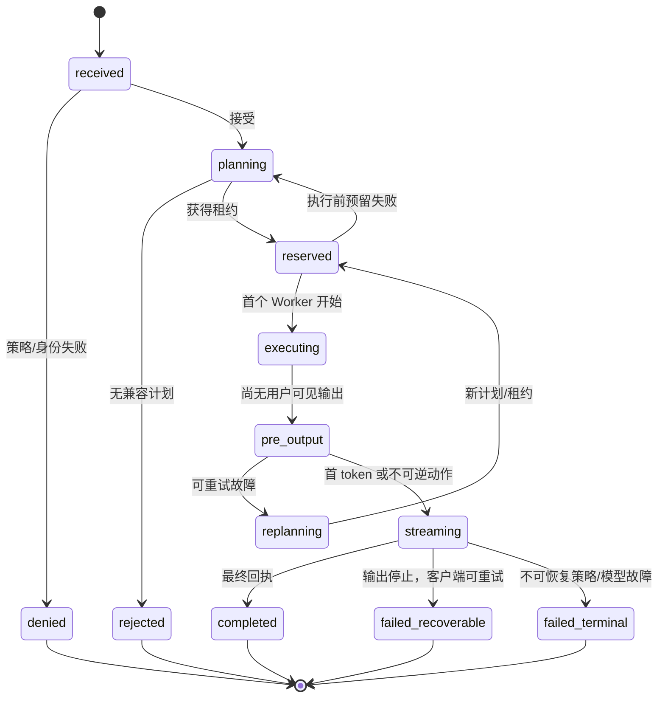
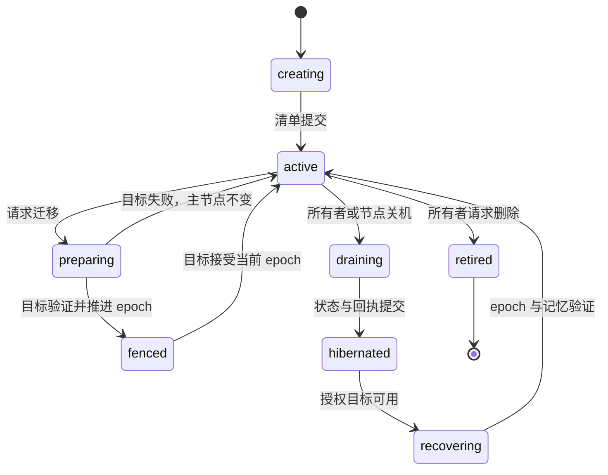

# 状态、一致性与故障模型

[English](STATE_AND_FAILURE.md) | [简体中文](STATE_AND_FAILURE.zh-CN.md)

**状态：** 架构契约 `v0.1`  
**适用：** 请求、容量租约、记忆、虚拟角色、训练轮次和签名回执

本文将高层架构主张转化为可测试状态转换。只有实现适用转换并通过故障测试，组件才算完成。

## 1. 术语

| 术语 | 定义 |
| --- | --- |
| 权威状态 | 决定某操作是否被接受的状态 |
| 副本 | 验证后可晋升或读取的拷贝 |
| 租约 | 提供者允许在特定时间使用指定容量的权限 |
| Fence | 防止旧所有者在替换后提交的单调令牌 |
| 提交 | 由不可变记录表示的持久状态转换 |
| 墓碑 | 防止陈旧副本复活的持久删除标记 |
| 回执 | 完成工作或观测状态的签名声明 |
| 故障域 | 预期会一起失效的组件集合 |
| 不可逆输出 | 不能静默重放的用户可见 token、动作或副作用 |
| RPO | 指定故障下最大已确认数据损失 |
| RTO | 指定故障后最大服务恢复时间 |

## 2. 正确性不变量

这些不变量高于可用性和延迟优化。

1. **身份不变量：** Worker 不能使用已撤销或不匹配节点身份执行。
2. **租约不变量：** Worker 没有兼容、未过期租约和 fencing token 时不能开始计划。
3. **兼容不变量：** 模型/Tokenizer/运行时摘要未知或不匹配时，管线不得跨越阶段边界。
4. **提交不变量：** 同一幂等键最多提交一次，除非显式创建新计划。
5. **流式不变量：** 首次输出后不得透明重放。
6. **耐久不变量：** 未验证独立故障域时，存储确认不能将记忆升级到 D2/D3。
7. **删除不变量：** 已提交墓碑后，陈旧副本不能再次可见。
8. **角色不变量：** 同一 epoch 不得有两个活跃角色主节点。
9. **训练不变量：** 没有评估产物、兼容结果和回滚引用时，训练更新不得进入发布。
10. **回执不变量：** 资源核算使用幂等签名回执，不根据重试次数推断。
11. **策略不变量：** 计划使用的授权 epoch 在整个执行期间有效。
12. **数据不变量：** 远端存储托管节点不需要用户记忆明文或原始媒体。

## 3. 状态所有权

| 状态 | 权威写入者 | 读取者 | 耐久预期 | 冲突规则 |
| --- | --- | --- | --- | --- |
| 节点身份 | 节点 | Peer、成员权威 | 长期本地密钥 | 签名轮换链 |
| 成员 epoch | 成员权威 | 所有已准入节点 | 目标 D2+ | 单调 epoch，较高有效 epoch 获胜 |
| 能力声明 | 节点 | 发现层 | TTL 缓存 | 同 epoch 新签名；陈旧拒绝 |
| 运行容量租约 | 提供者代理 | 规划器 | 短期 | 过期和 fencing，不合并 |
| 请求状态 | 请求入口 | 客户端、Worker、审计 | 回执支持 | 单一请求所有者和幂等键 |
| 执行计划 | 请求入口 | 被租用 Worker | 终态前持久 | 版本不可变 |
| 模型产物清单 | 注册表 | Worker、规划器 | 内容寻址 | 摘要冲突致命 |
| 记忆元数据 | 命名空间权威 | 授权 Agent | 按策略 D2/D3 | 版本向量 + 策略，不盲 LWW |
| 记忆密文 | 托管节点 | 授权恢复者 | 依赖副本清单 | 摘要寻址不可变 chunk |
| 副本清单 | 命名空间权威 | 修复和恢复 | 目标 D2+ | 单调版本 + 签名确认 |
| 墓碑 | 命名空间权威 | 托管节点、Agent | 长于陈旧副本 | 单调删除 epoch |
| 角色清单 | 角色控制器 | 入口和 Worker | 目标 D2+ | fenced primary epoch |
| 训练轮次 | 实验协调者 | 参与者和评估者 | 持久审计 | 不可变轮次清单 |
| Adapter 更新 | 参与者 | 聚合器/评估器 | 内容寻址 | 必须签名和来源 |
| 配额使用 | 核算权威 | 租户和运维者 | 持久可审计 | 回执 ID 去重重试 |

## 4. 请求状态机



### 4.1 状态定义

| 状态 | 允许新工作？ | 可自动重试？ | 必需证据 |
| --- | --- | --- | --- |
| `received` | 否 | 不适用 | 请求 envelope |
| `planning` | 否 | 可以 | 候选计划 |
| `reserved` | 否 | Worker 启动前可以 | 租约 ID |
| `executing` | 否 | 仅在用户可见输出前 | Worker 启动回执 |
| `pre_output` | 否 | 截止/预算内可以 | 阶段回执 |
| `streaming` | 否 | 不可透明重试 | 首个输出事件 |
| `completed` | 否 | 否 | 最终签名回执 |
| `failed_recoverable` | 否 | 仅客户端发起 | 失败类别和安全边界 |
| `failed_terminal` | 否 | 否 | 终态原因 |

### 4.2 幂等性

请求幂等键覆盖：

- 租户和 Agent 身份；
- 操作类型和规范化输入摘要；
- 模型/策略 epoch；
- 请求输出模式。

同键重试返回既有终态或附着到仍在运行的请求。模型、策略或 prompt 变化需要新键。

## 5. 容量租约生命周期

```text
offered -> reserved -> active -> completed
                   \-> expired
                   \-> revoked
                   \-> failed
```

- Offer 仅用于通知，不独占。
- Reservation 在 `start_by` 前独占声明 slot。
- 活跃租约可因安全、热、电源、策略或身份原因撤销。
- 撤销递增 fence。
- 旧 fence 提交被拒绝。
- 运行请求中的过期租约不能静默续期。

### 5.1 租约回执字段

- `lease_id`、`plan_id`、`request_id`、`idempotency_key`；
- 提供者节点/组/Worker 身份；
- 模型、运行时和兼容摘要；
- slot 数、队列位置和 start-by；
- 过期时间和最大工作量；
- 策略 epoch、隐私范围和模型许可证范围；
- fencing token；
- 撤销条件和提供者签名。

## 6. 记忆生命周期

### 6.1 对象状态

```text
candidate -> active -> sealed -> archived
                    \-> deleted(tombstoned)
candidate -> rejected
active -> superseded(version)
```

- **candidate：** 已提取但尚未授权为持久知识。
- **active：** 可在作用域内检索。
- **sealed：** 保留但排除普通检索。
- **archived：** 元数据和/或密文移动到冷层。
- **superseded：** 历史版本不再是默认版本。
- **deleted：** 已写墓碑，最终从所有授权托管节点删除。
- **rejected：** 未接受为持久记忆，保留遵循审计策略。

### 6.2 提交协议

1. 命名空间权威验证同意、范围、保留和写授权。
2. 所有者/Agent 加密并内容寻址不可变版本。
3. 本地日志记录意图、版本和目标耐久级别。
4. 所需托管节点存储 chunk 并返回签名确认。
5. 命名空间权威推进副本清单。
6. 只有满足耐久策略后写入才可见。
7. 无法满足策略时返回 `D1-degraded` 或明确失败。

### 6.3 耐久主张

| 等级 | 提交条件 | 可能丢数据的故障 |
| --- | --- | --- |
| `D0` | 仅内存 | 进程崩溃 |
| `D1` | 本地持久提交 | 主机/磁盘损失、本地损坏 |
| `D2` | D1 + 一个远端故障域确认 | 本地与该域共同损失、密钥丢失 |
| `D3` | D1 + 两个远端故障域确认 | 三个域共同损失、密钥丢失 |

在称为 SLO 前，项目必须发布各级实测 RPO/RTO 和密钥恢复假设。

### 6.4 副本修复

- 每日或按策略比较 Merkle/清单。
- 从验证副本修复，再删除可疑副本。
- 无法证明摘要/版本的副本被隔离，不计入耐久。
- 配额压力暂停新写入或触发迁移，绝不静默删除最后良好副本。
- 确认与策略匹配前，清单保持 degraded。

### 6.5 删除

删除是独立单调操作：

1. 命名空间权威以新删除 epoch 写墓碑；
2. 授权 Agent 停止检索该版本；
3. 墓碑通过反熵传播到已知副本；
4. 托管节点按策略删除密文和确认记录；
5. 可 crypto-shred 密钥使不可达副本失效；
6. 墓碑版本高于副本版本，陈旧副本不能复活；
7. 不可达副本显示为删除债务。

“远程删除完成”是可测状态，不是尽力而为日志。

## 7. 虚拟角色生命周期



### 7.1 Fencing 规则

- 角色控制器是主节点 epoch 权威。
- 主机只有在本地清单 epoch 等于权威 epoch 时可服务角色。
- 导出迁移包不激活目标。
- 目标激活先递增 epoch，再关闭旧主节点。
- 陈旧主节点可完成已接受的非变更请求，但不得接受新工作。
- 回滚需要新 epoch，不恢复旧 epoch。

### 7.2 无法联系控制器时恢复

默认拒绝新角色写入，只允许声明的本地只读行为。紧急晋升需要预先授权 quorum 或离线恢复授权，优先防止脑裂而不是方便。

## 8. 节点生命周期

| 状态 | 新租约 | 新记忆写 | 已有工作 | 排空回执 |
| --- | --- | --- | --- | --- |
| `joining` | 否 | 否 | 无 | 不适用 |
| `benchmarking` | 有限探测 slot | 否 | 无 | 不适用 |
| `resident` | 是 | 是 | 是 | 否 |
| `degraded` | 按策略 | 仅 D1，除非策略允许 | 是 | 非终态 |
| `draining` | 否 | 不接受新外部写 | 在期限内完成/中止 | 必需 |
| `hibernated` | 否 | 否 | 无 | 必需 |
| `revoked` | 否 | 否 | 安全停止 | 可达时必需 |

正常关机是协议，不仅是进程信号：冻结准入、处理/checkpoint 工作、复制高价值状态、传播墓碑、checkpoint 本地存储并签回执。

## 9. 故障矩阵

| 故障 | 检测 | 安全即时行为 | 恢复 | 禁止主张 |
| --- | --- | --- | --- | --- |
| 入口崩溃 | 客户端断开、租约过期 | 停止新请求 | 客户端用幂等键重试 | 无迁移设计却称无缝会话 |
| Worker 输出前崩溃 | 缺少心跳/回执 | 预算内重规划 | 使用另一兼容 Worker | 重复副作用 |
| Worker 输出后崩溃 | 流中断 | 停止流并标不可逆 | 仅支持 checkpoint 时恢复 | 透明整请求重放 |
| 租约过期 | 代理时钟/期限 | fence Worker 结果 | 新租约/计划 | 过期工作算提交 |
| 阶段不兼容 | 清单校验 | 分发前失败 | 部署兼容产物 | “尽力”替换 Tokenizer |
| 网络分区 | 探测/租约失败 | 隐藏远端能力 | 重连、协调 epoch | 继续声称在线资源池 |
| 成员撤销 | 新 epoch/签名 | 拒绝 Worker 和新租约 | 轮换或重新准入 | 无限接受旧 epoch |
| 记忆托管节点丢失 | 缺确认/清洗 | 标副本 degraded | 从验证副本修复 | 把丢失节点算耐久 |
| 最后良好副本不可用 | 清单/清洗 | 冻结删除/驱逐 | 恢复备份或密钥 | “永久记忆” |
| 墓碑传播部分完成 | 删除债务清单 | 删除对象不可访问 | 反熵删除 | 陈旧副本复活 |
| 角色控制器分区 | epoch 不确定 | 只读/本地 | 重连协调 | 双主节点 |
| 目录不可用 | 发现超时 | 尝试其他目录/直连 | 刷新快照 | 把目录当请求权威 |
| 训练更新变差 | 评估/回归 | 隔离 | 回滚基础/金丝雀 | 自动全局发布 |
| 模型注册表被攻破 | 摘要/签名不匹配 | 拒绝产物 | 恢复信任根 | 运行未知镜像 |

## 10. 重试与重复副作用规则

- **纯读取：** 策略和期限内可安全重试。
- **带请求键的幂等写：** 可重试，权威去重。
- **非幂等本地工具：** 不得静默重试。
- **流式模型输出：** 仅首 token 前可重试。
- **Avatar/世界动作：** 需要动作授权和去重键，不能盲重试。
- **角色迁移：** epoch fencing。
- **训练轮次：** round ID 和更新摘要去重。

## 11. 配额与核算

签名回执绑定：

- 租户、请求和计划 ID；
- 提供者身份和租约；
- 模型/运行时/阶段产物摘要；
- 接受工作和消耗资源单位；
- 传输字节和存储时长；
- 开始/结束时间；
- 重试/重复状态；
- 提供者签名。

核算按回执 ID 幂等存储。未消耗提供者容量的重试不产生新计费回执。失败的部分执行遵循已发布最小工作策略。

## 12. 可观测性要求

### 12.1 请求轨迹字段

- trace ID、request ID、幂等键哈希、计划版本；
- 授权和成员 epoch；
- 执行模式及原因码；
- 容量租约和 fence；
- 阶段/Worker ID、产物摘要；
- 排队、传输、TTFT、ITL、完成和重试数；
- 终态和安全重试边界；
- 回执 ID。

### 12.2 持久状态指标

- 低于目标耐久性的记忆；
- 清洗失败副本；
- 删除债务年龄；
- 密钥授权年龄与轮换状态；
- 角色 epoch 冲突；
- 反熵延迟和修复字节；
- 配额拒绝与存储压力。

### 12.3 禁止遥测

- Prompt 或记忆明文；
- 原始音频、图像或精确位置；
- 可用轮换伪名时使用原始用户标识；
- 公开指标中的命名空间 ID；
- 密钥、token 或私有端点凭证。

## 13. 故障注入门槛

在标记稳定前必须通过：

1. 首 token 前后终止 Worker；
2. 进程暂停到租约过期；
3. 每个幂等请求重复投递；
4. 副本确认期间网络分区；
5. 墓碑后的陈旧副本；
6. 本地磁盘满和配额压力；
7. 本地提交后、远端确认前断电；
8. 有密文但密钥不可用；
9. 角色迁移各状态边界；
10. 旧主节点以陈旧 epoch 恢复；
11. 恶意 Peer 返回篡改能力或回执；
12. 训练更新性能变好但回归失败；
13. 目录故障但直连 Peer 健康；
14. 租约过期附近时钟偏移；
15. 活跃请求期间撤销。

## 14. SLO 发布模板

```text
主张：
工作负载和测试时长：
部署拓扑和故障域：
注入故障：
已提交写入或请求：
丢失或重复操作：
实测 RPO / RTO：
P50 / P95 / P99 恢复延迟：
密钥和备份假设：
已知未检测故障模式：
复现命令和产物：
```

当前仓库只有机制级测试，没有生产 SLO 证据。README、Release 和研究报告中必须保持这一区别。
