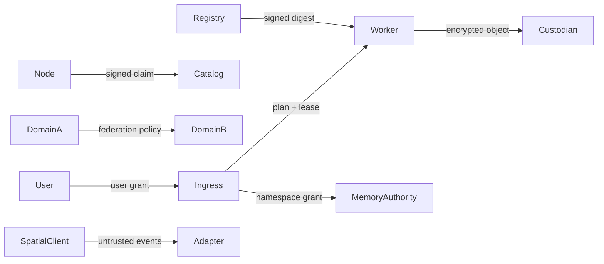

# Architecture Threat Model

[English](THREAT_MODEL.md) | [简体中文](THREAT_MODEL.zh-CN.md)

**Status:** Draft research threat model `v0.1`  
**Scope:** Invite-only heterogeneous inference, durable memory, virtual roles and continual-learning workflows

This model identifies architectural trust boundaries. It is not a penetration-test report or production security certification.

## 1. Protected assets

- node and role private keys;
- tenant identity and access grants;
- namespace encryption keys and recovery shares;
- prompt, media and memory plaintext;
- memory plaintext-adjacent metadata such as access patterns;
- virtual-role identity, policy and allowed actions;
- model weights, adapter updates and immutable artifact hashes;
- capacity, quota and settlement receipts;
- membership, revocation and role-primary epochs;
- operator infrastructure and other tenants' endpoint availability.

## 2. Actors

| Actor | Capability |
| --- | --- |
| Legitimate user | Authorized requests within a namespace |
| Honest node operator | Controls hardware, runtime and local logs |
| Malicious invited operator | Controls a node, its clock, network path, telemetry and returned data |
| Compromised worker | Can exploit runtime, model parser or local filesystem boundary |
| Compromised ingress | Can observe requests routed through it |
| Malicious model artifact | Can execute payloads or generate harmful/adversarial output |
| Poisoned data contributor | Can manipulate memory or training updates |
| Domain administrator | Can change policy or revoke members but must not read every namespace |
| External attacker | Can scan exposed endpoints, replay credentials or exhaust quotas |
| Curious storage custodian | Can inspect ciphertext, metadata, sizes and access timing |

## 3. Trust boundaries

Every arrow crosses an authorization boundary. “Invited” does not imply trusted with plaintext, global quotas or arbitrary code.

## 4. Threat register

| ID | Threat | Impact | Required controls | Current status |
| --- | --- | --- | --- | --- |
| T01 | Stolen shared bearer token | Whole invitation network exposed | Per-node mTLS, tenant tokens, revocation, rate limits | Not implemented |
| T02 | Node impersonation | False routing and forged receipts | Ed25519 identity plus membership certificate bound to key | Partial signature check, no CA |
| T03 | Capability inflation | OOM, slow pipeline, SLA failure | Measured benchmarks, leases, fast demotion, historical completion | Partial, coarse RTT choice |
| T04 | Replay of announce or request | Duplicate work or accounting | Expiry, nonce/idempotency, audience and fence | Partial freshness only |
| T05 | Malicious peer URL / redirect | SSRF and credential leakage | Allowlisted scheme/address policy, no credential-forwarding redirects, egress isolation | Not implemented |
| T06 | Worker executes unapproved code | Host or network compromise | Signed runtime digest, sandbox, allowlisted arguments, no uploaded executable models | Not implemented |
| T07 | Model/tokenizer substitution | Silent quality corruption | Full manifest tuple compatibility barrier | Manifest exists but is incomplete |
| T08 | Ingress sees plaintext | Prompt/memory leakage | Trusted ingress policy, local-only mode, enclave/confidential computing only as measured option | No confidentiality from ingress |
| T09 | Custodian inspects content | Memory confidentiality loss | Source-side encryption, key isolation, blind indexes, padded/chunked sizes | Basic AES-GCM and blind index |
| T10 | Traffic-analysis metadata | Sensitive activity inference | Metadata minimization, batching, cover traffic research, scope separation | Not addressed |
| T11 | Key loss | Durable ciphertext becomes unrecoverable | Owner KEK, threshold recovery, rotation and recovery drills | Single local key |
| T12 | Storage quota exhaustion | Denial or eviction pressure | Per-tenant/provider quotas, reservation, backpressure, migration | Basic provider cap |
| T13 | Last-copy deletion | Data loss | Repair-before-eviction invariant and deletion freeze | Not fully implemented |
| T14 | Stale replica resurrects data | Delete/privacy violation | Monotonic tombstones, anti-entropy and deletion debt | Best-effort propagation |
| T15 | Role split-brain | Two active agents perform actions | Fenced primary epochs and action grants | Manual migration, no fencing |
| T16 | Streaming replay duplicates output/side effects | User harm and accounting mismatch | Retry boundary at first output | No resumable checkpoint |
| T17 | Memory poisoning/prompt injection | Persistent behavior compromise | Untrusted-content labeling, evidence gate, quarantine, source policy | Data marked untrusted conceptually; no full pipeline |
| T18 | Training poisoning/backdoor | Unsafe global adapter | Local provenance, anomaly checks, robust aggregation, regression and canary | Design only |
| T19 | Self-training collapse | Quality degradation | Human evidence, holdout evaluation, rollback and data decontamination | Design only |
| T20 | Membership revocation delayed | Removed node continues service | Monotonic epoch, short leases, revocation-aware workers | Not implemented |
| T21 | Catalog poisoning | Routing to false or unsafe capacity | Signed snapshots, issuer policy, replica comparison, direct reachability probe | No catalog |
| T22 | Relay bandwidth exhaustion | Network outages/cost | Relay quotas, path budgets, authenticated streams and backpressure | HTTP mesh only |
| T23 | Quota double counting | Unfair settlement | Idempotent receipts and terminal-state accounting | Partial/no settlement |
| T24 | Spatial sensor overcollection | Bystander privacy harm | Ephemeral session, explicit memory grant, redaction, action token | Mock interface only |
| T25 | Malicious avatar intent | Real-world or virtual harm | Least-privilege action grants, confirmation for high impact, audit | Prefix-token mock only |
| T26 | Model/data license violation | Legal and community harm | License manifest, domain policy and deny execution by default | Manual documentation only |
| T27 | Observability leakage | Secrets or prompt exposure | Structured redaction, bounded labels, no raw content | Basic logging only |
| T28 | Clock manipulation | Lease and tombstone faults | Monotonic counters, bounded skew, provider-local TTL plus signing time | Not addressed |

## 5. Security architecture decisions

### 5.1 Identity

- Node identity and user identity are distinct.
- A node certificate binds public key, invitation domain, allowed roles and expiry.
- Worker manifests bind the node to runtime and model digests.
- Revocation uses a monotonic epoch; expiring leases carry the epoch.
- Key rotation uses signed succession records.

### 5.2 Authorization

- Tenant/agent grants are short-lived and namespace-scoped.
- Role grants contain allowed actions, models, memory scopes and data classes.
- The planner evaluates policy before discovery results influence execution.
- Workers re-check the signed plan and lease; an ingress compromise does not automatically grant arbitrary worker code execution.

### 5.3 Data protection

- Memory is encrypted before it reaches a custodian.
- Key grants can be revoked independently from ciphertext retention.
- Blind indexes leak access patterns; the project must document this rather than claim full metadata privacy.
- Sensitive telemetry uses bounded hashes or rotating pseudonyms.
- Raw media is used only in an explicit privacy mode and should expire by default.

### 5.4 Supply chain

- Model, tokenizer, chat template, adapter and runtime image are content-addressed.
- Artifact trust evidence includes signer identities and policy.
- Workers reject unknown or revoked artifacts.
- Model loaders run with no unnecessary network or filesystem access.
- Training updates are immutable content plus provenance, not executable scripts.

### 5.5 Isolation

- Each worker has CPU, memory, disk, GPU and network quotas.
- Worker credentials are scoped to one model/task and expire.
- Worker egress is deny-by-default except for declared storage/result endpoints.
- Memory custodians cannot mount plaintext namespace storage.
- A compromised worker cannot request membership changes or arbitrary peer access.

## 6. Abuse and governance threats

The system must define policy for:

- harmful content and disallowed model use;
- resource exhaustion and denial-of-service;
- attempts to use node storage for unrelated data;
- unauthorized model redistribution;
- data retention and deletion obligations;
- user and bystander consent in spatial contexts;
- operator conflicts and removal;
- contribution disputes and settlement corrections.

A research invitation network should reject unknown nodes and tenants before engaging in public availability arguments.

## 7. Security gates

Before an external pilot:

- replace the shared token;
- add request size, rate, concurrency, context and egress budgets;
- validate peer URLs and disable cross-origin credential forwarding;
- isolate workers from host secrets and unrelated data;
- add namespace key wrapping and recovery drills;
- test revocation and lease expiry;
- run dependency and container scanning;
- complete a repository-grounded threat-model review;
- document residual risks accepted by the pilot owner.

Before public participation:

- independent security review;
- abuse response process;
- key compromise and membership recovery runbooks;
- privacy impact assessment;
- reproducible denial-of-service and quota tests;
- model/data license compliance review;
- no anonymous execution until identity, abuse and accounting assumptions are explicit.

## 8. Residual risks

Even after the planned controls:

- a trusted ingress may see plaintext unless a confidential-computing mode is selected;
- colluding workers can return consistently wrong but signed results;
- encrypted storage metadata may reveal approximate activity and size;
- a compromised owner device can authorize harmful actions;
- no algorithm can guarantee recovery after all keys and copies are destroyed;
- cross-domain policy composition may create unexpected authorization paths;
- small research populations cannot provide strong statistical trust signals.

The UI and documentation must not imply that “encrypted,” “replicated,” “signed” or “decentralized” alone means secure or correct.
