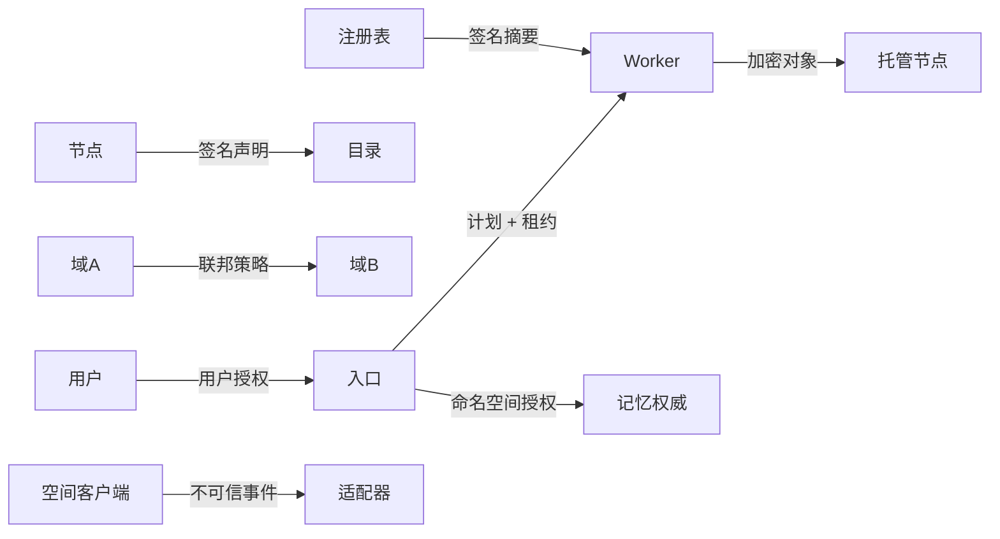

# 架构威胁模型

[English](THREAT_MODEL.md) | [简体中文](THREAT_MODEL.zh-CN.md)

**状态：** 研究威胁模型草案 `v0.1`  
**范围：** 邀请制异构推理、持久记忆、虚拟角色和持续学习流程

本文识别架构信任边界，不是渗透测试报告或生产安全认证。

## 1. 受保护资产

- 节点和角色私钥；
- 租户身份与访问授权；
- 命名空间加密密钥和恢复份额；
- Prompt、媒体和记忆明文；
- 与记忆明文相关的访问模式等元数据；
- 虚拟角色身份、策略和允许动作；
- 模型权重、Adapter 更新和不可变产物哈希；
- 容量、配额和结算回执；
- 成员、撤销和角色主节点 epoch；
- 运维基础设施以及其他租户端点可用性。

## 2. 参与者

| 参与者 | 能力 |
| --- | --- |
| 合法用户 | 在命名空间内提交授权请求 |
| 诚实节点运维者 | 控制硬件、运行时和本地日志 |
| 恶意受邀运维者 | 控制节点、时钟、网络路径、遥测和返回数据 |
| 被攻破 Worker | 可利用运行时、模型解析器或本地文件边界 |
| 被攻破入口 | 可观察经过它的请求 |
| 恶意模型产物 | 可执行载荷或生成有害/对抗输出 |
| 投毒数据贡献者 | 可操纵记忆或训练更新 |
| 域管理员 | 可修改策略或撤销成员，但不应读取所有命名空间 |
| 外部攻击者 | 可扫描公开端点、重放凭证或耗尽配额 |
| 好奇的存储托管者 | 可检查密文、元数据、大小和访问时序 |

## 3. 信任边界

每个箭头都跨授权边界。“受邀”不意味着可访问明文、全局配额或任意代码。

## 4. 威胁登记

| ID | 威胁 | 影响 | 必需控制 | 当前状态 |
| --- | --- | --- | --- | --- |
| T01 | 共享 Bearer Token 被盗 | 整个邀请网暴露 | 节点 mTLS、租户 token、撤销、速率限制 | 未实现 |
| T02 | 节点冒充 | 错误路由和伪造回执 | Ed25519 身份及绑定证书 | 部分签名校验，无 CA |
| T03 | 能力夸大 | OOM、慢管线、SLA 失败 | 实测基准、租约、快速降级、历史完成率 | 部分，粗略 RTT 选择 |
| T04 | 公告或请求重放 | 重复工作和核算 | 过期、nonce/幂等、audience 和 fence | 仅部分期限 |
| T05 | 恶意 Peer URL/重定向 | SSRF 和凭证泄漏 | scheme/地址允许列表、禁止凭证跨重定向、出站隔离 | 未实现 |
| T06 | Worker 执行未批准代码 | 主机或网络攻破 | 签名运行时摘要、沙箱、参数允许列表、禁止上传可执行模型 | 未实现 |
| T07 | 模型/Tokenizer 替换 | 静默质量损坏 | 完整 Manifest 兼容屏障 | 清单存在但不完整 |
| T08 | 入口读取明文 | Prompt/记忆泄漏 | 可信入口策略、本地模式、经实测的机密计算 | 入口不做机密性保证 |
| T09 | 托管者查看内容 | 记忆保密性丢失 | 源端加密、密钥隔离、盲索引、分块/padding | 基础 AES-GCM 和盲索引 |
| T10 | 流量分析元数据 | 推断敏感活动 | 元数据最小化、批处理、掩护流量研究、作用域隔离 | 未处理 |
| T11 | 密钥丢失 | 耐久密文无法恢复 | 所有者 KEK、阈值恢复、轮换和恢复演练 | 单一本地密钥 |
| T12 | 存储配额耗尽 | 拒绝服务或驱逐压力 | 每租户/提供者配额、预留、背压、迁移 | 基础提供者上限 |
| T13 | 最后副本删除 | 数据丢失 | 先修复后驱逐、删除冻结 | 未完整实现 |
| T14 | 陈旧副本复活数据 | 删除/隐私违规 | 单调墓碑、反熵、删除债务 | 尽力传播 |
| T15 | 角色脑裂 | 两个活跃 Agent 执行动作 | fenced primary epoch 和动作授权 | 手动迁移，无 fencing |
| T16 | 流式重放重复输出/副作用 | 用户伤害和核算错误 | 首输出后禁止重试，可恢复 checkpoint | 无恢复 checkpoint |
| T17 | 记忆投毒/Prompt 注入 | 持久行为被破坏 | 不可信内容标记、证据门、隔离、来源策略 | 概念性不可信标记，无完整管线 |
| T18 | 训练投毒/后门 | 不安全全局 Adapter | 本地来源、异常检查、鲁棒聚合、回归和 canary | 仅设计 |
| T19 | 自训练坍塌 | 质量下降 | 人工证据、holdout、回滚、数据去污染 | 仅设计 |
| T20 | 成员撤销延迟 | 被移除节点继续服务 | 单调 epoch、短租约、撤销感知 Worker | 未实现 |
| T21 | 目录投毒 | 路由到虚假/不安全容量 | 签名快照、签发策略、多副本比较、直达探测 | 无目录 |
| T22 | 中继带宽耗尽 | 网络中断/成本 | 中继配额、路径预算、认证流和背压 | 仅 HTTP |
| T23 | 配额重复计数 | 不公平结算 | 幂等回执和终态核算 | 部分/无结算 |
| T24 | 空间传感器过度采集 | 旁观者隐私伤害 | 临时会话、显式记忆授权、脱敏、动作 token | 仅 mock |
| T25 | 恶意 Avatar 意图 | 真实/虚拟伤害 | 最小权限动作授权、高影响确认、审计 | Prefix token mock |
| T26 | 模型/数据许可证违规 | 法律和社区伤害 | 许可证清单、域策略、默认拒绝 | 仅文档 |
| T27 | 可观测性泄漏 | Secret 或 Prompt 暴露 | 结构化脱敏、有限标签、无原始内容 | 仅基础日志 |
| T28 | 时钟操纵 | 租约和墓碑错误 | 单调计数器、有界时钟偏移、提供者本地 TTL + 签名时间 | 未处理 |

## 5. 安全架构决定

### 5.1 身份

- 节点身份和用户身份不同；
- 节点证书绑定公钥、邀请域、允许角色和期限；
- Worker Manifest 将节点绑定到运行时和模型摘要；
- 撤销使用单调 epoch，租约携带 epoch；
- 密钥轮换使用签名继承记录。

### 5.2 授权

- 租户/Agent 授权短期且限定命名空间；
- 角色授权包含允许动作、模型、记忆范围和数据类别；
- 规划器在发现结果影响执行前先评估策略；
- Worker 重新检查签名计划和租约，入口被攻破不自动允许任意 Worker 代码。

### 5.3 数据保护

- 记忆到达托管节点前加密；
- 密钥授权撤销独立于密文保留；
- 盲索引泄漏访问模式，必须公开而不是宣称完全元数据隐私；
- 敏感遥测使用有界哈希或轮换伪名；
- 原始媒体只在显式隐私模式中使用，默认过期。

### 5.4 供应链

- 模型、Tokenizer、聊天模板、Adapter 和运行时镜像内容寻址；
- 信任证据包含签名身份和策略；
- Worker 拒绝未知或已撤销产物；
- 模型加载器无多余网络或文件访问；
- 训练更新是不可变内容 + 来源，不是可执行脚本。

### 5.5 隔离

- 每个 Worker 有 CPU、内存、磁盘、GPU 和网络配额；
- Worker 凭证只限定一个模型/任务和短期期限；
- Worker 出站默认拒绝，只允许声明的存储/结果端点；
- 记忆托管节点不能挂载明文命名空间存储；
- 被攻破 Worker 不能请求成员变更或任意 Peer 访问。

## 6. 滥用与治理威胁

系统必须明确：

- 有害内容和禁止模型使用；
- 资源耗尽与拒绝服务；
- 节点存储被用于无关数据；
- 未授权模型再分发；
- 数据保留和删除义务；
- 空间场景中的用户和旁观者同意；
- 运维冲突与移除；
- 贡献争议和结算修正。

研究邀请网应在讨论公共可用性前拒绝未知节点和租户。

## 7. 安全门槛

外部试点前：

- 替换共享 token；
- 增加请求大小、速率、并发、上下文和出站预算；
- 校验 Peer URL，禁止跨域凭证转发；
- 隔离 Worker 与主机密钥/无关数据；
- 增加命名空间密钥封装和恢复演练；
- 测试撤销和租约过期；
- 运行依赖与容器扫描；
- 完成基于仓库的威胁模型评审；
- 记录试点所有者接受残余风险。

公共参与前：

- 独立安全评审；
- 滥用响应流程；
- 密钥泄漏和成员恢复手册；
- 隐私影响评估；
- 可复现 DoS 和配额测试；
- 模型/数据许可证审查；
- 在身份、滥用和核算假设未明确前不开放匿名执行。

## 8. 残余风险

- 可信入口仍可能看到明文，除非选择机密计算；
- 合谋 Worker 可返回一致但错误的签名结果；
- 加密存储元数据仍可能泄漏活动与大小；
- 所有者设备被攻破时可授权有害动作；
- 所有密钥和副本被摧毁后无法保证恢复；
- 跨域策略组合可能形成意外授权路径；
- 小型研究人群无法提供强统计信任信号。

UI 和文档不得暗示“加密”“复制”“签名”或“去中心化”本身等于安全或正确。
