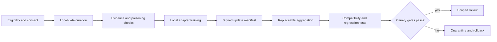

# NeuronMesh: Persistent Memory and Continual Learning

[简体中文](../../神经元式去中心化大模型网络系统-持续学习与持久记忆方案.md) | [English](continual-learning-persistent-memory.en.md)

**English edition note:** This edition preserves the engineering model, state semantics, learning workflow, metrics and risk controls from the Chinese research document. The Chinese source contains additional supporting detail and citations.

## 1. Executive conclusion

“Permanent memory” is not a physically provable property. In NeuronMesh it means a tested contract for:

- encrypted durable storage;
- independent failure-domain copies;
- recoverable keys and authorization;
- correct deletion and tombstones;
- measurable recovery point and recovery time;
- portable role state independent of one host.

Continual learning must not mean automatically training global model weights from every conversation. The practical architecture separates:

- episodic memory;
- consolidated semantic memory;
- procedural/tool/Adapter references;
- model parameter updates.

Only evidence-gated, evaluated Adapter updates may enter a scoped rollout.

## 2. Engineering definition of durable memory

| Property | Engineering meaning | Required evidence |
| --- | --- | --- |
| Persistence | Reconstruct after process restart | Restart test |
| Durability | Recover after named host/failure-domain loss | Fault injection and RPO |
| Availability | Access under specified online conditions | Availability benchmark |
| Portability | Recover on a different host | Export/import or quorum recovery |
| Recoverability | Reconstruct with authorized key material | Key-recovery drill |
| Deletability | Prevent stale resurrection and erase keys/data | Tombstone and repair test |
| Auditability | Explain versions, sources and changes | Signed/append-only evidence |

A working copy on a node is not a durable copy. A remote acknowledgement without digest/failure-domain verification is not a replica.

## 3. Memory ownership

### 3.1 Namespace scopes

```text
platform policy
  -> tenant/organization
    -> owner
      -> namespace
        -> virtual role
          -> memory object
```

Recommended scope classes:

- private personal;
- shared organization;
- role-local;
- task/ephemeral;
- public research fixture;
- audit/evidence.

Every object has one owning namespace authority. Replica custodians store encrypted data without becoming semantic owners.

### 3.2 Physical host vs virtual role

- host = replaceable execution and storage resource;
- role = durable identity, policy and memory grants;
- model/adapter = immutable artifact references;
- namespace = authorization and key scope.

Destroying or replacing a host must not delete a role automatically.

## 4. Memory object model

```text
MemoryObject
  stable object_id
  namespace and owner scope
  logical type
  version vector/parent version
  sensitivity and retention class
  consent/write grant
  encrypted content chunks
  blind index entries
  source references
  replica manifest
  tombstone state
```

### 4.1 Memory classes

- event/episodic;
- fact/semantic;
- preference;
- procedure/tool reference;
- summary/reflection;
- evaluation evidence;
- audit record.

### 4.2 States

```text
candidate -> active -> sealed -> archived
                    \-> deleted
candidate -> rejected
active -> superseded(version)
```

“Forgetting” usually maps to:

- removing local hot copy;
- moving encrypted content to a cold tier;
- seeding a role with an approved summary;
- stricter retrieval policy;
- actual deletion/tombstone.

Only actual deletion and key destruction count as deletion.

## 5. Tiered memory and apparent forgetting

| Tier | Location | Retrieval | Eviction |
| --- | --- | --- | --- |
| Hot | Role host or cache | Immediate | Only after durable copy |
| Warm | Nearby/authorized custodian | Index + remote decrypt | Policy-driven |
| Cold | Remote encrypted object store | On-demand restore | Tombstone/retention aware |

Migration rules:

1. confirm target digest and failure domain;
2. advance replica manifest;
3. update retrieval index;
4. only then remove local ciphertext;
5. show degraded state if user access is no longer supported.

### 5.1 Offline behavior

Offline nodes keep:

- recent hot memory;
- approved summaries and indexes;
- local unsynced WAL;
- explicit pending-delete and pending-repair records.

They must not claim remote memory availability while disconnected.

### 5.2 Real deletion

Deletion requires:

- tombstone with monotonic epoch;
- propagation to known replicas;
- anti-entropy;
- deletion debt for unreachable custodians;
- key crypto-shredding when policy requires;
- no stale replica resurrection.

## 6. Replication and recovery

### 6.1 Durability levels

| Level | Condition | Remaining failure boundary |
| --- | --- | --- |
| D0 | In memory only | Process crash |
| D1 | Local durable commit | Host/disk loss |
| D2 | D1 + one independent remote domain | Local + remote domain + key loss |
| D3 | D1 + two independent remote domains | Coordinated loss of all domains or key loss |

### 6.2 Replica manifest

Each acknowledgement includes:

- object/version digest;
- custodian and failure domain;
- encrypted chunk digests;
- manifest version;
- signed receipt;
- acknowledgement time.

### 6.3 Repair

- periodic Merkle/inventory comparison;
- quarantine mismatch;
- repair from a verified source;
- never delete the last good copy under quota pressure;
- surface deletion debt and durability degradation.

### 6.4 Key architecture

- per-namespace DEK;
- owner-controlled KEK;
- per-device or threshold-wrapped DEK;
- short-lived role grants;
- rotation and recovery drills;
- crypto-shredding for revocation/deletion.

Encryption without a tested key recovery path is not durable memory.

## 7. Node lifecycle and shutdown

### 7.1 States

```text
joining -> benchmarking -> resident
resident -> degraded -> resident
resident/degraded -> draining -> hibernated
resident -> revoked
```

### 7.2 Planned shutdown

1. stop accepting new leases/writes;
2. finish or abort work within deadline;
3. replicate high-value memory;
4. propagate tombstones;
5. checkpoint WAL/storage;
6. sign a receipt containing memory roots and achieved durability;
7. enter hibernated.

### 7.3 Sudden power loss

The system can recover only:

- already committed local/WAL state;
- acknowledged remote replicas;
- records whose keys remain available.

Unconfirmed in-memory work can be lost. The UI must not report a clean drain.

## 8. Resource pledges

An invited node commits:

- storage minimum/maximum and safety reserve;
- CPU limit;
- accelerator windows;
- daily egress;
- availability class;
- allowed maintenance windows;
- power/thermal restrictions;
- supported data/model scopes.

A pledge is not current free capacity. Capacity leases remain short-term.

## 9. Retrieval

Retrieval combines:

1. namespace and role permission;
2. recency/importance/retention;
3. lexical blind index;
4. vector or hybrid index when supported;
5. source/evidence quality;
6. conflict and supersession state;
7. token and privacy budget.

The model must not be the sole authority that decides what becomes durable. A write gate identifies source, consent, content class and potential injection.

### 9.1 Memory injection

- all external memory is untrusted evidence;
- memory cannot grant permissions or change system policy;
- quarantine suspicious instructions;
- preserve provenance;
- use scoped retrieval and context labels;
- test poisoning with cross-session canaries.

## 10. Context and token budget

Do not target equal numbers of input and output tokens. The goal is acceptable task quality under a bounded cost and privacy budget.

Dynamic context budget should consider:

- task type and quality floor;
- model context limit;
- retrieval confidence;
- prompt-injection risk;
- latency and energy;
- user tenant quota;
- output budget and completion strategy.

Memory retrieval should reduce repeated long prompts, not create an invisible uncontrolled prompt expansion.

## 11. Continual learning

### 11.1 Three speeds

1. **Immediate memory:** new observations available under policy.
2. **Consolidation:** summarize, deduplicate, link, validate and seal.
3. **Parameter learning:** slower local Adapter training and governed rollout.

### 11.2 Recommended form

Start with:

- local or domain-controlled Adapter/LoRA experiments;
- immutable base-model manifest;
- local data retention;
- bounded update artifacts;
- replaceable aggregation;
- evaluation before rollout.

Do not begin with:

- raw conversation broadcast;
- internet-scale synchronous full-model training;
- automatic mutation of a shared global model;
- model self-training without external evidence.

### 11.3 Federated adapter round



Every round records:

- hypothesis;
- base model/tokenizer/runtime digests;
- participants and consent scope;
- update rank/format/precision;
- aggregation/adversary assumptions;
- evaluation suite;
- canary percentage;
- rollback artifact.

### 11.4 Catastrophic forgetting

- preserve representative regression sets;
- compatibility-aware replay;
- constrain adapter rank/parameters;
- hold out private and public test sets;
- evaluate prior skills, safety and factual behavior;
- quarantine updates that improve one metric while regressing others.

### 11.5 Poisoning and backdoors

- data provenance;
- anomaly and outlier checks;
- participant diversity;
- robust aggregation or exclusion rules;
- behavior probes;
- canary updates;
- rollback;
- explicit residual risk.

Cryptographic signatures prove origin, not honesty.

### 11.6 Self-training degeneration

- require external evidence or human feedback;
- prevent model output from becoming unreviewed training truth;
- track data lineage;
- decontaminate evaluation sets;
- compare against base and prior rollout;
- stop on quality collapse.

## 12. Memory consolidation

Memory consolidation mimics sleep rather than infinite accumulation:

1. collect candidate events and feedback;
2. deduplicate and identify contradictions;
3. assign source confidence;
4. link to existing facts;
5. summarize without losing provenance;
6. seal stale or superseded versions;
7. queue questionable memory for review;
8. archive cold objects;
9. delete under policy.

Consolidation itself must be an observable, reversible job.

## 13. Evaluation

### 13.1 Memory quality

- Recall@K / precision;
- factual consistency;
- stale-memory rate;
- injection quarantine;
- false-positive deletion;
- token cost;
- restore and retrieval latency.

### 13.2 Persistence

- planned shutdown success;
- forced-power-loss recovery;
- replica satisfaction;
- deletion propagation;
- stale-resurrection count;
- key rotation/recovery;
- measured RPO/RTO.

### 13.3 Learning quality

- target improvement;
- regression on held-out tasks;
- safety behavior;
- poisoning detection;
- privacy leakage;
- rollout rollback time;
- compute/energy per accepted improvement.

## 14. Implementation workflows

### A. Local durable memory

- namespace object model;
- encryption and blind index;
- local journal/version;
- retrieval;
- restart tests.

### B. Cross-node sealing and recovery

- encrypted chunk transfer;
- replica manifest;
- signature/ack verification;
- cold recall;
- deletion debt.

### C. Consolidation and evidence gate

- candidate extraction;
- provenance and conflict handling;
- summary/archive;
- poisoning tests.

### D. Federated adapter pilot

- one stable base model;
- 3–10 invited participants;
- local bounded updates;
- aggregation/evaluation;
- canary/rollback.

### E. Continuous research

- negative results;
- heterogeneous hardware;
- privacy and abuse review;
- stability over multiple rounds.

## 15. Risk register

| Risk | Required response |
| --- | --- |
| False durability | Signed fault-domain acks and degraded state |
| Key loss | Owner recovery/rotation drills |
| Stale replica resurrection | Tombstones and anti-entropy |
| Storage exhaustion | Quotas, migration, repair-before-eviction |
| Memory poisoning | Untrusted labels, evidence gate, canary tests |
| Role split-brain | Fenced primary epochs |
| Training poisoning | Provenance, robust aggregation, behavior tests |
| Self-training collapse | External evidence and rollback |
| Privacy leakage | Scoped keys, metadata review, retention |
| Overstated permanence | Publish RPO/RTO and unsupported failures |

## 16. Stop conditions

- if multiple replicas do not improve measured recovery, simplify the storage model;
- if key recovery cannot be made operable, reduce retention and capability claims;
- if memory injection cannot be bounded, disable automatic promotion;
- if adapter training regresses more than its target benefit, stop global aggregation and return to local tools/memory;
- if role migration cannot prevent split-brain, keep roles pinned and label migration experimental;
- if no honest deletion semantics exist, do not promise user-controlled forgetting.

## 17. Final position

NeuronMesh should first build reliable non-parametric memory and role portability. Continual parameter learning comes later, with explicit consent, provenance, evaluation and rollback. This ordering makes the system useful even before distributed training is solved and prevents unsupported memory claims.
