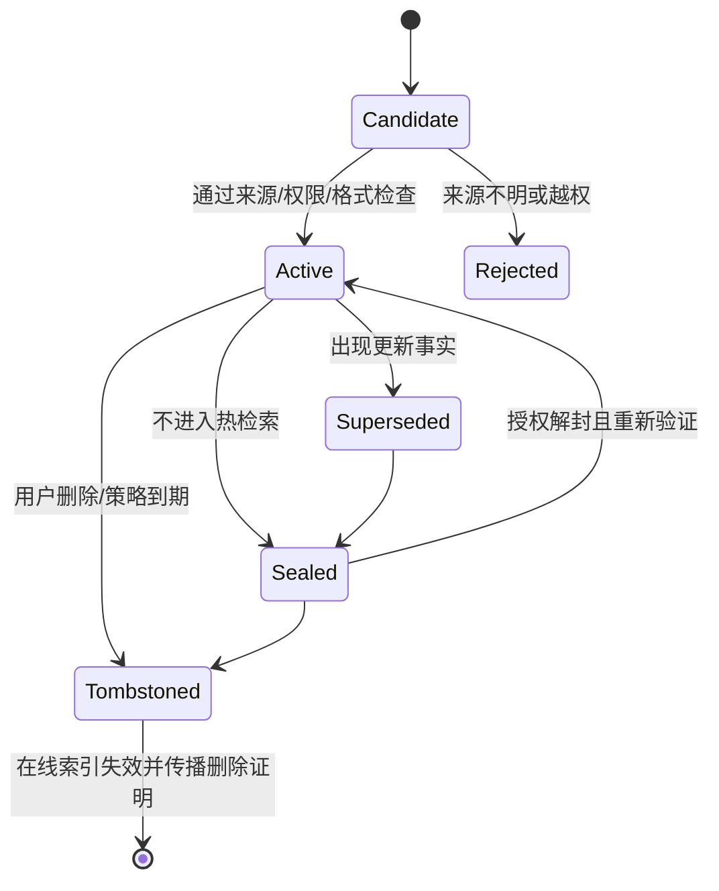
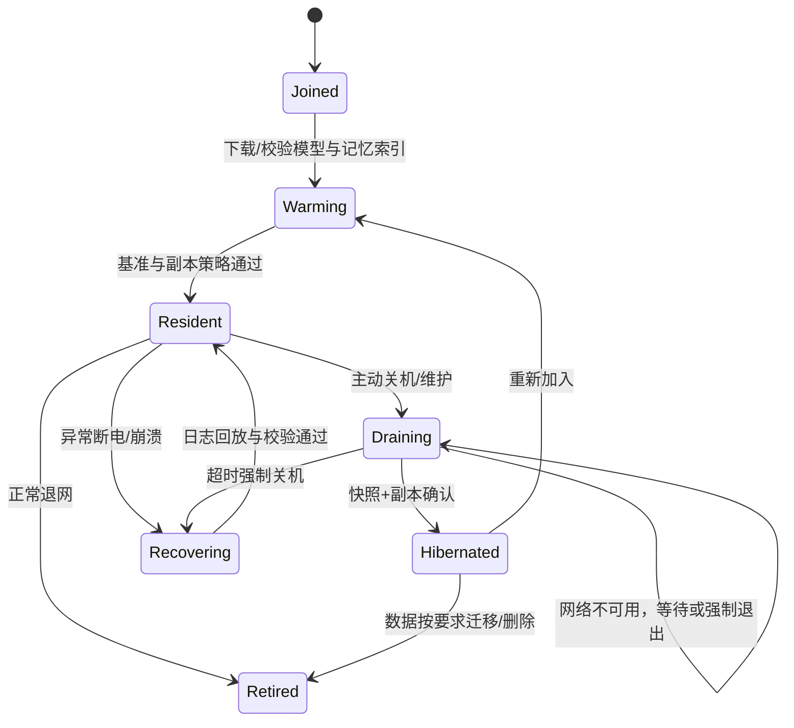

# 神经元式去中心化大模型网络系统

[简体中文](神经元式去中心化大模型网络系统-持续学习与持久记忆方案.md) | [English technical edition](docs/research/continual-learning-persistent-memory.en.md)
## 持续学习、持久记忆与联邦训练子系统方案

> 评审日期：2026-10-30  
> 适用范围：研究型、邀请制、半可信异构节点网络  
> 本文是技术可行性方案，不替代个人信息保护、著作权、模型许可证或安全合规意见。

---

## 1. 结论

“让加入的节点共同学习、长期记忆、持续成长”可以作为系统研究目标，但不能按以下方式直接实现：

- 每次对话后立即更新全网基础模型权重；
- 把用户事实、原始对话和多媒体全部永久写入模型参数；
- 把“物理主机”作为记忆的唯一归属；
- 承诺任何数据永远不丢失；
- 把“不确定自己是否忘记”当作记忆系统可靠性的证明；
- 用模型自评或惊奇度自动决定哪些新信息可以进入永久记忆和训练集。

可行的总体路线是：

```text
快速环路：交互 -> 记忆抽取 -> 检索 -> 回答 -> 追加事件
巩固环路：去重 -> 冲突检测 -> 合并摘要 -> 版本化 -> 门控
学习环路：精选经验 -> 本地 Adapter 训练 -> 兼容合并 -> 回归评测 -> 签名发布
长期环路：共享基础模型按版本演进，个性化事实仍留在可治理的记忆空间
```

核心设计原则：

1. **记忆与主机解耦**：记忆归属于用户、组织或 Agent 身份，不归属于某台笔记本或手机。
2. **事实与参数分离**：易变化的事实、偏好和经历进入外部持久记忆；稳定技能进入共享 Adapter 或基础模型。
3. **双层学习而非全量实时训练**：前台只读写记忆，后台周期性训练轻量 Adapter。
4. **不可撤销的全局记忆最小化**：敏感个人信息不进入共享基础权重。
5. **删除优先于假永久**：提供复制、快照、恢复、封存和可审计删除，不承诺物理永恒。
6. **提交质量不提交原始日志**：共享训练使用经过同意、验证、去标识化和评测的数据或更新。
7. **跨节点训练先小后大**：首期只做联邦 LoRA/Adapter 微调，不在公网做全参数预训练。

---

## 2. “永久记忆”的工程定义

在工程上，建议把“永久记忆”改写为“持久、可恢复、可验证、可撤销的长期记忆”。

| 语义 | 工程定义 | 可验证方式 |
| --- | --- | --- |
| 持久 | 在约定期限和复制策略内可重复读取 | 定期完整性挑战、读取演练 |
| 不遗失 | 指定数量的故障域同时失效后仍可恢复 | 故障注入、恢复演练 |
| 封存 | 暂时不进入热检索，但数据仍保留 | 状态、索引和访问审计 |
| 永久 | 满足策略期内持续留存，而非热存储永远在线 | 版本链、租约、保留证明 |
| 删除 | 元数据、索引、密文副本和密钥按策略清除 | 删除凭证、跨副本核查 |
| 恢复 | 拥有授权和恢复密钥后可重建索引与访问 | 恢复点目标/RTO 实测 |

必须承认：

- 所有副本损坏、所有密钥丢失、成员集体退出或发生灾难时，数据可能不可恢复；
- 被第三方备份的数据可能无法证明已彻底物理删除；
- 个人信息删除权可能与“永久记忆”冲突；
- 进入全局模型权重的数据很难进行低成本、可证明的精确删除。

因此首期应承诺可执行的耐久性目标，例如：

- 每个记忆对象至少 3 个副本；
- 副本分布在不共享同一故障域的 3 个节点；
- 单节点故障后仍可读取；
- 节点重新上线后自动修复缺失副本；
- 每 24 小时执行完整性检查；
- 每季度执行一次跨域恢复演练；
- 在线删除请求在 60 秒内使所有在线索引失效，离线副本在重新联网后立即执行墓碑和密钥撤销。

这里的数值是首期测试门槛，不是“永不丢失”的物理保证。

---

## 3. 记忆归属与命名空间

### 3.1 不把记忆绑定到物理节点

以下身份必须分开：

- `host_id`：硬件节点身份，可能更换、损坏或退休；
- `owner_id`：用户、组织或 Agent 主体；
- `memory_namespace_id`：某个主体或作用域的记忆空间；
- `session_id`：一次会话；
- `model_release_id`：模型版本；
- `adapter_id`：个性化或领域技能版本。

记忆通过 `owner_id + memory_namespace_id` 定位。节点只持有加密副本、索引分片和访问授权。

### 3.2 记忆作用域

至少支持：

| 作用域 | 示例 | 默认共享范围 |
| --- | --- | --- |
| `session` | 当前任务临时状态 | 仅当前会话 |
| `private_user` | 个人偏好、经历、联系人 | 仅该用户 |
| `private_org` | 企业文档、流程、项目事实 | 仅授权组织 |
| `group` | 若干节点共同形成的领域记忆 | 明确授权成员 |
| `domain` | 组织级经过验证的知识 | 域成员 |
| `public_curated` | 有明确来源和许可证的公共知识 | 全网可检索 |

任何记忆从私有作用域提升到更大范围，都必须重新经过授权、脱敏、来源核验和许可证检查。

### 3.3 物理主机、硬件节点与虚拟角色

必须在实现中区分三层身份：

1. **物理主机**：真实设备及其运行状态；
2. **硬件节点**：主机经准入、资源承诺和基准测试后，在邀请网络中的可调度成员；
3. **虚拟角色**：在硬件节点上创建的用户、Agent、领域专家或研究角色。

硬件节点不是虚拟角色的记忆所有者。虚拟角色的身份、模型版本、Adapter、记忆和权限应按 `role_id + owner_id` 保存，并可在兼容硬件节点上恢复。

建议的虚拟角色清单：

```json
{
  "role_id": "agent://research/lab-assistant",
  "owner_id": "invite://university-a/lab-7",
  "primary_host_id": "host-17",
  "standby_hosts": ["host-03", "archive-node-2"],
  "memory_namespace_id": "ns-role-7",
  "adapter_ids": ["private-adapter-12"],
  "model_release_ids": ["model-r17"],
  "presentation_bindings": ["avatar://lab-a/assistant"],
  "allowed_worlds": ["world://lab-a"],
  "policy": {
    "replica_failure_domains": 3,
    "rpo_class": "high",
    "allowed_regions": ["research-cn-east"],
    "raw_media_retention_days": 30
  },
  "state_version": 184,
  "status": "active|draining|migrating|hibernated|recovering"
}
```

清单中只保存密钥引用，不保存明文私钥或访问令牌。

虚拟角色迁移时：

1. 主节点停止接受该角色新写入；
2. 提升 `state_version` 并生成 fencing token；
3. 将未复制日志、记忆增量和 Adapter 检查点转移到目标节点；
4. 目标节点校验模型、完整性和权限；
5. 达到副本确认门槛后切换主节点；
6. 旧主节点进入只读或退役状态；
7. 从旧版本恢复的进程因 fencing token 过期而无法继续写入。

虚拟角色可以在手机上创建并交互，但它的长期存在不能依赖手机保持开机。

---

## 4. 分层记忆架构

### 4.1 记忆类型

| 层 | 内容 | 生命周期 | 是否进入共享训练 |
| --- | --- | --- | --- |
| 工作记忆 | 当前上下文、KV cache、临时计划 | 请求/会话级 | 否 |
| 情节记忆 | 会话事件、决策、结果、用户反馈 | 中长期 | 默认否，需单独授权 |
| 语义记忆 | 稳定事实、实体关系、偏好、规则 | 长期、可版本化 | 只允许已验证的可泛化知识 |
| 技能记忆 | Adapter、提示策略、工具调用流程、操作模板 | 中长期、可发布版本 | 经过评测后可选 |
| 归档记忆 | 原始文本、音频、图像或加密分块 | 按保留策略 | 否 |
| 参数记忆 | 基础模型权重和共享 Adapter | 慢速版本发布 | 来自合规训练流程 |

基础模型不应成为用户事实数据库。大模型参数适合学习语言和技能中的统计规律，不适合承担频繁修改、跨用户隔离和精确删除的事实记录。

### 4.2 记忆对象

每个长期记忆至少包含：

```json
{
  "memory_id": "content-addressed-id",
  "namespace_id": "user-or-org-namespace",
  "kind": "event|fact|preference|procedure|summary",
  "subject": "entity-id",
  "content_cipher": "encrypted-blob-reference",
  "summary_ref": "encrypted-summary-reference",
  "safe_label": "short-non-secret-label-if-approved",
  "embedding_ref": "encrypted-vector-reference",
  "source_refs": ["source-id"],
  "provenance": {
    "writer_id": "peer-id",
    "source_type": "user|tool|document|model_inference",
    "trust_class": "verified|user_asserted|untrusted_external"
  },
  "valid_time": {
    "from": "timestamp",
    "to": null
  },
  "version": 3,
  "supersedes": "previous-memory-id",
  "conflicts_with": ["other-memory-id"],
  "sensitivity": "internal",
  "retention_policy": "policy-id",
  "replication_policy": "three-failure-domains",
  "status": "active|sealed|tombstoned",
  "signature": "..."
}
```

摘要也可能泄露隐私，因此除明确审核过的短标签外，`summary` 和 `embedding` 都不能默认公开或明文存储。

### 4.3 记忆状态



“封禁到其他主机”不应理解为把明文搬到远端。建议采用：

- 热索引移除；
- 密文分块迁移；
- 访问令牌撤销；
- 元数据保留墓碑；
- 需要时凭授权和密钥解封；
- 撤掉精确检索所需索引，避免“封存但仍可被悄悄召回”。

### 4.4 热/温/冷分层与“假遗忘”

人脑式“假遗忘”适合映射为**可逆分层迁移**，不应直接删除长期记忆。

内容大小主要决定计算和存储分层；内容重要性决定复制等级和保留期。小型但关键的身份、偏好和删除证明仍须异地备份，大型但临时的帧缓存不一定需要长期保存。

| 层级 | 本机保留 | 远端保留 | 默认用途 |
| --- | --- | --- | --- |
| 热记忆 `hot` | 完整对象、摘要、向量、常用关系 | 持续增量副本 | 当前会话和高频偏好 |
| 温记忆 `warm` | 摘要、实体索引、对象指针、部分向量 | 完整对象、版本链和副本 | 有过使用历史但近期较少 |
| 冷记忆 `cold` | 加密指针、哈希、授权和恢复策略 | 加密原始对象、分块和归档副本 | 大型媒体、长期经历、低频事实 |
| 墓碑 `tombstone` | 删除状态和必要审计 | 删除证明和防复活状态 | 删除、到期或不可保留内容 |

虚拟角色的本地“假遗忘”至少保留：

- `memory_id`；
- `namespace_id`；
- 类别和短标签；
- 内容哈希；
- 远端位置候选；
- 版本和状态；
- 访问策略；
- 恢复所需的密钥引用；
- 最近使用和迁移时间。

失去这些指针后，系统就无法知道远端存在哪份记忆，即使密文仍保存在别的节点上，也会变成事实上的失忆。

#### 4.4.1 分层迁移策略

可以综合以下信号决定是否迁移：

- 对象大小；
- 最近访问时间；
- 访问频率；
- 对用户明确表示的重要性；
- 是否属于当前任务或领域；
- 来源可信度和冲突状态；
- 本地配额压力；
- 远端故障域健康；
- 是否需要快速离线访问。

迁移顺序应为：

1. 确认远程副本和恢复演练；
2. 写入新的 `storage_tier` 和位置清单；
3. 更新本地摘要和指针；
4. 保留足够长的双写窗口；
5. 确认索引切换完成；
6. 按配额淘汰本地大对象；
7. 产生迁移回执，但不产生删除回执。

“假遗忘”不是取消所有索引。可以移除高成本全文或向量热索引，但至少保留可授权恢复的冷指针。

#### 4.4.2 按需回忆

当用户或模型需要冷记忆时：

1. 使用短标签、实体、时间和关键词定位候选；
2. 校验当前授权、版本和墓碑；
3. 从多个副本选择一个可验证来源；
4. 解密并校验内容哈希；
5. 若只剩摘要，明确说明原始对象不可用；
6. 把本次需要的最小片段提升到温层或热层；
7. 设置再次迁移的期限；
8. 记录召回不等于永久下载到本地。

不应为了一个查询把整个大型归档恢复到本机。

#### 4.4.3 离线时的记忆边界

断网后：

- 热记忆通常仍可读取；
- 温记忆可以根据本地摘要和指针提供有限回答；
- 冷记忆只有在本地保存了副本时才能读取；
- 远端冷记忆不可用时，系统必须明确回答“当前离线且该记忆不在本机”；
- 离线新增记忆写入本地 WAL，重连后同步；
- 离线状态不得伪造远端备份成功。

因此，“主机不关机记忆就不会消失”应准确表述为：

> 当系统可访问约定数量的记忆副本和必要密钥时，虚拟角色记忆保持可检索；主机持续运行有助于本地缓存和日志，但不能单独保证记忆持久。

#### 4.4.4 真正遗忘

以下状态与“假遗忘”不同：

- 用户明确删除；
- 保留期到期；
- 违反授权或政策；
- 数据来源要求撤回；
- 不可修复且不再具有保留价值的临时 scratch。

真正遗忘需要传播墓碑、撤销访问、删除索引和副本，并按法规要求处理密钥与密文。不能用“已经迁到别的机器”代替删除证明。

---

## 5. 跨节点持久存储

### 5.1 存储结构

建议分为三类对象：

1. **内容对象**：原始文本、媒体、摘要和结构化事实的加密分块；
2. **索引对象**：可验证的向量/关键词索引分片或定位记录；
3. **策略对象**：访问控制、保留期限、复制策略、密钥轮换和删除状态。

成员查询 DHT 只获得加密内容的位置和能力，不应直接获得记忆明文。

### 5.2 复制与恢复

首期实现：

- 按 `replica_count=3`、三个故障域存储；
- 大对象按固定大小分块，使用内容哈希校验；
- 使用 Merkle 树或版本链记录变更；
- 副本节点定期返回存储证明和可用性心跳；
- 入口读取至少成功两个一致性副本后返回；
- 副本缺失由后台修复，不阻塞交互；
- 将“数据读取成功”和“索引能够找到它”分别测试；
- 维护冷备快照，允许授权用户导出。

后期可研究纠删码、阈加密和跨域恢复，但首期三副本更容易审计。

### 5.3 加密与删除

- 每个 `memory_namespace_id` 使用独立内容密钥；
- 记忆对象使用信封加密；
- 访问使用短期能力令牌，不让存储节点长期持有明文密钥；
- 删除时先撤销索引和访问，再删除密文和内容密钥；
- 使用 `tombstone` 防止离线节点恢复旧版本；
- 敏感数据在训练前尽量不写入共享参数；
- 对确有法规删除要求的场景执行实际副本清理，而不只做密钥销毁。

“密钥销毁”可用于一般性不可读保证，但不等于完成所有司法辖区的删除义务。

### 5.4 存储配额和长期成本

“永久记忆”会持续消耗磁盘、带宽、索引和恢复算力，不能无限免费增长。每个命名空间需要：

- 热、温、封存层的容量配额；
- 最大单对象和总对象数量；
- 每个副本的存储租约和续租周期；
- 访问频率驱动的冷热迁移；
- 用户可导出的归档格式；
- 副本不足时的明确告警和恢复优先级；
- 节点退出时的副本重建上限；
- 以实际字节、读取次数和恢复演练计入贡献。

邀请节点可以选择只提供“冷归档字节”而不提供 GPU 推理。内存长期增长时，应依靠分层、压缩和归档控制成本，而不是无上限向所有节点复制。

### 5.5 常驻节点与主动关机硬化流程

“加入后尽量不关机”应定义为一种**常驻节点承诺**，而不是软件能够阻止硬件停止的绝对规则。系统目标是：

- 节点在线时持续保存并复制记忆；
- 正常维护或主动退出时安全转移；
- 异常断电时只丢失最后未确认的小窗口；
- 主机身份消失后，主体记忆仍可从其他节点恢复；
- 安全更新仍能通过滚动维护完成。

#### 5.5.1 节点生命周期



建议定义四类可用性承诺：

| 类型 | 典型设备 | 常驻策略 |
| --- | --- | --- |
| `resident` | 服务器、固定工作站、接 UPS 的小主机 | 目标 24×7 运行，采用滚动维护和远端复制 |
| `resident-constrained` | 台式机、长期供电笔记本、机顶盒 | 允许计划维护和睡眠窗口，需保持至少一个远端副本 |
| `opportunistic` | 手机、平板、移动笔记本 | 不承诺持续在线，只在充电、前台或用户允许时计算 |
| `archive-only` | 低功耗 NAS/小主机 | 不承担实时推理，只持有加密记忆和模型分块 |

不能把手机等受后台调度、电量和蜂窝流量限制的设备写成“永不关机节点”。它们可以拥有持久主体记忆，但物理执行实例允许频繁进出。

#### 5.5.2 主动关机前的硬化步骤

主动关机必须通过协调流程，而不是直接关闭客户端：

1. 节点发布 `DRAINING` 状态，入口停止给它分配新任务；
2. 现有请求完成、迁移，或保存可恢复检查点；
3. 对内存日志执行 WAL checkpoint 并 `fsync`；
4. 生成加密快照、版本清单、Merkle 根和模型/Adapter 版本摘要；
5. 将快照或增量分块发送给多个故障域中的副本节点；
6. 至少取得规定数量的签名副本确认；
7. 生成 `shutdown_receipt`，记录快照 ID、副本回执、未完成任务和恢复入口；
8. 吊销当前容量租约，标明节点暂时离线；
9. 关闭网络监听和后台训练任务；
10. 进程正常退出；
11. 下一次启动执行日志回放、哈希校验、墓碑合并和副本修复。

`shutdown_receipt` 示例：

```json
{
  "host_id": "...",
  "namespace_versions": ["ns-a:184", "ns-b:72"],
  "snapshot_ids": ["sha256:..."],
  "wal_last_sequence": 981204,
  "merkle_root": "sha256:...",
  "model_release_ids": ["model-r17"],
  "adapter_ids": ["private-adapter-4"],
  "replica_acks": [
    "domain-a/peer-17",
    "domain-b/peer-03"
  ],
  "unfinished_requests": ["request-..."],
  "created_at": "2026-10-30T14:00:00+08:00",
  "signature": "..."
}
```

只有收到达到策略要求的副本确认后，客户端才显示“长期记忆已安全转移”。只有本机文件而不满足副本要求时，应显示“仅本地已硬化，远端持久性未完成”。

#### 5.5.3 异常断电和强制关机

任何软件都不能保证突然拔掉电源后无损。必须建立明确的持久性等级：

| 等级 | 确认条件 | 允许损失窗口 | 使用场景 |
| --- | --- | --- | --- |
| `D0` | 仅进程内缓存 | 可能丢失整个会话 | 临时 scratch |
| `D1` | 本地 WAL `fsync` | 通常只可能丢失极端写入竞争中的最后请求 | 普通本地记忆 |
| `D2` | 两个故障域确认复制 | 已确认写入通常不因单机掉电丢失 | 重要长期记忆 |
| `D3` | 三个故障域确认并完成完整性摘要 | 风险进一步降低，非物理永恒 | 关键身份、配置、删除证明 |

首期建议：

- 临时 token/KV 使用 `D0`；
- 普通交互事件至少 `D1`；
- 被用户标记为“长期保留”的事实和偏好要求 `D2`；
- 删除墓碑、密钥状态和模型发布清单要求 `D3`；
- UI 明确显示当前写入已达到哪一级；
- 不把本地快照完成误报为跨节点持久化完成。

异常重启时：

1. 旧租约到期前不得继续写入；
2. 使用 epoch/fencing token 防止旧进程复活后造成双写；
3. 重放 WAL，截断不完整事务；
4. 与副本比较版本和 Merkle 根；
5. 应用墓碑，防止已删除记忆复活；
6. 恢复或重新构建索引；
7. 读取测试通过后才重新发布 `resident` 能力。

#### 5.5.4 检修和安全更新

“永不停机”不能没有安全补丁和硬件维护。系统应支持：

- 滚动维护：先迁移容量，再重启一个故障域，验证后继续；
- 强制安全重启：可降低可用性优先级，但必须保留签名快照；
- UPS/温度/磁盘健康告警；
- UPS 电量不足时主动触发 `DRAINING`，不要等到硬断电才开始转储；
- 看门狗检测进程失联，但不得利用看门狗绕过持久化确认；
- 计划维护窗口；
- 意外重启和计划重启分别统计；
- 不允许长期运行过期且已知有严重漏洞的二进制；
- 节点可以主动拒绝承担关键任务，但不能伪造持久化确认。

“主体不死亡”依赖多个故障域和可恢复记忆，单一硬件长期不关机反而是更脆弱的设计。

### 5.6 硬件资源承诺与虚拟角色定时备份

邀请网络可以把“贡献一部分硬件资源”设为加入条件，但必须使用明确的配额、隔离和可撤销租约。

#### 5.6.1 加入时提交资源承诺

每个硬件节点至少提交：

- 可运行的控制面能力：心跳、健康检查、清单签名和完整性挑战；
- 最低存储配额；
- 可接受的 CPU/GPU/内存并发上限；
- 网络上行、下行和每日流量上限；
- 计划在线时段和供能约束；
- 是否允许运行后台训练、感知、缓存或 Relay；
- 允许保存的记忆作用域和地域限制；
- 不提供资源的时段或降级规则。

```json
{
  "host_id": "host-17",
  "admission_epoch": 4,
  "storage_pledge": {
    "minimum_bytes": 4294967296,
    "maximum_bytes": 17179869184,
    "safety_reserve_bytes": 8589934592,
    "classes": ["snapshot", "delta-log", "cold-archive"]
  },
  "compute_pledge": {
    "max_cpu_cores": 4,
    "max_role_slots": 2,
    "allow_background_training": false,
    "allowed_windows": ["22:00-06:00"]
  },
  "network_pledge": {
    "max_uplink_mbps": 50,
    "daily_egress_bytes": 10737418240,
    "metered_allowed": false
  },
  "availability_class": "resident-constrained",
  "signature": "..."
}
```

存储承诺不能占满设备磁盘。建议使用类似以下策略，并由邀请域配置：

```text
可贡献空间 =
  clamp(
    2% × (可用磁盘 - 系统安全余量),
    最低准入配额,
    用户配置上限
  )
```

最低准入配额可以是例如 256 MiB、1 GiB 或更高，取决于设备和研究项目；关键配置是：

- 不能导致主机因磁盘写满而损坏；
- 节点必须持续证明其承诺的密文对象仍可读取；
- 达到配额后停止接收新副本，而不是驱逐已有重要副本；
- 节点容量下降时先触发副本迁移和容量告警。

计算资源同样需要隔离：

- 使用独立系统账户、容器/cgroup、进程优先级和磁盘配额；
- 用户前台任务优先于研究网络后台任务；
- 手机等设备只在允许的充电、温度和非计费网络条件下运行；
- 硬件节点不能读取其承载的其他租户记忆明文；
- 允许节点在任意时刻撤回未租用资源，但已承诺的持久副本必须完成安全迁移。

“主动贡献”应作为准入规则执行：

- 未提交并验证最低资源承诺的主机不能成为正式硬件节点；
- 连续多个审计周期低于承诺时进入 `probation`，停止接收新虚拟角色和新副本；
- 进入 `probation` 后优先将已有重要副本迁出，而不是立即删除；
- 节点可以限制贡献上限，但不能把已承诺且尚未迁移的数据静默丢弃；
- 所有超额使用都必须由短期租约明确授权。

#### 5.6.2 资源贡献回执

每个节点定期生成签名资源回执：

```json
{
  "host_id": "host-17",
  "epoch": 42,
  "storage_committed_bytes": 10737418240,
  "storage_used_bytes": 7340032000,
  "storage_proof_successes": 287,
  "cpu_seconds": 92140,
  "gpu_seconds": 18220,
  "egress_bytes": 6710886400,
  "uptime_seconds": 864000,
  "availability_class": "resident",
  "signature": "..."
}
```

该回执只用于资源审计和公平调度，不自动等同于加密货币或真实结算。

#### 5.6.3 虚拟角色备份等级

系统根据虚拟角色的重要性设置备份策略：

| 等级 | 增量复制 | 快照 | 最小故障域 | 典型内容 |
| --- | --- | --- | --- | --- |
| `B0` 临时 | 不复制 | 不保证 | 0 | 当前请求 scratch |
| `B1` 普通 | 事件批次/小时 | 每日 | 2 | 一般会话经历 |
| `B2` 高价值 | 秒级至分钟级增量 | 每小时 | 3 | 长期偏好、重要语义事实、私有 Adapter |
| `B3` 关键 | 同步增量确认 | 高频签名快照 + 离线归档 | 3 | 身份、密钥策略、删除墓碑、发布清单 |

表中的频率是首期建议，实际按对象更新频率和成本调整。备份不能只做“每日全量”，否则主机在两次备份之间失效会丢失大量记忆。

#### 5.6.4 定时备份流程

```text
1. 备份调度器扫描到期虚拟角色
2. 从上次确认的 state_version 生成增量
3. 按故障域、容量、信任和地域策略选择目标节点
4. 目标节点预留租用空间并返回短期容量租约
5. 发送加密增量、快照引用和签名清单
6. 目标节点校验哈希/Merkle 根并持久化
7. 返回副本确认
8. 更新角色 manifest 和备份水位
9. 验证失败的副本进入迁移/修复队列
10. 定期执行恢复演练，而不是只看备份完成日志
```

为了减少峰值流量：

- 备份时间加入随机抖动；
- 同域节点错开备份；
- 只传输相对上一次确认版本的增量；
- 原始媒体与语义摘要使用不同保留策略；
- 低优先级备份可让位于推理任务；
- 当全网络容量不足时，角色明确显示 `backup_degraded`。

#### 5.6.5 故障域和授权边界

“备份到其它地方”必须满足：

- 同一虚拟角色的多个副本不能全部落在同一主机、同一机架或同一网络故障域；
- 不得复制到角色策略禁止的地域或组织；
- 目标节点只能在获得授权令牌后读取解密所需密钥；
- 副本对象使用内容哈希和签名清单防止静默损坏；
- 备份调度器可替换，不能成为永久单点；
- 节点退出后，其保存的副本先在别处恢复，再过期清理。

如果当前找不到满足策略的目标节点，系统应拒绝创建需要该备份等级的长期角色，或明确以较低持久性运行，不能假装已经完成三副本备份。

#### 5.6.6 资源贡献与使用配额

邀请域可以按滚动周期统计：

- 承诺存储的在线时长和实际可用容量；
- CPU 秒、GPU 秒和成功完成的研究任务；
- 上行/下行流量；
- 完整性挑战成功率和恢复演练结果；
- 承载其他角色副本的可靠性；
- 自身的虚拟角色、推理和备份消费。

资源回执用于公平调度、容量规划和研究积分，不一定直接兑换货币。角色所有者超出配额时，可以降低备份等级、排队、迁移到其他域或暂停新建任务，但不应因临时欠额直接删除长期记忆。

恶意虚报容量、重复回执或伪造存储证明的节点应被隔离并迁移副本。资源贡献系统本身必须可审计，不能只依赖节点自报。

---

## 6. 检索与上下文装配

### 6.1 检索顺序

```text
当前会话上下文
  -> 私有情节记忆
  -> 私有语义记忆
  -> 授权组/域记忆
  -> 经过许可的公共知识
```

优先本地，以减少延迟和泄露。跨节点检索必须同时校验：

- 命名空间授权；
- 记忆状态版本；
- 内容哈希；
- 写入者/来源签名；
- 保留期限和策略；
- 节点是否仍在邀请名单。

### 6.2 检索不是只看向量相似度

候选打分应联合考虑：

- 语义相关性；
- 时间有效性和新旧版本；
- 来源可信度；
- 用户/组织授权；
- 是否与当前任务同域；
- 冲突信息是否存在；
- 召回完整性；
- 进入上下文的 token 成本。

可借鉴 2026 年 AgentMemRec 的思路，把上下文选择看成“预算约束下的候选推荐”：先召回广候选，再排序，最后组合成覆盖关键证据的上下文，而不是把所有相似片段都塞给模型。

### 6.3 记忆写入不应由模型单独决定

建议采用“模型提议、规则门控、来源校验、人工或策略确认”的流程：

1. 模型从交互中提议候选记忆；
2. 提取事实，不复制完整 prompt；
3. 识别来源类型：用户断言、可信文档、工具结果、模型推理；
4. 检查是否可以写入该命名空间；
5. 检查是否与旧版本冲突；
6. 保存版本关系，不静默覆盖；
7. 只有高可信、可泛化且获授权的信息才能成为训练候选。

仅根据“模型感到惊奇”决定学习内容是危险的。2026 年证据门控持续学习研究表明，虚假信息往往比真实更新更“意外”，单一惊奇度会被谎言吸引。实际系统必须引入独立来源、冲突处理和证据门控。

### 6.4 记忆注入防护

长期记忆会变成跨会话攻击面。检索到的网页、文档、工具输出和记忆内容必须被视为**数据**，不能直接执行其中的指令。

防御措施：

- 将记忆内容标记为不可信上下文；
- 分隔系统策略、用户授权和外部事实；
- 禁止外部记忆修改系统指令或权限；
- 记录每条记忆的写入者与来源；
- 对写入进行权限检查和内容安全扫描；
- 支持一键撤销某来源产生的全部记忆；
- 跨租户不共享向量索引；
- 运行时检测异常召回、提示注入和权限提升。

---

## 7. 持续学习与训练闭环

### 7.1 三种更新速度

| 速度 | 更新对象 | 触发条件 | 主要成本 |
| --- | --- | --- | --- |
| 秒级/请求级 | 上下文和工作记忆 | 每次交互 | 低 |
| 日级/本地巩固 | 情节总结、语义事实、局部索引 | 会话结束或空闲期 | 中 |
| 周/月级联邦学习 | 私有/共享 LoRA Adapter | 足够的新样本和评测门槛 | 高 |
| 季度级基础模型版本 | 基础权重 | 新模型或许可更新的训练 | 很高 |

首期不应支持“每个节点实时训练基础模型”。

### 7.2 推荐训练形态

第一阶段只使用：

- 冻结基础模型权重；
- 每个用户/组织维护轻量 LoRA 或 Adapter；
- 按任务或领域路由不同 Adapter；
- 共享 Adapter 只由经过验证和同意的数据训练；
- 私有 Adapter 不允许自动上传到全网；
- 私有 Adapter 绑定 `owner_id` 和模型版本，而不绑定当前主机；主机失效时应能从备份恢复到兼容节点；
- 共享 Adapter 属于签名模型版本，必须有训练数据授权、评测报告和回滚点；
- 训练节点必须满足强神经元或组神经元基准；
- 手机等弱节点主要贡献记忆和体验反馈，不承担基础大模型训练。

“每个节点持续学习”并不意味着每个节点都训练基础模型。弱节点仍可学习本地记忆权重、检索排序、用户偏好、缓存策略、任务路由和轻量小模型 Adapter；只有通过基准并满足能耗预算的设备，才承担大模型 Adapter 训练。

| 网络角色 | 默认学习职责 |
| --- | --- |
| 弱神经元 | 记忆、检索排序、反馈和小模型适配；通常不训练大模型 |
| 强神经元 | 私有/领域 LoRA、离线巩固、任务评测 |
| 组神经元 | 高带宽组内更大 Adapter 训练或分片训练 |
| 域神经元 | 轮次协调、目录、策略、聚合副本和版本治理 |

这与 2026 年 CaLLM 的模块化 Adapter 路由、PFedQFT 的隐私联邦 Adapter 方向一致，也比直接持续微调全部参数更可控。

### 7.3 联邦学习一轮的流程

```text
1. 选择模型版本、任务域和适配器位置
2. 入口发布训练任务和参与条件
3. 授权节点在本地准备数据
4. 本地训练 LoRA，不上传原始数据
5. 返回压缩后的更新和签名训练回执
6. 检查更新结构、异常值和后门风险
7. 兼容性聚类与选择性聚合
8. 在保留集、旧任务集、安全集上回归验证
9. 签名发布候选 Adapter
10. A/B 或影子流量验证后扩大可用范围
```

可先用 Flower 等成熟联邦框架搭建研究基线，再替换为与自研 P2P 协议兼容的传输层。

### 7.4 聚合器与中心化边界

研究首期允许存在“每轮可替换的聚合器”，理由如下：

- 联邦学习仍需要一致性、版本和回滚；
- 无中心完全异步聚合会显著增加模型漂移和调试难度；
- 邀请制系统本来就存在信任边界和治理组织。

但聚合器应：

- 不持有原始训练数据；
- 按轮次轮换或由多个域副本承担；
- 只处理签名、压缩后的更新；
- 对所有更新保留可审计摘要；
- 不成为请求推理路径上的全局调度器；
- 失败后可从最后签名版本继续或回滚。

这与“推理入口无全局调度中心”可以同时成立；训练协调和推理调度是不同平面。

### 7.5 防止灾难性遗忘

至少采用一种保留机制：

- 小规模兼容性回放；
- Adapter 参数隔离；
- 旧任务校验集；
- 新任务与历史任务联合评测；
- 合并时只沿客户端更新共同子空间移动；
- 保留上一版本的签名回滚点。

2026 年的 CAMR、CaLLM、FedSEAM 等工作分别探索了兼容性回放、非参数 Adapter 路由和子空间一致合并。这些可以作为实验基线，但不能直接视为生产保证。

### 7.6 防投毒和防后门

训练入口必须包括：

- 数据来源和授权证明；
- 去重与污染样本检测；
- 客户端更新异常检测；
- 模型更新图和兼容性分析；
- 安全回归与触发样本测试；
- 金丝雀发布和立即回滚；
- 每轮更新签名和贡献回执。

2026 年 FedGraph 等工作表明，联邦 LLM 微调仍然容易受到后门攻击；联邦学习隐藏原始数据不等于隐藏恶意更新。

### 7.7 避免自我训练退化

系统不能把模型自己生成且未经验证的内容直接作为下一轮训练材料。否则会形成错误放大、风格坍缩、记忆污染和模型自我强化。

- 模型输出默认只能成为“候选经验”，不能直接成为高可信训练样本；
- 训练样本需有外部事实、工具结果、人工确认或可复现验证；
- 保持人工编辑、原始人类数据和真实任务分布的回放；
- 分别评测“新能力获得”“旧能力保持”“事实准确”“安全边界”；
- 设置新旧模型对抗测试和影子流量；
- 失败或质量回退的 Adapter 不得自动替换当前发布版本；
- 贡献者的训练回执与最终模型影响应可追溯。

---

## 8. 记忆巩固：模拟“睡眠”而不是无限累积

每台持续运行的主机可以在低负载或夜间执行巩固：

1. 合并重复事件；
2. 从具体对话抽取实体和事实；
3. 建立事件、时间、情感/偏好等多维索引；
4. 检测矛盾并保留版本分支；
5. 将高频低价值记忆压缩；
6. 将长期不使用但重要的对象转入封存层；
7. 对垃圾、过期和不可信输入生成墓碑；
8. 提出需要用户确认的记忆变更；
9. 生成可回放的精简摘要，而不是只保留摘要；
10. 记录巩固前后的证据覆盖率和回放准确率。

2026 年 ETAMem 和 REM 等工作指出，长期记忆的主要瓶颈往往不是“找得更相似”，而是如何记录、组织、何时召回以及何时遗忘。建议把“巩固”作为正式模块，而不是在 prompt 中让模型自由改写历史。

---

## 9. 输入、输出与记忆 Token 预算

### 9.1 不应追求输入和输出数量相等

本文把“输入 token 与输出 token 失衡”理解为：长期状态和检索片段不断占用输入预算、输出空间不足、上下文越长越依赖无序堆叠，而不是要求每个任务都机械达到 1:1。

不同任务的合理 token 结构不同：

- 文档问答需要较长输入和较短输出；
- 代码生成需要中等输入和较长输出；
- 多轮对话需要少量精选记忆和适度输出。

因此目标不是机械地让输入 token 等于输出 token，而是避免：

- 上下文不断膨胀；
- 检索片段重复堆叠；
- 输出空间被输入挤占；
- 模型为了显得“完整”而生成无必要长答案；
- 记忆被无限追加但从不巩固。

### 9.2 动态上下文预算

```text
context_capacity
  >= system_tokens
   + user_input_tokens
   + retrieved_memory_tokens
   + tool_result_tokens
   + reasoning_tokens
   + reserved_output_tokens
```

入口先预测任务类别和最小输出长度，再分配：

- 系统指令：固定小预算；
- 用户当前输入：不可随意截断，超限时明确提示；
- 记忆召回：按覆盖率和价值排序，而非无上限拼接；
- 工具输出：结构化、去重后注入；
- 输出预留：至少覆盖任务的最低完成长度。

### 9.3 训练目标

- 混合不同输入/输出长度分布，避免长度偏差；
- 对无必要冗长输出提供长度归一化评测；
- 对关键短答案不使用“越长越好”的奖励；
- 对长上下文任务单独训练记忆选择，而不是只扩大窗口；
- 评测项包括答案正确率、证据覆盖、输出充分性和冗余度。

长期记忆系统的核心指标应是“用多少 token 获得多少有效证据”，而不是“能塞进多少历史”.

---

## 10. 研究型实施路线

### 工作流 A：本地持久记忆（3～4 周）

交付：

- 命名空间、记忆对象、来源和状态 schema；
- SQLite 或等价本地元数据存储；
- 加密内容对象；
- 关键词与向量混合检索；
- 版本链、墓碑和删除证明；
- 固定 1000 条记忆的召回测试。

退出：

- 无越权跨命名空间检索；
- 删除后在线索引不可召回；
- 版本和冲突关系可重建；
- 检索结果能追溯到来源。

### 工作流 B：跨节点封存与恢复（5～6 周）

交付：

- DHT 定位记录；
- 三副本跨故障域存储；
- 完整性挑战；
- 在线删除和离线墓碑传播；
- 节点退出后的副本修复；
- 冷备导出与恢复；
- `resident/draining/hibernated/recovering` 状态机；
- 主动关机收据和 D1/D2/D3 持久化等级；
- 硬件资源配额、签名资源回执和虚拟角色迁移清单；
- 分级增量备份、快照和故障域调度器。

退出：

- 单节点故障后 100% 可读取测试样本；
- 三个故障域中的任意一个离线时仍可完成检索；
- 删除请求在 60 秒内使所有在线索引失效；
- 离线节点重新加入后不会复活已删除记忆；
- 100 次主动关机中，达到 D2 的已确认记忆丢失数为 0；
- 100 次强制断电中，丢失窗口不超过 WAL/复制策略规定的上限；
- 节点崩溃重启后进行日志回放和墓碑合并，不产生重复事实或双写；
- 网络断开时关机界面不能把“仅本地快照”显示成“已安全转出”；
- 虚拟角色从主节点迁移后，已确认记忆丢失数为 0，旧主节点不能继续写入；
- 每个准入节点能够证明其最低存储配额，承载方无法读取其他角色明文。

### 工作流 C：巩固与证据门控（4～6 周）

交付：

- 事件到摘要和结构化事实的转换；
- 时间/实体/冲突多维索引；
- 来源可信度和授权过滤；
- 记忆注入安全测试集；
- 低价值记忆压缩和封存；
- 热/温/冷层迁移、冷指针和按需回灌；
- 在线/离线记忆可见性和降级提示；
- 用户对重要事实变更的确认流程。

退出：

- 不把无来源模型推测直接提升为高可信事实；
- 冲突记忆不静默覆盖；
- 跨会话注入测试不能绕过权限；
- 巩固后关键证据召回率达到预设门槛；
- 每千问答的检索 token 成本有可解释下降；
- 冷层占用降低后，冷指针不丢失，按需召回率达到既定门槛；
- 断网时远端不可达记忆明确提示，不生成假装召回的结果。

### 工作流 D：联邦 Adapter 试点（8～12 周）

交付：

- 选择一个许可允许衍生训练的开源基座；
- 两个私有 Adapter 和一个共享 Adapter；
- 本地 LoRA 训练；
- 压缩更新；
- 每轮可替换聚合器；
- 更新签名、兼容性筛选、回归和回滚；
- 恶意更新与后门测试。

退出：

- 共享 Adapter 在固定任务集上相对基座有可重复增益；
- 旧任务回归不超过预设阈值；
- 不合格更新不会进入发布版本；
- 任何轮次可回滚到前一个签名版本；
- 未发现跨租户数据泄露。

### 工作流 E：持续自学习试验（持续）

只有前四项完成后，才实验：

- Adapter 自动路由；
- 按领域扩充新 Adapter；
- 兼容性回放；
- 基于评价反馈的课程选择；
- 多轮模型更新后的遗忘和演化评估；
- TEE/安全聚合/DP 等增强隐私方案。

---

## 11. 评测与验收

### 11.1 记忆质量

- 关键证据召回率 `Recall@K`；
- 时间、实体和冲突消解准确率；
- 过期事实误用率；
- 摘要对后续任务的可恢复性；
- 记忆写入误报率；
- 记忆删除完整率；
- 每任务检索 token 成本；
- 跨会话攻击成功率；
- 跨命名空间泄露事件数。

### 11.2 持续学习质量

- 新任务提升；
- 旧任务遗忘率；
- 安全规则回归；
- 输出长度合理性；
- 训练样本到输出的记忆关联；
- 更新接收率、拒绝率和回滚率；
- 客户端贡献可审计性；
- 异常更新检测率与误杀率。

### 11.3 持久性

- 单节点/双节点失效恢复率；
- 副本修复时间；
- 删除传播时延；
- 索引与内容一致性；
- 30 天持续运行后的游离对象数量；
- 恢复点目标和恢复时间目标；
- 密钥轮换和恢复演练结果。

### 11.4 研究基线

至少比较：

1. 仅使用模型上下文窗口；
2. 固定 RAG；
3. 分层长期记忆但无训练；
4. 本地 Adapter 但不合并；
5. 联邦 Adapter 合并；
6. 理想化集中式训练结果，仅作为质量上界。

公开评测可优先考察 LongMemEval、LoCoMo 等长期记忆任务，同时加入自有隐私、删除和跨租户测试。

---

## 12. 当前研究给出的风险提示

截至 2026-10-30，最新公开研究支持“持续学习+长期记忆可研究”，也暴露了若干关键问题：

- 2026 年记忆机制综述把记忆生命周期拆为建设、维护、检索、巩固、遗忘、治理和评测，说明单一向量库或 prompt 记忆不是完整系统。
- Evidence-Gated Continual Learning 指出，“惊奇度越高越值得学习”会让模型更容易吸收谎言，必须引入可信来源和证据门控。
- CaLLM 与 CAMR 等工作表明，Adapter 路由、兼容回放可以缓解持续学习中的新旧任务干扰，但仍需企业级回归和漂移监控。
- AgentMemRec、ETAMem 和 REM 等工作说明，长期记忆的收益取决于“选哪些、何时取、如何压缩、何时忘”，而不只是扩大上下文或向量库大小。
- 2026 年关于长期记忆提示注入的研究显示，持久记忆可把一次攻击传播到后续会话，甚至跨用户扩散。记忆隔离和写入权限是必需条件。
- “Democratizing LLM Training with the Edge” 在跨大学站点上验证了较小模型的分布式训练，同时把故障容忍、隐私、信任、激励和系统协同列为未解决问题。首期不能把这些研究结果外推为任意公网训练百亿参数模型。

---

## 13. 专利与交底书改写建议

不建议把独立权利要求写成“系统能够永久记住、持续自我学习并消除所有大模型弊端”。这类目标缺少可验证边界。

可以围绕具体闭环提出方法权利要求：

```text
一种去中心化大模型的版本化持久记忆与持续适配方法，包括：
1. 接收物理主机注册，生成包含计算、存储、网络和可用性配额
   的硬件节点资源承诺；
2. 在硬件节点上创建与主机身份分离的虚拟角色，所述虚拟角色
   具有独立角色标识、主体命名空间和记忆备份策略；
3. 根据请求生成记忆候选，并记录来源、作用域、
   有效时间、版本、冲突关系和保留策略；
4. 按备份策略将记忆增量、快照和角色清单复制到其他故障域节点，并将
   状态、索引和访问策略作为可验证元数据发布；
5. 根据任务预算，从主体记忆、组记忆和域知识中
   选择候选集合，经授权和来源校验后装配上下文；
6. 将满足证据门控的交互经验转为训练候选，
   在满足能力门槛的节点上训练轻量 Adapter；
7. 对多个 Adapter 更新执行兼容性聚类和选择性聚合；
8. 将聚合结果通过回归、安全和遗忘测试后签名发布；
9. 根据删除或封存请求更新墓碑、访问策略和副本状态；
10. 节点退出时进入排空状态，对记忆日志和检查点执行持久化，
   在取得多个故障域副本的签名确认后生成关机回执。
```

建议的从属技术特征：

- 主机身份与记忆主体身份分离；
- 物理主机、硬件节点和虚拟角色三级身份；
- 节点加入时的最低计算/存储承诺和可撤销容量租约；
- 虚拟角色主节点迁移、fencing token 和备份水位；
- 在线全池资源访问与离线本地自治的双模式切换；
- 热/温/冷分层迁移，冷层保留内容哈希、位置和恢复策略但不保留完整热索引；
- 热/温/封存/墓碑四态生命周期；
- 三副本跨故障域和完整性挑战；
- 记忆来源和写入权限门控；
- 外部记忆不进入系统指令区；
- 私有 Adapter 与共享 Adapter 分离；
- 每轮聚合器可替换；
- 快速降级、慢速升级、可回滚模型版本；
- 基于证据覆盖率和 token 成本选择记忆；
- 用户授权的数据删除和模型影响审计。
- `DRAINING` 状态、预写日志、快照、副本确认和签名关机回执；
- 异常断电后的日志截断、Merkle 校验、墓碑合并和 fencing token；
- 常驻、受限常驻、机会型、仅归档四类可用性承诺。

应先做现有技术检索，重点覆盖：

- 长期记忆 Agent；
- 分层记忆和 RAG；
- 联邦 LLM 微调；
- 持续学习 Adapter；
- 分布式 KV/向量存储；
- 联邦遗忘；
- 分布式模型更新验证。

---

## 14. 阶段停止条件

1. 如果外部分层记忆已经达到任务质量目标，继续把大量事实塞入基础权重没有收益，就保持“参数学能力、记忆存事实”的分工。
2. 如果联邦 Adapter 始终无法稳定超过固定 RAG 或本地 Adapter，就停止全网训练，仅保留邀请域内训练。
3. 如果旧任务回归或安全回归无法控制在阈值内，就不发布自动学习结果。
4. 如果无法实现跨租户隔离和记忆来源校验，就不开放跨会话持久记忆。
5. 如果删除语义与保留策略冲突，应优先执行用户权利和适用法律，不宣称“永久不可删”。
6. 如果三副本无法达到目标恢复率，应降低“永久记忆”承诺，转为可导出的持久档案。

---

## 15. 参考研究

核查日期均为 2026-10-30：

1. [Learning to Remember: Advances in Memory Mechanisms for Large Language Models](https://arxiv.org/abs/2610.35089)
2. [Surprise Alone Learns Lies: Evidence-Gated Continual Learning for LLMs from Streaming Claims](https://arxiv.org/abs/2610.39840)
3. [CaLLM: Continual Adaptation of LLMs via Non-Parametric Adapter Routing](https://arxiv.org/abs/2610.36994)
4. [CAMR: Compatibility-Aware Memory Replay for Continual Learning in Large Language Models](https://arxiv.org/abs/2610.36734)
5. [ETAMem: Decoupling and Aligning Heterogeneous Memory for Long-Term Conversational Agents](https://arxiv.org/abs/2610.37443)
6. [Agent Memory as Recommendation](https://arxiv.org/abs/2610.34673)
7. [REM: What to Store, When to Recall, What to Forget in Experience Memory for Coding Agents](https://arxiv.org/abs/2610.27377)
8. [Combining Long-Term Memory and LLMs Comes at a High Cost: From Prompt Injection to Persistent Compromise](https://arxiv.org/abs/2610.28810)
9. [PFedQFT: Personalized Federated Quantum-Inspired Fine-Tuning for Medical Large Language Models](https://arxiv.org/abs/2610.25712)
10. [FedGraph: Defending Federated Large Language Model Fine-Tuning Against Backdoor Attacks](https://arxiv.org/abs/2610.18430)
11. [Democratizing LLM Training with the Edge: Challenges, Systems, and the Road Ahead](https://arxiv.org/abs/2610.32215)
12. [Flower Federated AI Framework](https://github.com/adap/flower)

---

## 16. 最终技术定位

建议把系统定位为：

> 一个以邀请制异构硬件节点的计算与存储承诺为资源基础、以可在主机间迁移的虚拟角色为主体、以独立命名空间为记忆归属、以分层外部记忆实现快速持续适应、以证据门控的本地 Adapter 和可替换聚合器实现慢速共同学习、以故障域感知定时备份和墓碑机制实现可恢复长期记忆的去中心化大模型系统。

这比“每次交互永久改写共享模型”更安全、可验证和可实施，同时仍保留了“全网共同成长、记忆长期保存、节点不断学习”的核心愿景。
