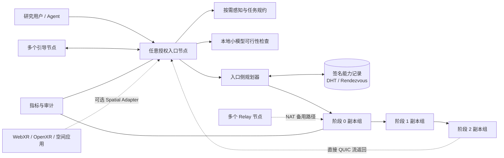
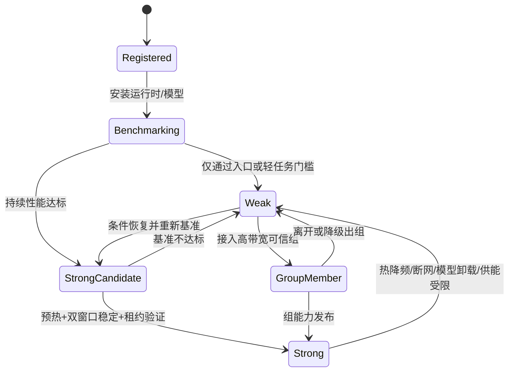
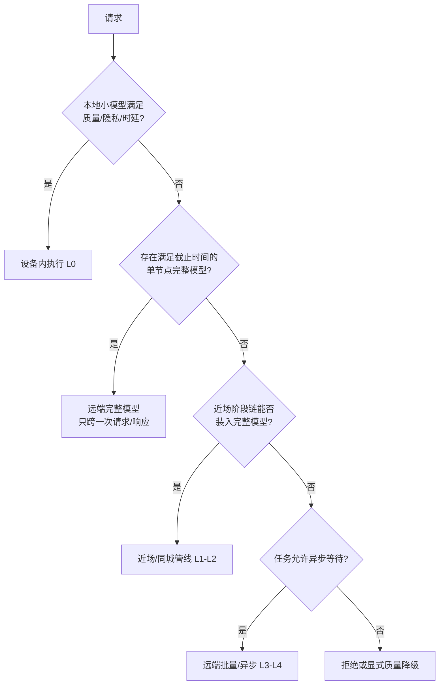

# 神经元式去中心化大模型网络系统
## 研究型/邀请制网络的技术评审与可执行方案

> 评审对象：`神经元式去中心化大模型网络系统-技术交底书.md`  
> 评审日期：2026-10-30  
> 本文结论仅作技术规划，不替代专利检索、法律意见或安全审计。

---

## 1. 结论

在**研究型网络或邀请制、半可信节点网络**的边界下，这个思路可行，而且比“互联网级公开商用系统”更合理。

建议把第一阶段目标定义为：

> 用 6～12 台跨 2～3 个网络位置的异构主机，组成一个无全局推理调度器的大模型协同推理试验网。节点可以包括服务器、台式机、笔记本、手机和小型机顶盒；但不同设备承担不同角色，不要求每类设备都运行大模型阶段。网络验证设备/网络画像、公网管线并行、入口侧多模态压缩、能力路由、邀请制信任和故障恢复。

可行性判断如下：

| 能力 | 研究型/邀请制网络中的判断 | 主要限制 |
| --- | --- | --- |
| libp2p 节点发现、认证连接、NAT 穿透 | 可行 | 有些 NAT 仍需中继，不能保证全部直连 |
| 公网管线并行推理 | 可行，已有 Petals 等工作验证 | 延迟受慢节点和跨地域链路支配 |
| 无全局调度器 | 可行，但要保留入口侧按需规划和引导节点 | “无调度决策”不现实，应改为“调度逻辑随入口分布” |
| 异构 CPU/GPU 节点 | 可行 | CPU 更适合入口处理、小模型和辅助任务，进入大模型关键管线前必须过性能门槛 |
| 入口侧 OCR/ASR/图像压缩 | 可行 | 不应强制所有节点常驻全部模型，高保真任务需选择性上传 |
| 多副本和故障切换 | 有限可行 | 已输出的流式结果不能无损“自愈”，模型冷加载也有明显时延 |
| 随机交叉验算和信誉 | 可做研究机制 | 不能仅靠抽样证明正确性，也不能阻止女巫攻击或节点合谋 |
| Gossip 贡献摘要 | 可行 | 只能做局部传播，不是全局统一账本，不能单独保证结算唯一性 |
| 邀请制研究网络 | 推荐 | 需节点证书、准入名单、审计日志和研究数据协议 |

因此，项目应定位为“开放入口、无全局调度中心、邀请制成员、分布式能力路由”的研究基础设施，而不是“任何互联网主机随即可信加入、达到商用 SLA 的全球大模型”。

### 1.1 阶段目标

首期建议在 20～24 周内完成可重复的试验网，假设有 3～4 名核心研发人员：

- 1 人负责 P2P、身份和路由；
- 1～2 人负责模型切分、推理运行时和通信；
- 1 人负责入口、多模态、可观测性、安全与评测。

只有 1～2 人时，计划应顺延 1.5～2 倍，并减少跨地域节点数量。

### 1.2 首期不做的内容

- 不承诺任意公网主机可以匿名加入；
- 不承诺互联网规模或商用级可用性；
- 不在公网跨主机执行 Attention/FFN 张量并行；
- 不把 INT4 激活值作为通用跨节点张量格式；
- 不把随机复算当作完整的正确性证明；
- 不在首期实现无许可代币和全球结算；
- 不宣称已输出 token 后可在节点故障时无感恢复；
- 不因 `ggml-rpc-server` 可运行就把它直接暴露到公网。

---

## 2. 当前方案中最重要的技术修正

| 原稿表述 | 问题 | 建议改法 |
| --- | --- | --- |
| “互联网规模”“海量闲置 CPU”“真正去中心化” | 功能愿景被写成了已验证能力，缺少规模、延迟、故障率和信任边界 | 首期改为“跨多地域的邀请制异构推理试验网”，把公开互联网规模列为后续研究目标 |
| “无中心服务器、无全局调度中心” | 推理总是需要选择模型、阶段、节点和超时策略；DHT 只负责索引，不会自动生成可执行管线 | 改为“无全局常驻调度器；由请求入口按需规划，调度决策分布式产生” |
| “每个节点具备感知、路由、计算三重身份” | 低配节点、NAT 受限节点和仅接入节点不具备等价能力 | 把节点拆为入口、感知、管线计算、局部张量组、中继五类角色，一个节点可同时承担多类角色 |
| “所有节点强制标配 OCR、ASR、图像编码” | 常驻模型增加内存、安装包、冷启动和升级成本，并占用被邀请方的资源 | 入口节点至少具备文本预处理和策略路由；多媒体能力采用可配置感知包，可选本地闭环模式 |
| “仅传特征向量就充分保护原始数据” | 嵌入可能泄露信息；ASR 会丢失语气，OCR 和 CLIP 特征也可能不足以完成细粒度视觉任务 | 建立 `local_only`、`redacted_features`、`encrypted_full_media` 三种处理模式，并记录用户选择和保留期 |
| “DHT + Gossip 完成邻居发现和路由学习” | DHT 适合做键值索引，Gossip 是最终一致的事件传播，不适合持续同步精确负载 | DHT 存签名能力记录；Gossip 传事件；即时容量、队列和 RTT 由入口直接探测并采用短期租约 |
| “QUIC + Noise 加密” | libp2p 的 QUIC 已使用 TLS 1.3 和 QUIC 自身加密，再加 Noise 不是必要组合 | QUIC 使用 TLS 1.3；TCP 等非加密传输可配 Noise；需要跨阶段保密时另设应用层任务加密 |
| “GGUF 是模型分片格式” | GGUF 是本地权重容器，不是公网管线协议或调度格式；不同推理后端对权重格式支持不同 | GGUF 用于 CPU/llama.cpp 本地模型；PyTorch 管线用 safetensors 并建立阶段清单；两者通过模型清单统一 |
| “GPU 节点主干，CPU 节点 KV 备份和校验” | 远程 KV 备份占用大量带宽，失效后未必能提升交互延迟；批量校验也不等于能加入关键推理路径 | CPU 默认承担入口、感知、小模型、节点管理和本地验证；只有通过基准测试的 CPU 才可承载模型阶段 |
| “流式结果沿原路由链路回传” | 路径越长延迟越高，中间节点失效会破坏响应 | 结果通过已建立的直接 QUIC 流返回入口；控制面记录阶段链，数据面尽量直达 |
| “随机抽样交叉校验识别恶意节点” | 重复复算成本高，合谋或低概率抽样会漏检，浮点后端也可能不一致 | 首期采用邀请制、制品哈希、签名回执、任务审计；抽样复算作为可配置风险控制，不宣称证明正确性 |
| “Gossip 同步贡献摘要实现激励统计” | 没有共同状态就无法裁决冲突、双花或伪造回执 | 研究期使用签名回执和离线统计；涉及真实结算时引入可信清算方、联盟账本或带质押的结算层 |
| “任意节点立即可作为工业级入口” | 公开监听 HTTP API 会带来身份伪造、滥用、DDoS、CORS 和资源耗尽风险 | 入口默认只监听本机；对外服务需 HTTPS、鉴权、速率限制、输入配额和请求预算 |
| “节点下线后网络自动自愈” | 备用模型阶段可恢复，但请求状态、KV 和已经输出的 token 未必可恢复 | 明确故障语义：未提交请求可重试；已输出请求停止并返回可恢复错误，或从最近检查点续算 |

---

## 3. 可执行的研究型系统架构

### 3.1 总体结构



系统分为四个平面：

1. **成员平面**：邀请证书、节点身份、模型访问权限、撤销列表。
2. **发现与规划平面**：签名能力记录、入口侧候选查询、短期容量租约、阶段链选择。
3. **推理数据平面**：QUIC 双向流、阶段激活传输、推理结果流式回传。
4. **观测与审计平面**：请求 ID、阶段回执、匿名指标、故障和模型制品哈希。

引导节点和中继节点是基础设施，但不是全局推理调度器。任一授权入口都可独立制定请求执行计划。

### 3.2 节点角色

| 角色 | 最低能力 | 首期职责 | 不应默认承担的职责 |
| --- | --- | --- | --- |
| 入口节点 `ingress` | 2 核、4 GB 内存、稳定出网 | API、鉴权、请求规约、路由规划、流式转发 | 大模型阶段 |
| 感知节点 `perception` | 8 核、16 GB 内存，可选 GPU | OCR、ASR、VAD、图像编码、质量检查 | 必须参与所有请求 |
| 管线计算节点 `pipeline-worker` | 足够装入指定阶段的内存/显存 | 加载固定连续 Transformer 层、执行 prefill/decode | 任意动态代码执行 |
| 局部张量组 `tensor-group` | 同一可信局域网、高带宽互联 | 节点内或机架内张量并行，必要时 prefill/decode 分离 | 公网跨地域 All-Reduce |
| 中继节点 `relay` | 稳定公网地址和带宽预算 | 为不可直连节点提供有限中继 | 查看明文或无限转发 |
| 轻量边缘节点 `light-edge` | 手机、机顶盒、单板机等可运行签名入口程序 | 本地入口、感知、小模型、缓存、离线任务 | 长时间高性能计算、匿名 Relay、关键模型阶段 |

同一个物理节点可声明多个角色，但角色能力必须经过测试，不只是硬件探测结果。

### 3.3 能力记录

静态能力使用签名、带过期时间的记录；实时负载不写入长期记录。

```json
{
  "node_id": "ed25519-public-key-hash",
  "device_class": "laptop",
  "unit_scope": "single",
  "service_roles": ["ingress", "pipeline-worker"],
  "network": ["quic-v1", "tcp-noise"],
  "runtime": ["py-stage-v1", "cuda-13", "bf16"],
  "stages": [
    {
      "model": "research/model@revision",
      "layer_start": 0,
      "layer_end": 11,
      "precision": "bf16",
      "artifact_hash": "sha256:...",
      "warm": true
    }
  ],
  "resources": {
    "ram_gib": 128,
    "vram_gib": 48,
    "gpu_class": "A6000"
  },
  "compute_profile": {
    "arch": "x86_64",
    "backend": "cuda",
    "sustained_workload_id": "stage-bench-v1",
    "sustained_tokens_per_second": 12.4,
    "thermal_throttle_ratio": 0.08,
    "max_slots": 1
  },
  "network_profile": {
    "link_class": "ethernet",
    "metered": false,
    "nat_class": "port-restricted",
    "rtt_p50_ms": 27,
    "rtt_p95_ms": 61,
    "uplink_mbps_p10": 35,
    "jitter_ms_p95": 18
  },
  "energy_profile": {
    "power_source": "ac",
    "active_hours": "08:00-24:00",
    "daily_energy_budget_wh": 1800
  },
  "derived_capacity": [
    {
      "tier": "strong",
      "for_model": "research/small-model@revision",
      "task_profile": "text-short-interactive",
      "valid_until": "2026-10-30T10:15:00Z"
    },
    {
      "tier": "weak",
      "for_model": "research/large-pipeline-model@revision",
      "task_profile": "pipeline-stage",
      "valid_until": "2026-10-30T10:15:00Z"
    }
  ],
  "capacity_lease_endpoint": "/infer/capacity/v1",
  "expires_at": "2026-10-30T12:00:00Z",
  "signature": "..."
}
```

记录中不应包含用户的 prompt、KV 内容或未脱敏的性能日志。

### 3.4 模型阶段清单

每个可执行阶段必须绑定完整模型上下文：

```text
model_id
model_revision
license_id
tokenizer_hash
chat_template_hash
layer_start / layer_end
attention_config
precision
artifact_hash
runtime_image_digest
max_context_tokens
estimated_stage_memory
```

任一项不兼容，都不能组成同一条推理管线。这样可以避免“阶段哈希相同但 tokenizer、量化或 RoPE 配置不同”造成的静默错误。

### 3.5 设备类型、持续算力和网络亲疏度

设备类型只能用于选择安装包和初始角色，不能直接决定实际可用算力。系统应同时使用以下四类画像：

1. **设备画像**：服务器、台式机、笔记本、手机/平板、机顶盒、单板机或未知设备；
2. **计算画像**：CPU 架构、内存、GPU/NPU 后端、支持精度、模型格式、并发槽位和实际持续吞吐；
3. **网络画像**：以太网、Wi-Fi、蜂窝网络、整流/中继、NAT 类型、上下行带宽、RTT、抖动、丢包和是否计费流量；
4. **运行画像**：交流电/电池、充电状态、温度、可持续时长、允许运行时段和每日能耗预算。

其中“持续算力”必须通过固定基准负载测试。例如手机首次跑分可能很高，但数分钟后因发热降频；笔记本拔掉电源后会进入节能模式；机顶盒的 CPU 和网络很稳定，但内存很小。因此不能只用设备名称、CPU 主频或网速标签做节点选择。

签名记录中的性能值代表最近一次基准结果，并带时间戳和有效期；请求时的可用槽位、温度、电量和网络质量由短时探测或租约端点提供。入口不得把节点自报的“高速网络”当成事实，至少应同时参考最近的双向吞吐、`P95 RTT`、抖动、丢包和历史完成率。

推荐的设备默认角色如下：

| 设备 | 默认角色 | 可以就近提供的资源 | 可以远端提供的资源 | 主要限制 |
| --- | --- | --- | --- | --- |
| 服务器 | 管线阶段、全模型提供者、Relay、缓存 | 大模型阶段、局部张量组、长上下文 | 完整模型推理、批量任务、模型存储 | 带宽成本、冷却、故障域 |
| 台式机/工作站 | 管线阶段、全模型提供者、感知 | 稳定 GPU 阶段、少量本地张量并行 | 完整模型推理、批处理、阶段副本 | 家用 NAT、上下行不对称、开启时长 |
| 笔记本 | 入口、感知、间歇计算 | 本地小模型、OCR/ASR、短时 GPU 阶段 | 低优先级批任务、缓存 | 电池、发热、降频、移动网络 |
| 手机/平板 | 本地入口、感知、个人小模型 | 本地文本/语音/图像处理、离线推理 | 默认不承担常驻阶段；前台、充电且非计费网络时可选贡献 | 后台执行限制、温度、电量、数据流量、系统权限 |
| 机顶盒/小型 ARM 主机 | 入口、Relay、缓存、轻感知 | 本地 API、OCR/ASR、小模型、内容缓存 | 长时间存储、边缘代理、异步批任务 | 内存小、NPU 碎片化、厂商系统锁定 |
| 未知设备 | 只启用经过验证的最低角色 | 作为入口或轻量缓存 | 只有基准测试通过后才提升 | 不确定的兼容性和安全边界 |

“就近”和“就远”不应直接等同于地理位置，而应使用网络亲和等级：

| 等级 | 判定示意 | 适合的工作 |
| --- | --- | --- |
| `L0` 设备内 | 同进程/本机 | 隐私任务、本地小模型、最小延迟 |
| `L1` 近场 | 同一局域网或稳定 Wi-Fi，P95 RTT 通常低于 20 ms | 交互式管线、阶段热备、张量组 |
| `L2` 同城/邻近网络 | P95 RTT 约 20～60 ms，可直连或稳定 Relay | 2～3 阶段交互推理、语气/图像特征补充 |
| `L3` 区域网络 | P95 RTT 约 60～150 ms | 完整模型推理、预填充、异步任务；谨慎进入逐 token 管线 |
| `L4` 远域/不可稳定直连 | P95 RTT 高于 150 ms、需 Relay 或高抖动 | 完整模型离线任务、批处理、缓存、模型分发 |

上述数值只是首期配置起点，最终阈值必须由真实链路和具体模型基准决定。系统不应采集精确地理坐标或 SSID 来判定距离。

节点能否提供某类算力必须按以下顺序验证：

1. **容量适配**：模型阶段能否装入可用内存/显存；
2. **运行兼容**：设备后端、模型格式、精度和运行时是否匹配；
3. **持续性能**：在热稳定后是否仍达到该角色的最低吞吐；
4. **网络适配**：是否满足任务的 RTT、抖动、上下行和月度流量预算；
5. **供能适配**：电池、温度和能耗策略是否允许继续执行；
6. **信任适配**：邀请成员身份、数据范围和模型许可证是否允许。

任何一步失败，都不能仅因设备名称或“连接速度很快”而被调度为该任务的算力提供者。

### 3.6 强神经元、弱神经元、组神经元和域神经元

这些概念适合作为系统对外表达和发现层级，但实现上不能把四种节点做成互斥的静态设备类别。建议使用三个正交维度：

| 维度 | 可选值 | 含义 |
| --- | --- | --- |
| 组织范围 `unit_scope` | `single`、`group`、`domain` | 单机执行、由高带宽节点组成的逻辑计算组、某个成员域内的联合资源视图 |
| 相对能力 `capacity_tier` | `strong`、`weak` | 针对指定模型、精度、上下文和 SLA 测得的相对服务能力 |
| 执行职责 `service_roles` | `ingress`、`perception`、`pipeline-worker`、`full-model`、`relay`、`cache` | 当前能够提供的实际服务 |

因此，强、弱、组、域不是四个固定类别，而是从画像和运行状态推导出的标签。

#### 3.6.1 弱神经元

弱神经元应同时满足“能提供真实价值”和“不会成为关键路径瓶颈”：

- 主要承担入口、鉴权、请求规约、OCR/ASR、图像预处理、小模型分流、缓存和审计；
- 可以独立运行适合其内存和持续性能的本地小模型；
- 可以参与宽松时延的异步任务；
- 只有通过阶段持续性能门槛后，才可以短暂加入管线；
- 自动降级条件包括内存不足、模型未热加载、热降频、电池供电且不允许耗电、网络质量恶化或负载超限。

弱神经元不等于无用节点。它可以在整个系统中完成大量低时延、隐私敏感或轻量任务，减少远端大模型调用。

#### 3.6.2 强神经元

强神经元是相对于具体服务定义的能力等级，不是“永远强”：

- 能独立承载目标模型，或稳定承载一个高价值模型阶段；
- 在预热 15～30 分钟后仍达到服务吞吐门槛；
- 具有足够的模型、上下文和 KV 内存余量；
- 网络、供能和信任约束满足所要承担的服务；
- 能够发布可验证的模型制品、运行时和阶段层范围。

同一台设备可以同时是“3B 本地模型的强神经元”和“大型模型管线中的弱神经元”。能力记录必须写成：

```text
capacity_tier = strong
for_model = <model_id@revision>
task_profile = <context, modality, latency target>
valid_until = <timestamp>
```

不能只写 `capacity_tier=strong`。

#### 3.6.3 组神经元

组神经元把一组低延迟、高带宽、同一信任范围的设备表示成一个逻辑计算单元：

- 组内可做张量并行、局部专家并行或 prefill/decode 分离；
- 组对网络发布统一的 `group_id`、成员拓扑、聚合能力、模型版本和故障状态；
- 组的总算力不能简单按成员算力相加；实际能力以固定基准负载为准；
- 组内需要局部协调者，但应支持多个候选协调者和成员清单签名，避免形成新的全局单点；
- 组只吸收满足 L0/L1 网络和兼容运行时要求的成员；
- 任一成员离线时，组应收缩后重新基准测试，不能继续发布旧的聚合能力。

首期最现实的组神经元是“同一机架的服务器”“同一实验室的多 GPU 台式机”或“通过稳定局域网/Thunderbolt/RDMA 连接的小型设备组”。

#### 3.6.4 域神经元

域神经元是邀请成员、组织、区域或信任边界上的联合能力视图，不是一台被放大的超级计算机：

- 发布可用的强/弱神经元、组神经元、Relay 和缓存目录；
- 聚合域名、模型和角色索引，减少入口查询范围；
- 对域内策略、成员撤销、模型许可证和数据范围实施治理；
- 可以给出候选路径和网关建议，但最终请求计划仍可由请求入口生成；
- 域代表节点可以更换，入口应保留多个域代表和绕过域索引的发现方式；
- 不应把所有成员的理论 FLOPS 相加后宣传为一个可独占的算力池。

域神经元相当于“服务目录和信任作用域”，不是一个必须常驻的中心调度器。

#### 3.6.5 动态升降级

节点角色应由注册、基准、运行状态和租约共同决定：



为避免标签抖动，应采用以下规则：

- **快速降级、缓慢升级**：安全或容量条件一旦不满足立即撤掉对应角色；升级必须通过连续两个以上基准窗口；
- **按服务升降级**：设备可以保留本地小模型角色，同时失去大模型阶段角色；
- **短期租约优先**：分类标签只用于发现，真正分配仍需要当前容量租约；
- **滞回阈值**：升级阈值高于降级阈值，减少负载和网络波动导致的角色反复变化；
- **可解释**：每次升降级记录所用模型、基准 ID、RTT/吞吐、温度、供能、网络和租约信息。

示例上，同一台设备可以因服务不同呈现不同类型：

| 示例节点 | 对 3B 本地模型 | 对大型公网管线 | 可形成的上层结构 |
| --- | --- | --- | --- |
| 8×GPU 服务器 | 强神经元 | 强神经元或完整模型提供者 | 可参与组神经元，也可托管域目录副本 |
| 单 GPU 台式机 | 强或弱神经元 | 仅在其阶段基准达标时为可用阶段 | 可与同局域网设备组成组神经元 |
| 无独显笔记本 | 可成为小模型的弱/强神经元 | 弱神经元，默认不进入关键阶段 | 通常只作为组内缓存或入口 |
| 手机 | 可成为本地小模型的强神经元 | 弱神经元，只做入口或感知 | 通常不组成长期在线组神经元 |
| 机顶盒 | 可成为轻感知/小模型的弱神经元 | 不作为大模型阶段 | 可缓存、Relay，并发布域目录副本 |

这种表达保留了“神经元”式网络概念，同时把等级、组织和职责变成了可实现、可测试、可撤销的技术属性。

### 3.7 硬件节点与虚拟角色

每个通过邀请加入的物理主机都应形成一份可审计的硬件节点承诺，至少贡献：

- 心跳、健康检查、资源证明和清单签名等控制面能力；
- 一个不会危及主机自身运行的存储配额；
- 一份受限的 CPU/内存/GPU、网络和在线时间预算；
- 可配置的后台感知、缓存、验证或计算窗口。

节点可以只贡献部分资源，但配额、并发槽位、磁盘安全余量和网络流量必须有硬上限。主机的所有者可以暂停后台任务，但必须先完成其承载长期记忆的安全迁移。

虚拟角色不与 `host_id` 绑定，而使用独立的 `role_id`、`owner_id` 和记忆命名空间。角色可以创建在手机上的入口中，却把长期记忆和 Adapter 备份到服务器、机顶盒或 NAS；主机退出后，角色可在兼容节点恢复。

系统按角色重要性执行分级备份：

- 普通会话：事件增量复制和每日快照；
- 高价值长期记忆：分钟级增量、每小时快照、至少跨 3 个故障域；
- 身份、删除墓碑和模型发布清单：同步副本确认、签名快照和离线归档。

每个备份必须经过目标容量租约、加密传输、完整性校验和副本确认。仅在本地生成快照，不得标记为“已分布式备份”。

硬件资源承诺、虚拟角色清单、备份等级和调度流程详见同目录的《神经元式去中心化大模型网络系统-持续学习与持久记忆方案》。

### 3.8 元宇宙接入预留

元宇宙不作为首期核心依赖，而是在核心协议外增加版本化的“空间交互适配层”：

- `role_id` 与 Avatar/呈现身份分离；
- `session_id`、`space_id`、坐标参考系和世界时钟独立管理；
- WebXR、OpenXR、游戏引擎和自有空间应用通过适配器转换为统一事件；
- 空间事件只有经过来源、权限和保留期门控后，才能成为长期记忆候选；
- 模型输出是 Avatar 动作意图，必须经过短期权限令牌和 World Action Broker；
- 本地帧循环负责渲染和物理，远端模型推理与记忆检索不阻塞 Avatar 实时动作；
- 普通 OpenAI 兼容接口继续服务文本/语音 Agent，空间协议作为可选扩展。

首期只需冻结协议和桌面模拟器，不引入 WebXR、头显、Unity、Unreal 等强制依赖。未来的角色记忆、模型版本和训练结果仍由本系统管理，元宇宙平台只负责空间呈现与交互。

空间会话、Avatar、权限、隐私和兼容测试详见同目录的《神经元式去中心化大模型网络系统-元宇宙接入预留方案》。

---

## 4. 请求执行流程

### 4.1 流程

1. 入口接收请求，生成全局唯一 `request_id`、幂等键、截止时间和隐私模式。
2. 入口执行文本清洗、鉴权、大小限制和风险分类；媒体任务按需调用本地感知包。
3. 入口先生成访问控制签名，再提交给入口侧规划器；此过程不依赖全局调度器。
4. 规划器查询 DHT/Rendezvous 中的签名能力记录，对候选节点做 RTT、带宽和容量探测。
5. 规划器检查各阶段模型版本、层范围、精度、哈希和内存约束，生成完整候选链。
6. 各候选计算节点返回短期容量租约；租约包含最大请求时长、排队预算和撤租条件。
7. 入口将压缩后的任务表示送入第一阶段；中间阶段只接收边界激活值和必要控制字段。
8. 最后一个阶段连接入口的直接 QUIC 流，按 token 流式返回；结果不要求沿控制路径逐跳返回。
9. 每个完成阶段返回签名执行回执。回执记录任务 ID、阶段、模型哈希、输入/输出摘要、token 数和耗时，不记录明文内容。
10. 入口更新本地信誉、延迟和失败统计；全局仅发布必要的匿名聚合指标。

### 4.2 入口侧规划算法

约束优先，再优化代价：

```text
最小化：
  latency_ewma
  + queue_ewma
  + failure_penalty
  + cross_region_penalty
  + compute_cost

硬约束：
  阶段首尾连续
  模型/Tokenizer/精度/哈希完全兼容
  内存上限 <= 可用内存的 80%
  预计完成时间 <= 请求截止时间
  隐私模式允许经过该节点
  节点在有效邀请名单内
  节点/组对该模型和任务的专业能力等级满足最低门槛
  组清单和域授权仍在有效期内
```

首期建议使用“拓扑约束下的多目标最短路径”：

- 每个模型阶段有多个兼容副本；
- 节点对之间的链路代价来自最近 30～60 秒的 EWMA；
- 节点队列来自短期租约；
- 对跨地域、跨运营商和不同 GPU 架构增加惩罚；
- 选中后锁定租约，不把某一次选择的容量信息缓存成长期事实。

不建议让所有节点周期性 Gossip 完整负载表。节点多时这会形成信息陈旧、带宽放大和振荡；应使用入口主动探测加短期租约。

### 4.3 完整模型提供者与管线阶段的区别

远端设备的“网络远”并不等于只能做轻任务。如果一台远端服务器能独立装下完整模型，请求只需要在入口和设备之间跨一次网络，它可能比把慢速设备串成一条近场管线更快。

因此首期至少支持两种执行模式：

| 模式 | 网络流量形态 | 适合场景 | 设备要求 |
| --- | --- | --- | --- |
| 完整模型提供者 | prompt/媒体特征和输出跨网络各一次，decode 不逐 token 跨机器 | 远端强 GPU、单节点完整承载、交互或批量推理 | 单节点能加载完整模型；RTT 对单次任务可接受 |
| 多阶段管线 | 每个 prefill/decode 阶段都跨阶段边界 | 单节点无法容纳模型，且存在低延迟近场阶段组 | 至少 2 个兼容阶段；RTT、抖动和慢阶段受控 |

入口规划器按以下顺序决策：

```text
1. 若本地小模型满足质量、隐私和延迟预算，则本地执行。
2. 若远端单节点的完整模型满足质量、模型容量和任务截止时间，
   优先在单节点完成整个请求，避免公网逐 token 阶段延迟。
3. 若单节点均装不下模型，而近场阶段组能组成完整且兼容的链，
   并且预计 P95 延迟满足截止时间，则执行跨节点管线。
4. 若任务允许分钟级等待，则进入远端异步/批处理队列。
5. 否则拒绝请求，或明确降级为本地小模型；不得静默降低质量。
```



这可以同时利用远端大 GPU 和近场小设备：前者提供完整模型或批量算力，后者提供入口、多模态预处理、缓存和低延迟阶段。

### 4.4 在线全池访问与离线本地自治

系统应提供两种明确运行模式：

| 模式 | 资源范围 | 记忆范围 | 适用情况 |
| --- | --- | --- | --- |
| 在线 `networked` | 所有符合授权、能力、模型兼容、隐私、地域和当前容量约束的成员资源 | 本地缓存 + 远端副本 + 按权限检索 | 正常联网 |
| 离线 `offline-autonomous` | 仅本机 CPU/GPU、本地小模型、本地缓存和本地 Adapter | 仅本地保留的摘要、索引和热点记忆 | 断网、隔离研究、隐私任务 |

“获得全网算力”应定义为：

```text
可用网络能力 =
  全网络成员资源
  ∩ 角色授权
  ∩ 模型/精度/阶段兼容
  ∩ 隐私与地域策略
  ∩ 当前在线容量
  ∩ 请求租户配额
  ∩ 截止时间可行的路径
```

它不表示单个请求可以独占所有主机，也不表示任何主机上的模型都自动兼容。调度器仍负责公平、并发、租约和优先级。

#### 4.4.1 在线模式

在线主机可以：

- 查询和调用远端完整模型；
- 参与或发起局域组神经元；
- 使用多阶段管线承载本地无法装下的模型；
- 请求远端大型 Adapter、长上下文 KV 或冷记忆；
- 把本地虚拟角色记忆按策略复制到其他故障域；
- 把训练任务分配给满足门槛的强/组神经元。

每次请求仍需要：

- 有效角色和租户授权；
- 能力清单签名；
- 短期容量租约；
- 请求预算和公平配额；
- 数据地域/保留策略；
- 结果和资源回执。

#### 4.4.2 离线模式

断网后自动进入本地自治，不再假装拥有远端能力。入口应切换到：

- 本地小模型或最近缓存的模型阶段；
- 本地感知包和缓存特征；
- 本地记忆摘要、索引和最近使用对象；
- 本地私有的轻量 Adapter；
- 本地临时规则和工具；
- 本地 WAL 与新记忆增量。

离线能力必须在角色创建时明确显示，不能在线时承诺“永远可用”，离线后才发现所需模型或记忆不在本机。

离线期间：

- 继续完成可本地执行的任务；
- 不发布全局训练更新；
- 将记忆写入本地 WAL，并按 D1 以上等级硬化；
- 记录版本、来源和待同步变更；
- 对无法执行的远端任务排队或明确拒绝；
- 不沿用过期的主节点租约写共享记忆。

#### 4.4.3 重新联网

重新连接时执行：

1. 获取新的节点 epoch 和最新角色版本；
2. 比较本地 WAL 水位与云端副本水位；
3. 上传本地未同步增量；
4. 检测并解决冲突；
5. 获取最新墓碑和删除状态；
6. 更新本地索引；
7. 重新预热需要的模型/Adapter；
8. 完成副本确认后再恢复在线角色。

事实冲突不能全部依靠“最后写入获胜”。至少应使用版本向量和来源优先级；重要偏好、承诺和身份信息应由所有者确认。

---

## 5. 推理运行时的正确边界

### 5.1 公网只做管线并行

公网链路主要承担阶段边界的数据传输：

```text
入口 -> 阶段 0 -> 阶段 1 -> ... -> 阶段 N -> 入口
```

每个阶段持有连续层，权重常驻或缓存在本地，不在每个请求中传输模型权重。

激活流量可按以下方式估算：

```text
每 token 每个边界的近似字节数
  ≈ hidden_size × bytes_per_element

一次 prefill 在多个边界的近似流量
  ≈ prompt_tokens × hidden_size × bytes_per_element × boundaries
```

例如 `hidden_size=4096`、BF16、4096 token、2 个边界时，prefill 激活约为 67 MB；decode 每新增一个 token 每边界约传 8 KB。通常带宽可承受，真正的问题是跨地域 RTT、排队和慢阶段。

因此：

- 权重分发与请求推理分开；
- 跨公网使用 BF16/FP16 或后端原生激活精度，不默认改成 INT4 激活；
- 只传阶段边界必要状态，不逐层回到入口；
- 结果返回使用直接连接，确保入口兼作最终流汇聚点；
- 阶段数量首期限制为 2～3 个，避免延迟线性叠加；
- 每个请求设置总预算、单阶段预算和排队截止时间。

### 5.2 张量并行只在可信高带宽组内使用

张量并行会在层内产生频繁集合通信。它适合同机 GPU、同一机架、InfiniBand/RDMA 或可靠局域网，不适合直接跨越公共互联网。

首期组合建议：

- 跨地域：管线并行；
- 单机/同机架：张量并行；
- 同一可信模块：数据并行或副本调度；
- MoE/专家并行：只在高带宽局部组内试验，不放入首期公网默认路径；
- KV 远程备份：只服务长上下文和可恢复实验，不作为所有请求的实时必选步骤。

### 5.3 CPU 节点的真实定位

CPU 可以贡献可靠价值，但不能靠“节点数量多”自动获得等价 GPU 吞吐：

- 承担入口 API、鉴权、请求压缩、路由和指标；
- 运行本地 1B～3B 级小模型，直接完成低复杂度请求；
- 运行 OCR、ASR、VAD 和图像编码；
- 执行离线评测、回执验证、审计和数据整理；
- 在通过基准测试时承载量化小模型的独立阶段；
- 作为冷备缓存或模型文件分发节点，而不是默认的实时 KV 主路径。

CPU 节点加入大模型关键管线前必须满足两项条件：

1. 该阶段 `P95` 计算延迟不超过同级 GPU 阶段的既定倍率；
2. 该节点不会成为整条链路的持续吞吐瓶颈。

不满足时，应路由到本地小模型，而不是为了“充分利用 CPU”拖慢整个请求。

### 5.4 跨设备运行时

手机、机顶盒、桌面机和服务器不适合共用一个未分层的大型运行时。建议：

- P2P、身份、清单和请求协议采用统一的跨平台核心；
- 桌面/服务器 GPU 阶段可使用 Python/PyTorch 或经审计的推理服务；
- 手机、笔记本 ARM 和机顶盒优先使用原生 C/C++/Rust 运行时，例如按设备后端编译的 llama.cpp；
- 浏览器节点如后续支持，只作为入口或轻任务，并通过 JavaScript libp2p 和受支持的浏览器传输接入；
- NPU 通过独立适配器接入，只有通过同模型质量与阶段兼容测试后才进入调度池；
- 每个平台发布独立的架构、后端、模型格式和运行时签名清单。

手机和移动系统还可能限制后台常驻、长连接和持续计算。首期规则应为：

- 移动设备默认只在前台呼叫或明确启用时执行计算；
- 重型贡献默认要求充电、温度正常和非计费网络；
- 不把手机作为必须长期在线的中继或关键管线阶段；
- 用户可随时撤销上传、计算和后台网络权限；
- 对蜂窝网络设置单次、每日和每月流量上限。

---

## 6. 多模态与隐私设计

### 6.1 三种隐私模式

| 模式 | 入口处理 | 网络传输 | 适用任务 |
| --- | --- | --- | --- |
| `local_only` | OCR/ASR/图像编码和生成都在本地完成 | 不传原始媒体，也不调用远端模型 | 敏感材料、离线研究 |
| `redacted_features` | 只发送经过质量检查和脱敏的文本、结构化字段或模型兼容特征 | 不上传原图/原音频 | 文档问答、语音转写、一般图像分类 |
| `encrypted_full_media` | 经用户明确授权，原媒体加密后交给有权节点 | 端到端任务加密，受允许节点集合限制 | 细粒度视觉问答、语气/音乐/视频理解 |

“特征向量”不等于匿名数据。嵌入可能携带可识别信息，因此仍需访问控制、保留期限和删除机制。

### 6.2 感知包不要强制常驻

建议提供两种安装包：

- `ingress-lite`：文本 tokenizer、图像格式检查、输入限额、规则路由和小模型适配器；
- `perception-full`：OCR、ASR、VAD、图像编码和多模态融合适配器。

`perception-full` 按节点角色和内存预算加载，模型版本与主模型清单绑定。这样既能保持“任意入口可用”，又不会强制低配节点长期占用数 GB 内存。

### 6.3 端到端保密的边界

普通 P2P 连接加密只保护相邻节点之间的链路。阶段计算节点需要看到自己的输入激活，入口层也无法仅靠“只传向量”获得严格端到端保密。

因此首期应：

- 只邀请可信研究伙伴；
- 对请求内容设置保留期限和访问审计；
- 不允许计算节点读取别的任务数据；
- 默认关闭 prompt/媒体持久化；
- 对敏感任务使用 `local_only` 或受控可信节点；
- 将 TEE、机密计算和更强的端到端协议列为后续研究，不提前写入首期承诺。

### 6.4 持续学习与长期记忆

持续学习不以“每次交互更新全网权重”实现。首期拆成三条环路：

- 请求级：检索持久记忆并按 token 预算装配上下文，不在前台训练基础模型；
- 日级：在本地巩固情节、合并事实、记录版本和冲突；
- 周/月级：在满足算力门槛的邀请节点上训练轻量 Adapter，经证据门控、兼容聚合、回归测试和签名后发布。

长期记忆归属于用户、组织或 Agent 的主体命名空间，不绑定物理主机。事实、偏好和经历优先存于加密、版本化、可复制和可删除的外部记忆；基础模型与共享 Adapter 只学习经过验证、允许泛化的能力。

完整的数据结构、存储复制、记忆注入防护、联邦 Adapter 流程、评测门槛和最新研究依据见同目录的《神经元式去中心化大模型网络系统-持续学习与持久记忆方案》。

---

## 7. 邀请制网络安全模型

### 7.1 成员与身份

- 每个节点生成 Ed25519 密钥，由项目维护的准入 CA 签发研究网络证书；
- 证书包含角色、允许运行的模型和组织归属；
- 模型制品使用 SHA-256/BLAKE3 哈希绑定，运行时镜像也纳入清单；
- 支持撤销、过期和轮换；
- 多个引导节点和多个 Relay，避免单引导点中断。

### 7.2 请求安全

- 公网 API 必须启用 TLS、短期 Bearer Token 或 mTLS；
- 默认只允许已授权组织调用；
- 每个租户设置 token、并发、媒体尺寸、上下文和每日预算；
- 连接和请求均有握手、空闲、排队和总执行超时；
- 使用幂等键和请求预算，防止故障时重试风暴；
- 禁止在不同节点执行未签名的自定义代码。

### 7.3 可信性与校验

首期默认可信机制：

1. 固定模型、tokenizer、模板和 runtime image 的哈希；
2. 计算节点返回签名阶段回执；
3. 入口检测异常延迟、重复回执和异常 token 统计；
4. 对抽查请求使用双副本执行或预先声明的基准任务；
5. 维护局部信誉，但所有异常都能人工审计；
6. 高风险任务强制使用已知节点或 `local_only`。

随机复算应明确成本：

- 对 10% 请求做双算，平均增加约 10% 计算；
- 对 20% 恶意节点的单次抽样，漏检概率约为 80%；
- 抽样两次也不等于形成严格证明；
- 合谋节点可以返回一致但错误的结果。

因此它适合作为风险控制，不适合作为“全网正确性保证”。

### 7.4 贡献和结算

邀请制研究阶段可以不做代币：

- 记录签名执行回执；
- 由项目方按离线规则统计机时和令牌量；
- 用资源互换或研究积分结算；
- 每季度做一次审计与冲突处理。

如果未来需要开放结算，再研究：

- 预充值额度；
- 带质押的验证者；
- 批量结算或联盟账本；
- 链上仅存摘要的争议处理；
- 女巫攻击、双花和隐私保护。

Gossip 本身不提供唯一性和最终性，不能直接替代结算状态。

---

## 8. 故障语义

“自愈”需要拆成四种不同能力：

| 故障场景 | 首期处理 |
| --- | --- |
| 邻居发现信息过期 | 能力记录 TTL 过期，入口重新探测 |
| 某个阶段副本不可用 | 未提交请求换用同阶段其他副本；已提交请求返回可恢复错误 |
| 入口节点失效 | 客户端断开；除非另设会话迁移，不能承诺无缝恢复 |
| 模型阶段冷启动 | 预留热副本或接受较长恢复时间；不应声称秒级恢复大模型 |
| 常驻节点主动关机 | 先进入 `DRAINING`，冻结新任务，持久化日志/记忆并通过远端副本确认后退出 |
| 常驻节点突然断电 | 依靠已确认复制、WAL 和周期快照恢复；不承诺未确认写入无损 |

建议明确请求状态：

- `pre_admission`：尚未持租约，可以换节点；
- `admitted`：已持租约，等待执行；
- `prefill`：尚未对外输出 token，可在限定条件下重试；
- `streaming`：已经开始输出，非幂等，不得默认静默重跑；
- `committed`：完成并生成签名回执；
- `failed_recoverable`：可人工或客户端重试；
- `failed_terminal`：数据或模型不可用，停止。

“连续自动绕路”只能用于在输出前发现的阶段失败。对已输出 token 的请求，要么保存可验证的 KV/生成检查点，要么明确要求客户端重试。

“加入后不关机”应作为邀请节点的常驻承诺和运维约束，而不是软件对硬件永不失效的保证。普通关闭、检修和安全更新必须走滚动维护；无法联系副本时，节点可以本地硬化后退出，但界面必须明确显示远端持久化未完成。详细状态机、`shutdown_receipt` 和 D0～D3 持久化等级见《神经元式去中心化大模型网络系统-持续学习与持久记忆方案》。

---

## 9. 研究假设与实验设计

### 9.1 需要验证的假设

| 编号 | 假设 | 对照 | 主要指标 |
| --- | --- | --- | --- |
| H1 | 2～3 阶段公网管线可让单个节点装不下的模型达到可交互速度 | 单机量化/CPU offload、局域网同模型 | TTFT、ITL、tokens/s、内存峰值 |
| H2 | 入口侧能力路由明显优于随机节点选择 | 随机、仅 RTT、完整规划 | P95 延迟、失败率、跨地域流量 |
| H3 | 入口压缩可减少媒体流量且不明显降低任务质量 | 原媒体直传 | 上传字节、OCR CER、ASR WER、视觉任务准确率 |
| H4 | 邀请制签名和租约能降低错误路由和重试风暴 | 无租约、静态路由 | 超时率、无效重试数、重复计费 |
| H5 | 失败前切换副本能提高完成率 | 无副本、只重试 | 请求完成率、P95 恢复时间 |
| H6 | CPU 小模型分流能提高整体有效吞吐 | 全部转发到大模型 | 完成任务数、GPU 队列长度、单位任务成本 |
| H7 | 设备+持续性能+网络+供能画像比单纯看硬件参数或网速更少误调度 | 仅设备类别、仅峰值规格、仅 RTT | 无效阶段分配、热降频中断、P95 延迟、完成率 |
| H8 | “远端完整模型”与“近场阶段管线”动态二选一优于固定执行模式 | 固定远端单节点、固定跨节点管线 | TTFT、完成率、跨公网字节、单位任务能耗 |
| H9 | 按“模型+任务+SLA”推导强/弱等级，比给设备永久贴强弱标签更可靠 | 永久静态分类、仅硬件规格分类 | 错分率、角色抖动、OOM/热中断、完成率 |
| H10 | 组/域联合视图能减少发现和规划开销，同时不形成全局调度依赖 | 只看域索引、遍历全 DHT | 候选查询数、规划延迟、域代表故障恢复时间 |
| H11 | 常驻节点的主动关机和副本确认协议，可把记忆丢失与请求中断控制在可测范围 | 直接退出、仅本地快照、无回执关闭 | 已确认写入丢失数、恢复时间、重复写入数 |
| H12 | 最小资源承诺+故障域感知定期备份，能在不破坏主机正常使用的前提下维持虚拟角色持久性 | 无承诺、同域备份、仅每日全量备份 | 备份满足率、恢复点、主机资源侵入、副本修复时间 |
| H13 | 在线主机使用符合权限和路径约束的全网可用资源，能显著超过本机离线能力 | 固定本地模型、随机远端节点 | 可承载模型规模、TTFT、完成率、资源公平性 |
| H14 | 热/温/冷分层迁移可降低本机存储压力，同时保持可接受的关键记忆召回率 | 全部热存本地、真实删除、无指针迁移 | 本地占用、Recall@K、冷召回时延、不可恢复对象数 |

### 9.2 固定基准场景

为了避免指标无法比较，所有实验固定：

- 一个允许研究使用的开源模型家族；
- 一个本地 1B～3B GGUF 回落模型；
- 一个需要跨至少两台计算节点才能放入显存的管线模型；
- 文本、OCR、ASR、图文四类任务集；
- 固定随机种子和采样参数；
- 固定输入长度分层：短、中、长上下文；
- 每个实验格固定硬件与系统镜像；跨设备实验保持工作负载和模型清单一致；
- 单机同模型参考运行时。

模型名称不应硬编码到协议层；实验报告中固定版本、许可证、量化方式和哈希。

### 9.3 重点指标

- 首 token 时间 `TTFT`；
- 相邻 token 时间 `ITL`；
- 输出吞吐 `tokens/s`；
- 请求完成率和可恢复失败率；
- `P50/P95/P99` 端到端延迟；
- 每请求跨地域上传/下载字节；
- 各阶段 GPU/CPU 利用率与排队时间；
- 阶段切换和副本恢复时间；
- 15～30 分钟持续吞吐、热降频比例和每 token 能耗；
- 各连接类型的上下行流量、RTT、抖动和 Relay 比例；
- 强/弱角色误分率、每 24 小时角色切换次数和升级/降级延迟；
- 组能力估计误差、域代表切换时间和无效候选比例；
- 计划关机收据完成率、强制断电恢复率和记忆版本一致性；
- 节点承诺资源达标率、备份策略满足率、副本故障域覆盖和角色迁移成功率；
- 在线/离线模式切换成功率、本地降级能力覆盖率、重连后冲突和重复写入数；
- 热/温/冷记忆占用比例、关键记忆召回率和冷记忆恢复时延；
- OCR 的 CER、ASR 的 WER、图文任务准确率；
- 每千 token 的有效算力成本；
- 错误模型版本、重复回执、越权和数据保留违规次数。

### 9.4 网络矩阵

至少覆盖：

- 同机进程间；
- 同局域网；
- 同城、不同网络；
- 跨运营商；
- 跨地域；
- 服务器、台式机、笔记本、手机和 ARM 小主机混合；
- 以太网、Wi-Fi、蜂窝网络和移动热点；
- 家用 NAT；
- 对称 NAT/CGNAT；
- 启用 Relay 回退；
- 1%～10% 节点随机离线；
- 单个 GPU 阶段 OOM 或进程崩溃；
- 引导节点不可达。

---

## 10. 可执行路线图

### 阶段 0：两周，冻结研究边界

交付物：

- 本方案转为 3～5 页 ADR；
- `hardware_pledge`、`node_capability`、`device_profile`、`neuron_profile`、`group_manifest`、`virtual_role_manifest`、`stage_manifest`、`request_envelope` 八个核心 schema；
- `spatial_envelope`、`avatar_binding` 两个可选接口 schema，只冻结字段与版本规则；
- 一份请求状态机和故障语义；
- 一份强/弱/组/域角色派生规则及升降级状态机；
- 选定两个模型：本地小模型和跨阶段大模型；
- 基准请求集和同机基线脚本；
- 邀请节点数据与模型许可证清单。

退出条件：

- 两个模型都能生成固定版本清单和哈希；
- 阶段边界可以在本地进程间跑通；
- 能测出单机基线的 TTFT、ITL 和 tokens/s。

### 阶段 1：四周，局域网管线

目标：

- 4～6 个节点，其中至少加入 1 台手机作为本地入口/感知节点、1 台 ARM 小主机作为 Relay/缓存候选；
- 1 个入口、2 个 GPU 阶段、1 个 CPU 感知/管理节点；
- 跨至少两台计算节点运行一个单机放不下的模型；
- 完成文本请求和多模态压缩；
- 验证完整模型提供者与管线阶段两种执行路径的选择；
- 至少验证单节点强弱分级和一个由两台网络直连设备组成的组神经元；
- 每个节点提交硬件资源与存储承诺，创建一个可迁移虚拟角色并完成至少一次跨主机备份；
- 使用桌面模拟器完成一次“空间会话事件 -> 虚拟角色 -> 记忆检索 -> Avatar 动作意图”的闭环，不依赖真实头显；
- 使用 QUIC 流和签名清单传输，不直接开放 RPC 端口到公网。

退出条件：

- 1000 次固定请求无未检测的模型阶段不匹配；
- 同一任务质量相对同模型单机参考集下降不超过 2 个百分点；
- 管线 `P95 TTFT` 不超过同机参考的 2 倍；
- 管线吞吐不低于同机参考的 60%；
- 进程崩溃能够被检测并返回明确错误；
- 手机入口、ARM 小主机缓存和至少一种异地完整模型提供者能够完成端到端请求；
- 节点未完成持续基准时不会获得强神经元或关键模型阶段资格；
- 注入热降频、拔出电源、降速网络后，相关角色在一个租约周期内撤销；
- 所有准入节点都有资源配额和存储承诺，虚拟角色删除主节点后可恢复；
- 承载节点无法读取其他虚拟角色的明文记忆；
- 空间模拟器可加载角色记忆并生成受权限约束的动作意图，原始会话坐标不进入长期记忆。

达不到时，先缩小模型或阶段数，不进入公网。

### 阶段 2：六周，跨地域邀请网

目标：

- 6～12 个节点，覆盖 2～3 个网络位置；
- 2～3 个阶段副本；
- libp2p AutoNAT、DCUtR、Circuit Relay 回退；
- 入口侧规划器和短期容量租约；
- 设备/网络画像、完整模型提供者和阶段管线的动态选择；
- 跨两个邀请域发布可替换的域能力目录，并验证域代表故障切换；
- 高价值虚拟角色至少跨三个故障域，并连续完成两个独立备份周期；
- 验证在线 `networked` 与离线 `offline-autonomous` 的自动切换、本地降级和重连合并；
- 公开 API 仅对研究成员开放；
- 开展 Wi-Fi/蜂窝/以太网、NAT、节点离线、热降频和模型阶段热备实验。

退出条件：

- 授权节点加入测试成功率不低于 95%；
- 可直连的网络中，DCUtR 直连成功率不低于 70%；
- 不能直连的请求能够回退到 Relay，且不会无限重试；
- 注入 100 次单个阶段故障，未输出请求的成功切换率不低于 95%；
- 多设备混合场景中，因把设备误判为可计算阶段而导致的 OOM/热中断低于总请求的 1%；
- 强神经元误升级率低于 1%，故障以外的角色抖动控制在每节点每 24 小时 1 次以内；
- 域代表节点故障后，入口在 10 秒内改用其他域目录或直接 DHT 发现；
- 高价值虚拟角色的定时备份满足率达到 99%，随机抽取副本可恢复到声明版本；
- 所有节点磁盘使用不超出承诺配额，后台任务不突破资源上限；
- 完成 100 次断网/重连测试；断网后 P95 在 5 秒内停止声称拥有远端能力并切换本地入口，重连后不产生重复写入；
- 完成至少 50 次计划关机和 50 次强制断电测试；D2 已确认记忆在计划关机后无丢失，强制断电损失不超过声明窗口，已删除记忆不复活；
- 失败时没有重复执行产生的隐藏重复计费；
- 可复现实验数据和报告完成。

### 阶段 3：六至八周，多模态与研究扩展

目标：

- 20～30 个邀请节点，覆盖服务器、台式机、笔记本、手机和 ARM 小主机；
- 完成本地小模型分流与远端大模型协同；
- 加入 `local_only`、`redacted_features`、`encrypted_full_media` 三个隐私模式；
- 对 OCR、ASR、图文问答进行质量-带宽权衡；
- 验证热/温/冷记忆迁移、冷记忆按需召回和离线不可达提示；
- 加入双副本抽查和签名回执；
- 运行 24 小时稳定性测试。

退出条件：

- 不同隐私模式的数据流向可验证；
- 请求鉴权、配额、撤销和日志保留策略通过测试；
- 24 小时测试中的崩溃、超时、错误路由均有可解释记录；
- 模型许可证和数据处理规则通过内部评审；
- 形成可提交论文/专利的对比结果。

### 阶段 4：外部网络之前

只有在以下条件满足后，才讨论公开或半公开节点：

- 有独立威胁模型和安全审计；
- 有明确的滥用处理和模型内容责任；
- 有稳定的结算或不依赖真实结算的资源互换制度；
- 跨公网模型阶段已证明有足够收益；
- 已处理开源模型许可证、个人信息和跨境数据问题；
- 对公开节点有身份、配额、撤销和黑名单机制。

---

## 11. 停止条件与转向条件

这些条件应在项目开始前写入研究计划，避免无限扩大范围：

1. 如果 2～3 个公网阶段的 `P95 TTFT` 超过同机参考 3 倍，且模型容量收益小于 30%，则暂停公网大模型管线，转向“多个本地小模型 + 统一入口路由”。
2. 如果节点故障导致已输出请求无法恢复的比例较高，则不宣称自愈，只提供未输出阶段的重试。
3. 如果入口压缩使 OCR、ASR 或视觉任务质量下降超过预设阈值，则保留选择性原媒体传输模式。
4. 如果邀请制之外无法建立可执行的身份、滥用和结算机制，就不开放匿名节点。
5. 如果随机复算的额外成本高于其检测收益，则改为邀请制基准审计 + 异常触发复算。
6. 如果某个 GPU/CPU 后端无法通过统一阶段清单兼容性测试，则不纳入默认调度池。
7. 如果移动设备无法满足前台限制、能耗预算或认证要求，则只保留其入口和本地感知能力，不要求其参与常驻网络计算。
8. 如果组神经元无法在实测中显著提高目标模型吞吐或容量，就只把它作为缓存/管理组，不继续宣传为聚合算力单元。
9. 如果强/弱角色频繁震荡且加入滞回后仍不能稳定，则取消长期标签，只保留逐请求能力租约。

---

## 12. 对技术交底书的改写建议

### 12.1 标题和摘要

建议把“互联网规模”从首期标题中的绝对承诺改为研究目标，并让独立权利要求聚焦真实技术机制：

> 一种开放入口的邀请制去中心化异构大模型协同推理方法及系统

摘要应写明：

- 入口节点如何把多模态请求转换为统一请求记录；
- 如何根据签名能力记录选择完整的阶段链；
- 如何结合设备、持续算力、网络亲疏度和供能状态，选择本地小模型、远端完整模型或近场阶段管线；
- 如何针对指定模型和 SLA 计算强弱神经元等级，并把高带宽成员组合成组神经元、把邀请范围表达为可替换的域能力视图；
- 如何通过短期租约和截止时间控制跨地域执行；
- 如何只跨节点传输阶段激活；
- 如何在未提交请求失败时切换副本；
- 如何生成签名执行回执。

这比“所有节点都有 OCR、ASR、路由、GPU、账本”更容易形成可审查的技术方案。

### 12.2 独立权利要求建议方向

下面是技术写作方向，不是法律意见：

```text
一种去中心化异构大模型协同推理方法，包括：
1. 在任一入口节点接收请求，生成包含模型约束、隐私模式、
   截止时间、输入模态和资源预算的统一请求记录；
2. 从分布式索引获取带签名的节点能力记录，所述记录至少包括
   设备类别、持续计算基准、运行后端、网络画像、供能状态、
   连续模型层范围、模型制品哈希、精度和运行时版本；
3. 针对请求对应的模型、精度和任务 SLA，根据所述持续计算基准得到
   节点相对能力等级，并依据高带宽成员关系得到组能力记录；
4. 根据设备/网络画像，在本地小模型执行、单节点完整模型执行、
   多阶段协同执行和异步批处理之间进行选择；
5. 对多阶段协同执行，根据阶段连续性、制品兼容约束、隐私约束和截止时间生成
   至少一条候选推理阶段链，并向候选节点请求短期容量租约；
6. 在满足内存和网络约束的候选链中选择满足延迟代价的链，
   将请求发送至首阶段；
7. 各阶段在本地执行其对应该连续层范围的计算，阶段间仅传输
   边界激活及必要控制信息，末阶段通过直接加密流返回入口；
8. 在已产生输出前检测到阶段失效时，以相同模型制品和兼容
   层范围选择替代副本并重新执行；
9. 生成与请求、阶段、模型哈希和资源用量关联的签名回执。
```

建议从属权利要求覆盖：

- 入口侧三种多模态隐私模式；
- DHT 静态能力记录与短期租约分离；
- 基于持续性能而非设备名称确定移动端、笔记本、台式机和小主机的角色；
- 强/弱能力标签按“模型+任务+SLA”计算，并采用快速降级、双窗口升级和滞回；
- 高带宽可信成员组成组神经元，域目录提供可替换索引但不独占请求规划；
- 根据网络亲疏度和任务截止时间选择远端完整模型或近场管线；
- 公网管线并行、可信高带宽组内张量并行；
- 直接 QUIC 回传；
- 已输出 token 后的检查点恢复语义；
- 在线访问符合授权和容量约束的分布式资源池，离线切换至本地小模型与本地记忆缓存；
- 热/温/冷记忆可逆分层迁移，冷层保留恢复指针和完整性信息；
- 抽查复算或双副本审计；
- 邀请证书和模型访问控制。
- 将虚拟角色与元宇宙 Avatar/空间身份分离，通过适配层把多平台空间事件映射为异步语义事件，并在进入记忆或执行动作前进行授权校验。

### 12.3 不建议写入首版独立权利要求的内容

- “真正去中心化”“互联网规模”“任意节点”；
- 把第三方 Agent 产品名称作为权利要求特征；
- 把所有可选模型和框架名称堆在一起；
- 只描述功能结果，不描述数据结构、步骤和约束关系；
- 将矿工/Gossip/账本混在同一个没有结算语义的模块；
- 用一个宽泛的“可信校验模块”代替具体校验步骤。

Patchwork 式组合容易遇到已有系统的现有技术。建议在申请前由专业人员针对以下方向做检索：

- Petals/Hivemind 类分布式大模型；
- P2P Transformer 管线推理；
- 分布式能力发现与任务调度；
- 异构设备模型放置；
- 多模态入口压缩和隐私路由；
- 去中心化推理验证和贡献回执。

---

## 13. 现有技术对方案的启示

截至 2026-10-30 核查：

- Petals 已展示跨互联网组织大模型管线的路线。其公开论文报告了跨地域运行 50B+ 模型的能力，README 也提供私有 swarm 路径。这证明研究型方案可行，但同时意味着“P2P + 模型分片 + 管线推理”本身不能直接作为新颖性依据。
- libp2p 的 QUIC 文档明确说明 QUIC 使用 TLS 1.3，并直接承载加密流；本文据此把“QUIC + Noise”改为“QUIC/TLS 1.3，TCP 传输可配 Noise”。
- libp2p 的 DCUtR 支持通过 Relay 协调打洞；Circuit Relay v2 仍可能成为带宽和容量瓶颈，因此必须准备中继和不可直连路径的测试矩阵。
- vLLM 的多节点文档要求相同运行环境，并把跨节点张量并行的高速互联列为重要条件；因此本文把公网并行收窄为阶段管线，把张量并行限制在高带宽可信组。
- llama.cpp 的 RPC 文档当前仍明确警告其处于概念验证阶段、功能易碎且不安全，禁止在开放网络或敏感环境暴露。因此本文只把其作为受控局域网实验候选，并增加认证、隔离和资源限制。
- llama.cpp 当前 README 已列出 CPU+GPU 混合推理、Metal、Vulkan、OpenCL、WebGPU 和 Android 构建路径。这支持桌面、笔记本、ARM 小主机和移动端采用不同本机后端，但不能替代设备级持续性能测试。
- Exo 展示了多设备自动发现和拓扑感知切分，但其公开使用说明主要围绕本地网络和受控设备，说明“设备就近组成高带宽组”是更现实的落地形态。
- js-libp2p 为浏览器/JavaScript 运行环境提供统一网络栈，可在后续把浏览器作为轻量入口；首期不把浏览器 WebGPU 视为稳定的公网模型阶段。

---

## 14. 参考资料

核查日期均为 2026-10-30：

1. [libp2p QUIC](https://docs.libp2p.io/concepts/transports/quic/)
2. [libp2p DCUtR](https://docs.libp2p.io/concepts/nat/dcutr/)
3. [libp2p Circuit Relay v2](https://docs.libp2p.io/concepts/nat/circuit-relay/)
4. [libp2p Kademlia DHT](https://docs.libp2p.io/concepts/discovery-routing/kaddht/)
5. [Petals 项目](https://github.com/bigscience-workshop/petals)
6. [Distributed Inference and Fine-tuning of Large Language Models Over The Internet](https://arxiv.org/abs/2312.08361)
7. [Petals: Collaborative Inference and Fine-tuning of Large Models](https://arxiv.org/abs/2209.01188)
8. [vLLM 并行与扩展文档](https://docs.vllm.ai/en/latest/serving/parallelism_scaling.html)
9. [llama.cpp RPC 说明](https://github.com/ggml-org/llama.cpp/blob/master/tools/rpc/README.md)
10. [Exo 项目](https://github.com/exo-explore/exo)
11. [Megatron-LM 张量模型并行论文](https://arxiv.org/abs/1909.08053)
12. [RFC 9001: Using TLS to Secure QUIC](https://www.rfc-editor.org/rfc/rfc9001.html)
13. [llama.cpp README（后端与 Android 构建）](https://github.com/ggml-org/llama.cpp)
14. [js-libp2p](https://github.com/libp2p/js-libp2p)

---

## 15. 最终建议

保留原方案的“研究图景”，但把首期技术交底书改成以下一句话所描述的系统：

> 一个面向跨地域邀请节点的开放入口式大模型协同推理网络，每个准入物理主机承诺受隔离的计算、存储和网络配额；通过设备、持续算力、网络和供能画像，将节点动态推导为指定服务下的强/弱神经元，将高带宽可信设备组合为组神经元，将邀请作用域表达为可替换的域能力视图。系统在本地小模型、远端完整模型、近场阶段管线和异步任务之间动态选择，并让独立于主机的虚拟角色将其版本化记忆按故障域定时备份，从而验证服务器、PC、笔记本、手机和 ARM 小主机共同提供异构算力与持久存储的能力。

这条路线比“所有节点具备全部能力且互联网规模自组织”更窄，却更可测、更容易实现，也更容易形成真实的论文结果和专利技术特征。
